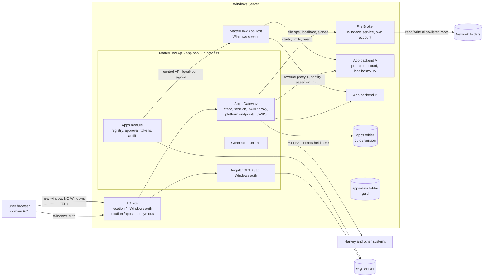

# 01 Architecture

Related: `docs/architecture.md` sections 2, 5, 6.6, `docs/runbook.md` section 5, `deploy/web.config`, `backend/src/MatterFlow.Api/Http/SecurityHeadersMiddleware.cs`, `backend/src/MatterFlow.Api/Hosting/SpaHosting.cs`.

## 1. Components



| Component | Runs as | Responsibility | Never does |
|---|---|---|---|
| MatterFlow web | App pool identity (gMSA `svc-matterflow$`, `docs/runbook.md` 5.1) | Registry, upload/validate, unzip, gateway, tokens, permission checks, audit, connector calls | Run uploaded code; create IIS sites/app pools; read network shares directly |
| Apps Gateway | Inside web process | Serves `/apps/*` with sandbox headers; authenticates by token; proxies to back ends | Accept Windows credentials on `/apps` |
| App Host | Own Windows service account | Start/stop/restart back ends in job objects; health; logs; per-app config | Serve users; talk to SQL Server |
| File Broker | Own account `svc-mf-files` (file shares only) | Browse/read/write inside allow-listed roots for approved apps | Run app code; accept requests except from MatterFlow web (localhost, signed) |
| App back end | Per-app account | App logic; may call platform services with a service token | Reach the network directly (firewalled to loopback), read other apps' data |

The App Host and File Broker may ship as two roles of one executable (`MatterFlow.AppHost.exe --role host|broker`), installed as two services so they have different accounts. **IT dependency** (see `06`). The App Host is needed from Phase 2 and the File Broker from Phase 3; Phase 1 serves static front ends only.

## 2. Storage layout

Configured by `Apps:StoragePath` (default `D:\MatterFlow\apps`, shown here as `\apps`), `Apps:DataPath` (`\apps-data`). Both outside the IIS site folder and outside `wwwroot`; there is no IIS virtual directory or handler mapping pointing at them.

```text
\apps\
  <guid>\                         one folder per registered app (AppGuid)
    packages\1.0.0.zip            the original upload (kept for audit and re-extract)
    1.0.0\                        one folder per version
      app.json                    manifest copy (what was validated)
      integrity.json              SHA-256 of every file, computed by the server at ingest
      frontend\                   static files (served by the gateway only)
      backend\                    binaries (executed only by the App Host)
    1.1.0\ ...
    current.txt                   not authoritative; DB (AppVersion.Status = ACTIVE) is
\apps-data\
  <guid>\
    data\                         the app's own files/SQLite (read-write for the app account)
    logs\                         App Host captured stdout/stderr (rolling)
    config\                       generated per-app config (non-secret) 
    run\                          pid, port lease, handshake files
```

Rules: web identity gets modify on `\apps`, read on nothing in `\apps-data` except `logs` (read); App Host account gets read on `\apps\<guid>\<ver>\backend` and modify on `\apps-data`; the per-app account gets **read** on its own `backend\` and **modify** on its own `\apps-data\<guid>\data` only. Versions are immutable once extracted (read-only ACL after hash verification). Rollback is a database pointer change, never a file copy.

## 3. Request flows

### 3.1 Static front end (window mode)

```mermaid
sequenceDiagram
  participant B as Browser (new window, opaque origin after load)
  participant I as IIS (/apps anonymous)
  participant G as Gateway
  B->>I: GET /apps/md-convert/ (top-level navigation)
  I->>G: anonymous request
  G->>G: slug -> App (ENABLED?) -> ACTIVE AppVersion; normalise path
  G-->>B: 200 index.html + sandbox headers (section 6)
  B->>I: GET /apps/md-convert/assets/main-ab12cd34.js
  G-->>B: 200 + ACAO * + sandbox headers
```

The gateway resolves `slug -> AppGuid -> active version folder`, maps the URL path onto `frontend\`, and serves with `PhysicalFileProvider` rooted at that folder (no directory browsing, no extension-less guessing except SPA fallback when `frontend.spa=true`). Disabled app: HTML page "This app is currently switched off" (HTTP 503, still with sandbox headers). Unknown slug: 404.

Static files are **not individually authorized** (decision S1): they are identical for everyone, contain no secrets by contract (validator warns on secret-looking strings), and every data-bearing call needs a token. Residual risk: anyone on the intranet who knows a slug can read the front-end code (`03` T-INFO-1). Hardening option "capability path" is in `10` (Q-S1).

### 3.2 Back-end proxy

```mermaid
sequenceDiagram
  participant F as App front end (sandboxed)
  participant G as Gateway
  participant H as App Host registry
  participant K as App back end (127.0.0.1:51xx)
  F->>G: POST /apps/hv-up/api/transfers  Authorization: Bearer <session token>, Origin: null
  G->>G: validate session (hash lookup), app ENABLED, role grant still valid, rate limit
  G->>G: strip Authorization/Cookie; mint identity assertion (aud app:hv-up, 120 s)
  G->>K: POST /transfers  X-MF-Identity: <JWT>  X-MF-App: hv-up  X-MF-Request-Id
  K->>K: validate identity JWT via JWKS (SDK), do work
  K-->>G: 202
  G-->>F: 202 + CORS (ACAO null) + sandbox headers
```

The gateway adds nothing else: no cookies, no Windows identity. If the back end is not `RUNNING` the gateway returns 503 `APP_BACKEND_UNAVAILABLE` with `Retry-After` and asks the App Host to start it (on-demand start when `backend.startMode = onDemand`, else always-on).

### 3.3 Launch (summary; full detail in `04`)

`<a href="/api/v1/apps/md-convert/launch?task=TSK-1234&step=981" target="_blank" rel="noopener">` -> Windows-auth GET under `/api` -> checks, audit, mint 60 s launch token -> `302 Location: /apps/md-convert/#mf_launch=<jwt>` -> app JS reads the fragment, clears it, `POST /apps/_mf/session` -> session token.

## 4. Routing: gateway versus the Angular SPA

| URL | Handled by | Auth at IIS |
|---|---|---|
| `/apps` and `/apps/` (exactly) | Angular SPA fallback, launcher page | anonymous (location) but the shell has no data; data comes from `/api` under Windows auth |
| `/apps/<slug>/...` | Gateway (static or `/api/` proxy) | anonymous |
| `/apps/_mf/...` | Gateway platform endpoints (`session`, `jwks.json`, `schemas`, `v1/*`) | anonymous, token required except JWKS and schemas |
| `/api/v1/apps/...`, `/api/v1/admin/apps/...` | Controllers (Windows auth, CSRF header rule, `Perm:` policies) | Windows |
| `/admin/apps...` | Angular SPA (admin screens) | Windows |

Changes to existing code (indicative): `SpaHosting.ServerPrefixes` gains `/apps/` (any `/apps/<segment>` never falls back to `index.html`; exact `/apps` does), and the Angular launcher must use only the route `/apps` (filters in the query string, no child routes). Slug validation reserves `api`, `_mf`, `admin`, `health`, `static`, `assets`, `launch`, `login`, and slugs cannot start with `_`.

> **Trade-off:** because the IIS location `apps` also matches the exact path `/apps`, the launcher's HTML shell is served without Windows auth. It is the same public `index.html` as any other route and calls `/api` with credentials as usual. If IT objects, rename the launcher route to `/tools` (cost: one line plus menu text).

## 5. Middleware order

Existing order (`Program.cs`): SecurityHeaders -> RequestBodyLimit -> QueryLimit -> ExceptionHandler -> StatusCodePages -> static files (SPA) -> RequestForgeryGuard -> Authentication -> Authorization -> RateLimiter -> controllers -> SPA fallback.

New order (branch before the Windows pipeline):

```text
HSTS
SecurityHeadersMiddleware                (baseline; for /apps/* defers to AppsHeaders)
RequestBodyLimitMiddleware               (skips /apps/<slug>/api and /apps/_mf/v1/files upload; per-app limit applies)
QueryLimitMiddleware
ExceptionHandler, StatusCodePages
MapWhen(path starts with "/apps/" AND second segment present)  -->  APPS BRANCH:
    AppsPathGuard        reject encoded slashes, "..", backslashes, NUL, ADS ":", device names; normalise
    AppsHeaders          sandbox CSP + friends (section 6), CORS for null origin
    AppsRateLimiter      per session / per IP, separate budgets (static, api, platform)
    AppsRouter           _mf endpoints | /api/ proxy (YARP) | static files
    (no RequestForgeryGuard, no UseAuthentication/Windows, no SPA fallback)
UseMatterFlowStaticFiles (SPA)
RequestForgeryGuard, Authentication, Authorization, RateLimiter
controllers, SPA fallback
```

The architecture test "every controller action declares a policy" stays valid; the gateway endpoints are minimal endpoints inside the branch and get their own test: "every gateway endpoint validates a token or is on the public allow-list (`jwks.json`, `schemas/*`)".

## 6. Exact response headers for `/apps/*`

Applied by `AppsHeaders` to **every** response in the branch (static, proxy, errors, 404) so a direct navigation to any HTML/SVG/XML inside a package is also sandboxed.

```http
Content-Security-Policy: sandbox allow-scripts allow-forms allow-modals allow-downloads allow-popups; default-src 'none'; script-src 'self'; style-src 'self' 'unsafe-inline'; img-src 'self' data: blob:; font-src 'self' data:; connect-src https://<host>/apps/<slug>/ https://<host>/apps/_mf/ wss://<host>/apps/<slug>/; media-src 'self' blob:; worker-src 'self' blob:; object-src 'none'; base-uri 'self'; form-action 'self'; frame-ancestors 'none'
X-Content-Type-Options: nosniff
X-Frame-Options: DENY
Referrer-Policy: no-referrer
Permissions-Policy: accelerometer=(), camera=(), geolocation=(), gyroscope=(), magnetometer=(), microphone=(), payment=(), usb=(), clipboard-read=(), interest-cohort=()
Cross-Origin-Opener-Policy: same-origin
Cross-Origin-Resource-Policy: cross-origin       (static files only; required because the opaque origin loads them)
Cache-Control: no-cache                          (index/HTML)   |  public, max-age=31536000, immutable (hashed assets)
Access-Control-Allow-Origin: *                   (static GET/HEAD only, no credentials)
Access-Control-Allow-Origin: null  + Vary: Origin  (api and _mf: preflight answers Allow-Headers: authorization, content-type, x-mf-request-id)
```

`<host>` is the validated request host (`AllowedHosts`). The manifest may request extra `connect-src` origins (`network.allowedOrigins`); default none, and an admin must approve each (they would let the front end call other intranet systems directly). An app that ships its own CSP header via `frontend` config can only **tighten**: the gateway sends its policy and the app's as two headers, and browsers apply both.

### Why the sandbox works, and what it breaks

- `sandbox` without `allow-same-origin` gives the document an **opaque origin**: it cannot read MatterFlow's origin storage, cannot call same-origin DOM APIs of MatterFlow windows, `document.cookie`, `localStorage`, `sessionStorage` and IndexedDB throw `SecurityError`, and `fetch` to `/api/...` is a cross-origin request with `Origin: null`. Because MatterFlow's `/api` sends no CORS headers and requires the `X-MatterFlow-Client` header (needs a preflight that fails), the app can neither read nor write MatterFlow data. Because IIS demands Windows credentials on `/api` and a credential-less cross-origin `fetch` never carries them, ambient authority is also absent.
- `connect-src` limited to the app's own path is **defence in depth** (path matching is ignored after redirects), not the primary control.
- Frame busting: `frame-ancestors 'none'` + `X-Frame-Options: DENY` stop clickjacking in window mode; the future `embedded` mode would change this to `frame-ancestors 'self'` and MatterFlow's CSP gets `frame-src https://<host>/apps/`.
- COOP `same-origin` plus `rel=noopener` leaves the app window with no handle to the MatterFlow window.
- **What it breaks for apps:** no cookies/web storage/IndexedDB/service workers (keep state in memory; use `postMessage` only within the app); module scripts and fonts are CORS fetches (hence `ACAO: *` on static files); `window.open` popups are sandboxed (no `allow-popups-to-escape-sandbox`); no top navigation; no `document.domain`; blob/PDF preview in `<iframe>` or `<object>` is blocked (`object-src 'none'`; render PDF with a JS viewer or offer a download); clipboard read blocked. Section 7 of `08` lists workarounds.

### CORS and `Origin: null`

Allowing `null` is normally dangerous because any sandboxed frame on any website sends it. Here it is acceptable because the gateway endpoints accept **only** a bearer token (no cookie, no Windows identity exists on `/apps`), so a foreign page without a token gains nothing. Additionally: requests whose `Origin` is neither absent nor `null` get 403; `Access-Control-Allow-Credentials` is never sent; `Sec-Fetch-Site: cross-site` requests to `_mf/session` are rejected. Static responses use `*` without credentials.

## 7. IIS configuration and what IT must do

Add to `deploy/web.config` (new `location`; the existing site-level settings stay):

```xml
<location path="apps">
  <system.webServer>
    <security>
      <authentication>
        <anonymousAuthentication enabled="true" />
        <windowsAuthentication enabled="false" />
      </authentication>
      <requestFiltering removeServerHeader="true">
        <!-- 256 MB: per-app limits (default 25 MB) are enforced by the gateway below this ceiling -->
        <requestLimits maxAllowedContentLength="268435456" />
      </requestFiltering>
    </security>
  </system.webServer>
</location>
```

> **IT dependency (Phase 0/1):** (1) accept an **anonymous-enabled location `/apps`** on a Windows-auth site; the existing section lock (`runbook.md` 5.5 step 3) already needs unlocking, and the same unlock covers the location. (2) For back ends with WebSockets/streaming (Phase 2): install IIS feature **WebSocket Protocol** (`Web-WebSockets`). (3) Provide folders `\apps` and `\apps-data` on a volume that is backed up (`runbook.md` 8), with the ACLs of section 2. (4) No new DNS name, no new certificate, no firewall change (everything is on 443 and loopback).

> **Assumption (verify in Phase 0):** an anonymous location below a Windows-auth site is not challenged for credential-less `fetch` and module-script requests in Edge and Chrome; a top-level navigation to `/apps/<slug>/` loads without prompts. If IT forbids anonymous, the fallback is mode B (credentialed CORS from `null`), which is weaker and listed in `10` (Q-IIS).

Other IIS notes: keep `urlCompression` off (the app compresses text itself); the `/apps` location inherits the `removeServerHeader`; URL Rewrite/ARR are **not** used (`06` section 6); the Hosting Bundle is already required.
