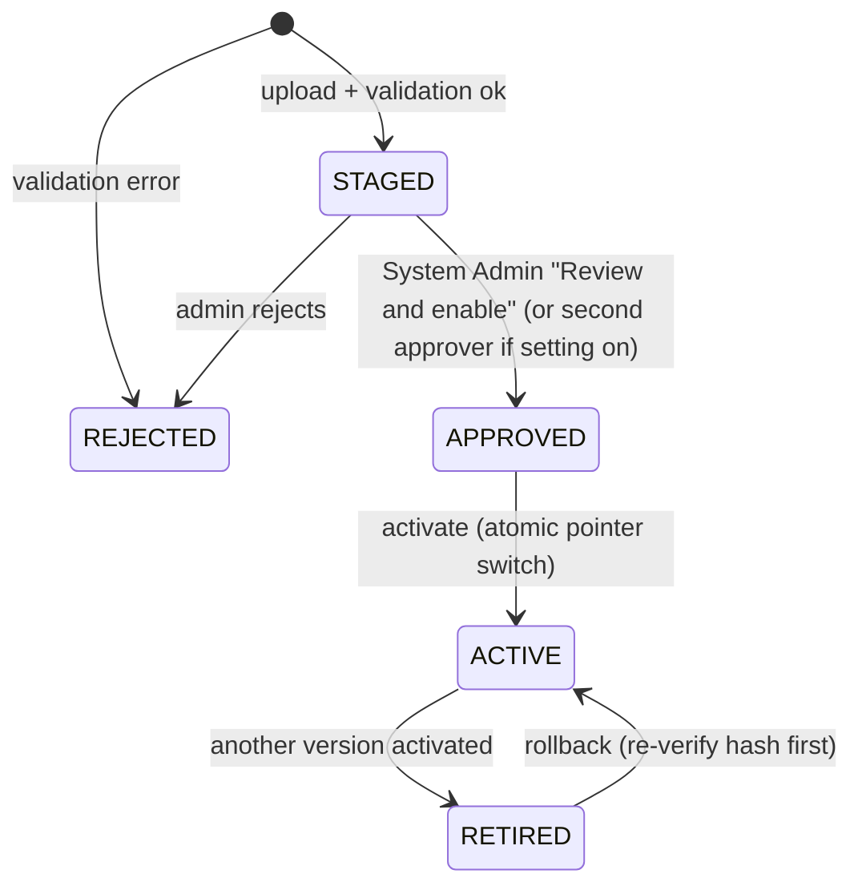

# 02 Package format

An app is published as **one zip file** (`<id>-<version>.mfapp.zip`, extension `.zip` is accepted; the CLI produces `.mfapp.zip`).

## 1. Layout

```text
md-convert-1.0.0.mfapp.zip
├── app.json                 REQUIRED manifest (UTF-8, no BOM), exactly one, at the root
├── frontend/                REQUIRED, static site; entry file named in app.json (default index.html)
│   ├── index.html
│   └── assets/...
├── backend/                 OPTIONAL; present only when app.json has "backend"
│   ├── HarveyUploader.Api.dll
│   ├── HarveyUploader.Api.runtimeconfig.json   framework-dependent, net10.0
│   ├── HarveyUploader.Api.deps.json
│   └── ... (published output of `dotnet publish -c Release -r win-x64 --no-self-contained`)
└── README.md                OPTIONAL, shown in the admin wizard (never rendered as HTML)
```

Nothing else at the root. The server writes `integrity.json` (not part of the package; computed at ingest).

## 2. Manifest `app.json`

Field summary (all names are final for `manifestVersion` 1):

| Field | Req | Meaning |
|---|---|---|
| `manifestVersion` | yes | `1` |
| `id` | yes | AppCode: immutable, `^[a-z][a-z0-9-]{1,38}[a-z0-9]$`. Workflow versions reference it. |
| `slug` | no | URL segment, default = `id`; reserved names refused. |
| `name`, `description` | yes | Display text (name <= 60, description <= 300 chars; plain text). |
| `version` | yes | Semver `MAJOR.MINOR.PATCH` (pre-release allowed, ignored for ordering of ACTIVE). Unique per app. |
| `icon` | no | Built-in icon name (PrimeIcons/Lucide subset in `contracts/task-type-icons.json` style) or `frontend/` path to a PNG/SVG <= 64 KB. |
| `category` | yes | One of the admin-managed categories (`Conversion`, `Transfer`, `Review`, `Utility`, `Other`...). |
| `publisher` | yes | `{ "name": "Data Services", "contact": "dataservices@firm.example" }` - display only; internal team. |
| `display` | no | `{ "mode": "window" }` (default); `"embedded"` is reserved and rejected in release 1. |
| `minMatterFlowVersion` | no | Semver; the platform refuses activation on older hosts. |
| `entryPoints` | no | `{ "launcher": true, "task": false, "step": true }` where the app may appear. Defaults: launcher true, task false, step true. |
| `frontend` | yes | `{ "entry": "index.html", "spa": true }` (`spa`: unknown paths without extension fall back to the entry). |
| `backend` | no | `{ "runtime": "dotnet10", "entrypoint": "backend/HarveyUploader.Api.dll", "healthPath": "/health", "startMode": "onDemand|always", "maxRequestBodyMb": 25, "requestTimeoutSeconds": 100, "memoryMb": 512, "cpuPercent": 25, "websockets": false }` |
| `context` | no | Fields requested: subset of `user`, `displayName`, `email`, `matter`, `task`, `step`. `user` always granted. |
| `platform` | no | `{ "services": ["files","connectors","jobs","callbacks"], "scopes": ["comments:write"] }` (Phase 3/4; unknown values are errors). |
| `fileRoots` | no | Logical roots the app needs: `[{ "name": "source", "access": "read", "purpose": "..."}]`. The package never names a real path; an admin binds each logical name to a configured File Root. |
| `connectors` | no | `[{ "name": "harvey", "type": "harvey", "operations": ["vaults.list","files.upload"], "purpose": "..." }]`, bound by an admin to a configured Connector. |
| `network` | no | `{ "allowedOrigins": [] }` extra `connect-src` origins (default none; admin approval each). |
| `config` | no | Environment/config schema (JSON-Schema subset) with per-property `"secret": true`. Values are entered by the admin in the app configuration screen. |
| `support` | no | `{ "contact": "...", "docsUrl": "https://..." }` shown on the app card. |

### JSON Schema (`/apps/_mf/schemas/app-manifest-1.json`, source file `contracts/app-manifest.schema.json` when implemented)

```json
{
  "$schema": "https://json-schema.org/draft/2020-12/schema",
  "$id": "https://matterflow/apps/_mf/schemas/app-manifest-1.json",
  "title": "MatterFlow app manifest v1",
  "type": "object",
  "additionalProperties": false,
  "required": ["manifestVersion", "id", "name", "version", "description", "category", "publisher", "frontend"],
  "properties": {
    "manifestVersion": { "const": 1 },
    "id": { "type": "string", "pattern": "^[a-z][a-z0-9-]{1,38}[a-z0-9]$" },
    "slug": { "type": "string", "pattern": "^[a-z][a-z0-9-]{1,38}[a-z0-9]$" },
    "name": { "type": "string", "minLength": 1, "maxLength": 60 },
    "description": { "type": "string", "minLength": 1, "maxLength": 300 },
    "version": { "type": "string", "pattern": "^(0|[1-9]\\d*)\\.(0|[1-9]\\d*)\\.(0|[1-9]\\d*)(-[0-9A-Za-z.-]+)?$" },
    "icon": { "type": "string", "maxLength": 120 },
    "category": { "type": "string", "maxLength": 40 },
    "publisher": {
      "type": "object", "additionalProperties": false, "required": ["name"],
      "properties": { "name": { "type": "string", "maxLength": 80 }, "contact": { "type": "string", "maxLength": 200 } }
    },
    "display": {
      "type": "object", "additionalProperties": false,
      "properties": {
        "mode": { "enum": ["window", "embedded"], "default": "window" },
        "window": { "type": "object", "additionalProperties": false,
          "properties": { "width": { "type": "integer", "minimum": 400, "maximum": 3000 }, "height": { "type": "integer", "minimum": 300, "maximum": 2000 } } }
      }
    },
    "minMatterFlowVersion": { "type": "string", "pattern": "^\\d+\\.\\d+\\.\\d+$" },
    "entryPoints": {
      "type": "object", "additionalProperties": false,
      "properties": { "launcher": { "type": "boolean" }, "task": { "type": "boolean" }, "step": { "type": "boolean" } }
    },
    "frontend": {
      "type": "object", "additionalProperties": false, "required": ["entry"],
      "properties": { "entry": { "type": "string", "pattern": "^[A-Za-z0-9._/-]+\\.html$" }, "spa": { "type": "boolean", "default": false } }
    },
    "backend": {
      "type": "object", "additionalProperties": false, "required": ["runtime", "entrypoint", "healthPath"],
      "properties": {
        "runtime": { "enum": ["dotnet10"] },
        "entrypoint": { "type": "string", "pattern": "^backend/[A-Za-z0-9._/-]+\\.dll$" },
        "healthPath": { "type": "string", "pattern": "^/[A-Za-z0-9._/-]*$" },
        "startMode": { "enum": ["onDemand", "always"], "default": "onDemand" },
        "maxRequestBodyMb": { "type": "integer", "minimum": 1, "maximum": 2048, "default": 25 },
        "requestTimeoutSeconds": { "type": "integer", "minimum": 5, "maximum": 900, "default": 100 },
        "memoryMb": { "type": "integer", "minimum": 64, "maximum": 4096, "default": 512 },
        "cpuPercent": { "type": "integer", "minimum": 5, "maximum": 100, "default": 25 },
        "websockets": { "type": "boolean", "default": false }
      }
    },
    "context": {
      "type": "array", "uniqueItems": true,
      "items": { "enum": ["user", "displayName", "email", "matter", "task", "step"] }
    },
    "platform": {
      "type": "object", "additionalProperties": false,
      "properties": {
        "services": { "type": "array", "uniqueItems": true, "items": { "enum": ["files", "connectors", "jobs", "callbacks"] } },
        "scopes": { "type": "array", "uniqueItems": true,
          "items": { "enum": ["task:read", "step:read", "comments:write", "form-values:write", "step:complete"] } }
      }
    },
    "fileRoots": {
      "type": "array", "maxItems": 8,
      "items": { "type": "object", "additionalProperties": false, "required": ["name", "access"],
        "properties": { "name": { "type": "string", "pattern": "^[a-z][a-z0-9-]{0,30}$" },
          "access": { "enum": ["read", "write", "readwrite"] }, "purpose": { "type": "string", "maxLength": 200 } } }
    },
    "connectors": {
      "type": "array", "maxItems": 8,
      "items": { "type": "object", "additionalProperties": false, "required": ["name", "type", "operations"],
        "properties": { "name": { "type": "string", "pattern": "^[a-z][a-z0-9-]{0,30}$" }, "type": { "type": "string", "maxLength": 40 },
          "operations": { "type": "array", "minItems": 1, "items": { "type": "string", "maxLength": 60 } },
          "purpose": { "type": "string", "maxLength": 200 } } }
    },
    "network": {
      "type": "object", "additionalProperties": false,
      "properties": { "allowedOrigins": { "type": "array", "maxItems": 5, "items": { "type": "string", "pattern": "^https://[A-Za-z0-9.-]+(:\\d+)?$" } } }
    },
    "config": {
      "type": "object", "additionalProperties": false,
      "properties": {
        "properties": { "type": "object", "maxProperties": 40, "propertyNames": { "pattern": "^[A-Za-z][A-Za-z0-9_]{0,39}$" },
          "additionalProperties": { "type": "object", "additionalProperties": false, "required": ["type"],
            "properties": { "type": { "enum": ["string", "integer", "boolean", "url"] }, "title": { "type": "string", "maxLength": 80 },
              "description": { "type": "string", "maxLength": 300 }, "default": {}, "secret": { "type": "boolean", "default": false },
              "required": { "type": "boolean", "default": false }, "enum": { "type": "array", "items": { "type": "string" } } } } }
      }
    },
    "support": {
      "type": "object", "additionalProperties": false,
      "properties": { "contact": { "type": "string", "maxLength": 200 }, "docsUrl": { "type": "string", "pattern": "^https://" } }
    }
  }
}
```

Cross-field rules enforced by the validator code (not expressible in the schema): `fileRoots` requires `platform.services` to contain `files`; `connectors` requires `connectors`; `platform.scopes` requires `callbacks`; `display.mode=embedded` is refused in release 1; `backend.websockets` requires startMode `always`; `backend.entrypoint` must exist in the zip; `frontend.entry` must exist.

### Example 1: `md-convert` (front end only)

```json
{
  "manifestVersion": 1,
  "id": "md-convert",
  "name": "Markdown to PDF",
  "description": "Converts a Markdown (.md) file to a PDF in your browser. Nothing is uploaded.",
  "version": "1.0.0",
  "icon": "file-pdf",
  "category": "Conversion",
  "publisher": { "name": "Data Services", "contact": "dataservices@firm.example" },
  "display": { "mode": "window", "window": { "width": 1100, "height": 800 } },
  "entryPoints": { "launcher": true, "task": false, "step": false },
  "frontend": { "entry": "index.html", "spa": false },
  "context": ["user", "displayName"],
  "support": { "contact": "Data Services help desk" }
}
```

### Example 2: `harvey-uploader` (front end + back end + file service + Harvey connector)

```json
{
  "manifestVersion": 1,
  "id": "harvey-uploader",
  "name": "Harvey vault uploader",
  "description": "Uploads the files of a network folder into a Harvey vault, with progress and a result report.",
  "version": "1.2.0",
  "icon": "cloud-upload",
  "category": "Transfer",
  "publisher": { "name": "Data Services", "contact": "dataservices@firm.example" },
  "minMatterFlowVersion": "1.4.0",
  "display": { "mode": "window" },
  "entryPoints": { "launcher": true, "task": true, "step": true },
  "frontend": { "entry": "index.html", "spa": true },
  "backend": {
    "runtime": "dotnet10",
    "entrypoint": "backend/HarveyUploader.Api.dll",
    "healthPath": "/health",
    "startMode": "onDemand",
    "maxRequestBodyMb": 25,
    "requestTimeoutSeconds": 100,
    "memoryMb": 768,
    "cpuPercent": 30
  },
  "context": ["user", "displayName", "email", "matter", "task", "step"],
  "platform": {
    "services": ["files", "connectors", "jobs", "callbacks"],
    "scopes": ["comments:write", "step:complete"]
  },
  "fileRoots": [
    { "name": "source", "access": "read", "purpose": "Folder that holds the files to upload" }
  ],
  "connectors": [
    { "name": "harvey", "type": "harvey", "operations": ["vaults.list", "files.upload"], "purpose": "Create the upload and list vaults the user may use" }
  ],
  "config": {
    "properties": {
      "DefaultVaultNamePrefix": { "type": "string", "title": "Vault name prefix", "default": "MF-" },
      "MaxParallelUploads": { "type": "integer", "title": "Parallel uploads", "default": 4 },
      "ReportWebhookUrl": { "type": "url", "title": "Report webhook (optional)", "required": false },
      "SigningSecret": { "type": "string", "title": "Report signing secret", "secret": true, "required": false }
    }
  },
  "support": { "contact": "Data Services help desk", "docsUrl": "https://wiki.firm.example/apps/harvey-uploader" }
}
```

(`harvey-uploader` needs the admin to bind `source` to a File Root, `harvey` to a Connector, and to approve the two scopes. See `05` section 5 wizard and `07`.)

## 3. Validation rules (run on upload; report shown in the wizard)

Run in a temporary folder `\apps\_staging\<upload-id>\` that is deleted afterwards; the zip is streamed, never fully buffered.

| # | Check | Limit / rule | Severity |
|---|---|---|---|
| V1 | Zip structure | Valid zip, no encryption, no multi-disk, no zip64 bomb; exactly one `app.json` at root; only top-level `app.json`, `frontend/`, optional `backend/`, `README.md` | error |
| V2 | Zip-slip | Every entry name, after normalisation, stays inside the target; reject `..`, absolute paths, drive letters, backslashes, `:` (alternate data streams), reserved device names (`CON`, `NUL`, ...), trailing dots/spaces, names > 200 chars, path > 240 chars | error |
| V3 | Symlinks / special entries | Reject entries with symlink/reparse attributes (zip external attributes) and any extracted reparse point | error |
| V4 | Size caps | Package <= `Apps:MaxPackageMb` (200); unpacked <= 500 MB; single file <= 100 MB; compression ratio per entry <= 100:1 and total <= 50:1 (bomb) | error |
| V5 | File count | <= 10,000 files, depth <= 20 | error |
| V6 | Extensions allow-list | `frontend/`: html, htm, js, mjs, css, map, json, txt, svg, png, jpg, jpeg, gif, webp, ico, woff, woff2, ttf, wasm, pdf, md. `backend/`: dll, json, pdb, xml, txt, config (`.exe` is **forbidden** in the first release: framework-dependent backends start as `dotnet <dll>`) | error |
| V7 | Forbidden files | `.exe`, `.bat`, `.cmd`, `.ps1`, `.vbs`, `.js` in `backend/`, `.lnk`, `.msi`, `web.config`, `.htaccess`, `.git/`, `node_modules/` (frontend must be built), private keys (`*.pfx`, `*.key`, `*.pem` containing `PRIVATE KEY`), `appsettings.Production.json` with a non-empty connection string | error |
| V8 | Manifest | Valid against the JSON Schema; cross-field rules; `id` equals the existing app's id when adding a version; version greater than any existing and not a duplicate; `minMatterFlowVersion` satisfied | error |
| V9 | Frontend entry | Entry exists; HTML contains no `<base href>` pointing outside, no `<meta http-equiv="refresh">` to another host; warns when scripts are inline (blocked by CSP) | warning |
| V10 | Backend binary | Entrypoint exists, valid PE/managed assembly, `runtimeconfig.json` targets `net10.0` framework-dependent, no native executables other than allow-listed NuGet runtimes folder `runtimes/win-x64/native/*.dll` (list shown for review) | error/warning |
| V11 | Dependency report | Reads `deps.json` and `package-lock.json` if present: lists packages and versions; optional `dotnet list package --vulnerable` / `npm audit` results if the dev CLI attached `audit.json` (informational; admin decides) | warning |
| V12 | Secret scan | Regexes for private keys, `password=`, connection strings, bearer tokens, Harvey-style keys in text files | warning (error for private keys) |
| V13 | Hashing | SHA-256 of the zip and of each file -> `integrity.json`; shown to the admin, recorded in `AppVersion` and audit | info |
| V14 | Antivirus hook | `IPackageScanner` (default `NoopScanner`; optional `DefenderScanner` runs `MpCmdRun.exe -Scan -ScanType 3 -File <staging>` ) result clean/infected/skipped | optional (`Apps:Scanner`) |
| V15 | Permission review | Computes the permission/scope request summary: context fields, services, scopes, roots, connectors, network origins, backend resource asks, and a delta versus the active version | info (drives wizard step 3) |

Result is stored as `AppVersion.ValidationReportJson`; any error => status `REJECTED` and nothing is extracted beyond staging.

> Optional **internal signature**: a CLI can add `app.sig` (Ed25519 over `integrity.json`) with a key held by the dev team; if `Apps:TrustedPublisherKeys` is configured the validator verifies it and shows "signed by data-services-2026" in the wizard. Default: off. No PKI, no certificates (decision D14).

## 4. Versioning, activation and rollback



- Exactly one `ACTIVE` version per app (filtered unique index). Activation re-hashes the extracted folder against `integrity.json`, then switches in one transaction; the App Host is told to restart the back end on the new folder; the old process drains (30 s) then stops.
- **Rollback** = activate a `RETIRED` version again; no files are copied. Versions are kept (default: all; admin may delete RETIRED ones to free space). Data in `\apps-data` is shared between versions, so apps must handle forward/back compatibility of their own files (guideline in `08`).
- Config and secrets belong to the **app**, not the version (`AppConfig`, `AppSecret`); a new version that adds required config keys cannot be activated until the values exist.
- A version requesting **more** permissions than the active one (new scopes, roots, connectors, context fields) shows the delta and needs explicit approval of the delta; the same-or-fewer case needs only "review and enable".
- Step links reference the AppCode, so activating a new version never touches workflows.

## 5. Packaging CLI (idea, built in Phase 1 with the template)

`mf-app` (a .NET global tool; npm wrapper optional):

| Command | Does |
|---|---|
| `mf-app init <id> --template static|dotnet` | Scaffolds from the template repo (`08`). |
| `mf-app validate` | Runs the same validator locally (shared library `MatterFlow.Apps.Packaging`), so errors appear before upload. |
| `mf-app pack` | Builds, publishes backend, writes `app.json` version from `Directory.Build.props`/`package.json`, zips with forward slashes, no timestamps (reproducible), prints SHA-256. |
| `mf-app sign --key dev.key` | Optional internal signature. |
| `mf-app push --server https://<host> ` | Optional: uploads through `POST /api/v1/admin/apps/packages` using the developer's Windows credentials (they must be System Admin); otherwise the zip is handed to a System Admin. |
| `mf-app dev` | Local harness (`08` section 2): serves the front end with the sandbox headers and a stub launch token. |
