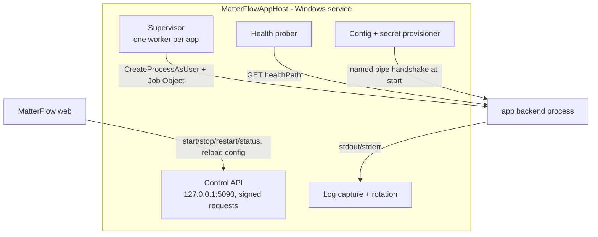

# 06 Hosting and the App Host

Related: `docs/runbook.md` (sections 1, 2, 5, 7, 8), `deploy/web.config`, `deploy/publish.ps1`, `01-architecture.md`, `03-security-model.md` T-03, T-12, T-15, T-21.

> **Summary for IT.** Phase 1 (static front ends) needs: an anonymous `/apps` IIS location and two folders. Phase 2 adds: two Windows services (App Host, File Broker in Phase 3), one local Windows account per app back end (script generated, reviewable), two folder trees with ACLs, a firewall rule per account, and optionally the IIS WebSocket feature. No new DNS name, certificate, SQL login or inbound firewall port.

## 1. Components and accounts

| Item | Account | Rights |
|---|---|---|
| IIS app pool (MatterFlow web) | existing gMSA `KE\svc-matterflow$` | Modify `\apps` (extract packages, immutable after verify), read `\apps-data\*\logs`. **No** execute right on `\apps\*\*\backend` (ACL deny execute for this account). Calls App Host over loopback. |
| App Host service `MatterFlowAppHost` | gMSA `KE\svc-mf-apphost$` (or local virtual account `NT SERVICE\MatterFlowAppHost` on a single server) | Log on as a service; **Replace a process level token** and **Adjust memory quotas** (to start children as other users); read `\apps\*\*\backend`; modify `\apps-data\*\{logs,run,config}`; no local admin, no network share rights, no SQL login |
| File Broker `MatterFlowFileBroker` (Phase 3) | gMSA `KE\svc-mf-files$` | NTFS read (write where granted) on the chosen shares only; localhost listener |
| Per-app account `mfapp_<guid8>` (local user) | created by the IT script `Register-MfApp.ps1` | Member of local group `MFApps` only; deny interactive and network logon; allow batch logon; read its own `\apps\<guid>\<ver>\backend`; modify `\apps-data\<guid>\data`; a Windows Firewall rule blocks all outbound traffic of this account except loopback (platform services are reached via the gateway on loopback) |

Per-app account passwords are random, generated by the script, and stored DPAPI-protected (LocalMachine scope, ACL: App Host account + Administrators only) in `\apps-data\_host\credentials\<guid>.bin`. The App Host calls `LogonUser`/`CreateProcessAsUser` to start the back end.

> **IT dependency:** installing the services, creating the `MFApps` group, granting the two user rights, and running `Register-MfApp.ps1` per back-end app. **Approval is thereby two-key**: a System Admin approves in MatterFlow; IT (or a delegated operator) provisions the account. This is intentionally conservative; if IT prefers to delegate it, a later option lets the App Host create accounts itself under a narrowly delegated right (open question Q-ACC). **Fallback tier L1** (dev, test, or if IT cannot create accounts): all back ends run under `svc-mf-apphost` with job objects and a restricted token; cross-app isolation is then weaker (T-15 residual) and the admin screen shows a "Shared account" warning chip.

Back ends need no domain identity: they reach MatterFlow platform services through the gateway on loopback (service token) and have no direct network access.

## 2. App Host service design



### Install

`MatterFlow.AppHost.exe install` (admin, once) registers the service (`sc create`, automatic start, delayed, recovery: restart after 5 s/30 s/60 s), writes `appsettings.json` (control port, paths, web base URL), creates `\apps-data\_host\`. Published with `deploy/publish.ps1` next to the web package (same release zip, folder `apphost\`); framework-dependent, needs the .NET 10 runtime (Hosting Bundle already installs it).

### Control channel

The web app talks to `http://127.0.0.1:5090/v1/...` (Kestrel, loopback only, no TLS needed on loopback). Every request carries `Authorization: Bearer <JWT>` signed (HS256 with a 256-bit key, `iat` within 30 s) using the control key stored DPAPI-protected, readable by the web account and App Host account only. App Host also refuses non-loopback remote addresses and any `Host` other than `127.0.0.1:5090`. API: `GET /apps`, `GET /apps/{guid}`, `POST /apps/{guid}/start|stop|restart`, `POST /apps/{guid}/reload-config`, `GET /apps/{guid}/logs?tail=500`, `GET /health`. Desired state (which versions should run) is pushed by the web app on activation/rollback and re-sent on App Host start (`GET /api/internal/apps/desired` is **not** exposed; the web app pushes).

### Supervision and lifecycle

States per app: `NOT_PROVISIONED` (no account yet) -> `STOPPED` -> `STARTING` -> `RUNNING` -> `STOPPING`; `UNHEALTHY`, `CRASH_LOOP`. `startMode=onDemand` starts on the first proxied request (gateway waits up to 15 s) and stops after `idleStopMinutes` (default 30) without traffic; `always` starts with the service. Process launch: working directory `\apps\<guid>\<ver>\backend`, command `dotnet.exe <entrypoint>` (path from `Apps:DotnetPath`), environment:

```text
ASPNETCORE_URLS=http://127.0.0.1:<port>      port leased from range 51000-51499 (Apps:PortRange), recorded in \apps-data\<guid>\run
ASPNETCORE_ENVIRONMENT=Production
MF_APP_CODE=harvey-uploader   MF_APP_VERSION=1.2.0   MF_DATA_DIR=\apps-data\<guid>\data
MF_JWKS_URL=https://matterflow.firm.local/apps/_mf/jwks.json    MF_PLATFORM_URL=https://matterflow.firm.local/apps/_mf/v1
MF_ISSUER=https://matterflow.firm.local
DOTNET_gcServer=0  DOTNET_GCHeapHardLimit=<memoryMb*0.8>
```

Config values are delivered in the handshake (secrets included): the child reads one JSON document from an inherited anonymous pipe handle on start (`MF_CONFIG_PIPE`); nothing secret is written to disk or environment. The SDK (`MatterFlow.App.Sdk`) wraps this into `IConfiguration`.

Health: the host calls `healthPath` every 15 s (timeout 3 s); 3 failures -> `UNHEALTHY` -> restart; startup grace 60 s. Health is reported to the web app (cached in `App.Health`). Crash loop: more than 5 exits in 10 minutes -> `CRASH_LOOP`, no more restarts, banner in admin UI, optional email via the existing notification channel (none exists; log only in release 1).

### Resource limits (Job Object)

`JOB_OBJECT_LIMIT_PROCESS_MEMORY`/`JOB_MEMORY` = `memoryMb`, CPU hard cap (`JobObjectCpuRateControlInformation`) = `cpuPercent` of one core... of the machine as configured, `ActiveProcessLimit` = 8, `KILL_ON_JOB_CLOSE`, `UILIMIT` all, die on unhandled exception, priority below normal. Disk: `\apps-data\<guid>\data` quota via an App Host periodic check (`Apps:DataQuotaMb` default 2048; over quota -> health `DEGRADED`, writes still allowed until 120%) because NTFS quotas are per volume owner and not always available. Open handles/sockets: Kestrel `MaxConcurrentConnections=200` in the SDK defaults.

### Logs

stdout/stderr captured to `\apps-data\<guid>\logs\app-YYYYMMDD.log` (ASCII-safe: control characters replaced, lines capped at 8 KB, rolling 10 MB x 10 files, 14 days). Admin screen shows the tail as text (never HTML). App Host's own log goes to the Windows Event Log (source `MatterFlowAppHost`) and `\apps-data\_host\logs`. Redaction: the capture pipeline masks values equal to any configured secret of that app and the patterns from `docs/architecture.md` 17.

### Upgrades, rollback, backup, configuration changes

- **Activation of a version:** web app extracts and verifies (read-only ACL), calls `POST /apps/{guid}/restart?version=1.2.0`; the host starts the new process on a new port, waits for health, the gateway swaps, the old process drains 30 s and stops. If the new version is unhealthy within 60 s the host keeps the old one and reports `ACTIVATION_FAILED`; the web app keeps the previous `ACTIVE` pointer (activation is two-phase).
- **Rollback:** same call with the previous version.
- **Config change:** `reload-config` restarts the back end (rolling).
- **App Host upgrade:** stop service (children die with the job), replace binaries, start; apps return per `startMode`. Document in `docs/runbook.md` section 7 when implemented.
- **Backup:** `\apps` (packages are the source of truth for code) and `\apps-data` (app data) are included in the server backup (`docs/runbook.md` 8). Database holds metadata and encrypted secrets and is covered by the SQL backups; the Data Protection key ring must be backed up too, otherwise secrets and signing keys are unrecoverable. > **IT dependency:** extend the backup job.

## 3. What IT installs, by phase

| Phase | IT items |
|---|---|
| 0/1 | Anonymous `/apps` location in `web.config` (unlock config section), `\apps` folder with ACLs, backup of `\apps`, test of Edge/Chrome behaviour |
| 2 | App Host service + gMSA (or virtual account), user rights, `MFApps` group, `Register-MfApp.ps1` per back-end app, firewall rules per account, optional WebSocket feature, port range reservation 51000-51499 on loopback, `\apps-data` ACLs and backup |
| 3 | File Broker service + gMSA `svc-mf-files$` with NTFS read on chosen shares; (optional) AD read for ACL probe; Harvey API credentials from the Harvey admin; outbound HTTPS from the server to Harvey |
| 4 | none beyond Phase 2 |

## 4. Windows and IIS specifics

- **Reverse proxy: YARP inside MatterFlow web versus IIS ARR/URL Rewrite.** Chosen: **in-app YARP** (`Yarp.ReverseProxy`, direct forwarder with per-request transformation). ARR/URL Rewrite cannot validate our session token, check role grants, mint the identity assertion, enforce per-app limits or write audit; it also needs a machine-wide ARR install (IT) and proxy enable. IIS remains the TLS terminator and process host. Cost: proxied traffic occupies the app pool process (in-process hosting); sizing is trivial at 200-300 users. If proxy load ever hurts, move the gateway to its own site (out-of-process) without changing URLs.
- **WebSockets/streaming:** YARP forwards WebSockets and SSE; needs IIS `Web-WebSockets` and `backend.websockets=true` in the manifest (with `startMode=always`). Response buffering off for `text/event-stream` and `application/octet-stream` streams. The gateway keeps a per-session connection cap (4).
- **Large uploads and request limits per app:** site limit 12 MB stays for the main site (`web.config`); `/apps` location ceiling 256 MB; per-app `maxRequestBodyMb` default 25 enforced by the gateway (`413 PAYLOAD_TOO_LARGE`) and Kestrel `MaxRequestBodySize` in the back end. Anything bigger (for example 5 GB) must **not** be a browser upload: it is a platform file-service transfer run as a job (`07`). `requestLimits` must be raised in `web.config` (IT-visible change).
- **Timeouts:** gateway `ActivityTimeout` 100 s default, per-app up to 900 s; long work is a job with polling. IIS `connectionTimeout` default 2 min applies to idle connections.
- **HTTP/2:** works; proxy to back end uses HTTP/1.1 on loopback.
- **Compression:** the gateway compresses text static files like the SPA (`docs/runbook.md` 1); proxied JSON is not compressed (BREACH, as for `/api`).
- **Ports:** back end ports are loopback only; bound to `127.0.0.1`; Windows Firewall blocks inbound from other hosts anyway.
- **Clock:** token validation allows 30 s skew; servers use domain time.
- **App pool recycle:** in-memory caches (session cache, rate limit counters) are rebuilt from the database; `AppSession` rows survive restarts, so users do not lose sessions on recycle.
- **Health of the framework:** `/health/ready` gains a non-blocking `apps` check (App Host reachable when any back-end app is `ENABLED`), reported as `Degraded`, never `Unhealthy`, so Apps problems cannot take MatterFlow itself out of rotation.
