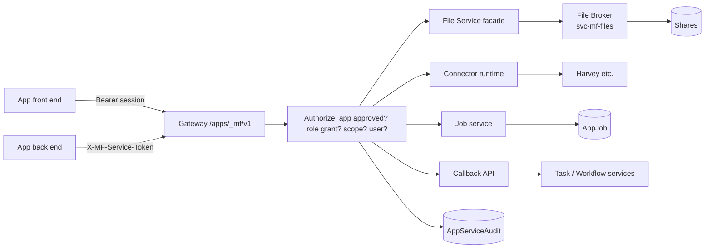

# 07 Platform services and API

Related: `03-security-model.md` sections 6 and 8, `04-launch-identity-and-tokens.md`, `06-hosting-and-app-host.md`, `docs/architecture.md` 11 (API conventions, ProblemDetails, stable error codes).

Platform services are what a browser cannot do: read network folders and call other systems with credentials the app must never hold. They are offered by MatterFlow under `https://<host>/apps/_mf/v1/*`, used by an app **front end** (bearer session token) or **back end** (`X-MF-Service-Token` forwarded by the gateway). All calls are on behalf of the launching user, limited to what the manifest requested and an admin approved, and audited in `AppServiceAudit`. Conventions as the main API: JSON, ProblemDetails with stable `code`, `traceId`, offset or cursor paging, CORS `null` + `Vary: Origin`, no cookies.



## 1. File service

### 1.1 Concepts

- **File root**: admin-configured `FileRoot(Name, UncPath)`; **logical root** in the manifest (`source`) is bound to a file root (and optionally a sub-folder) per app by an admin (`AppFileRootGrant`). Apps only ever see logical names and opaque references, never UNC paths (they can display relative paths).
- **Access** `read | write | readwrite` per binding. The effective right also requires the optional ACL probe to pass (1.3).
- **fileRef**: an opaque, session-bound handle (`fr_...`, HMAC of root id + relative path + session id, 30 min). Back ends receive file refs from the front end and pass them back; they cannot forge paths.

### 1.2 API draft

| Method and path | Purpose | Notes |
|---|---|---|
| `GET /apps/_mf/v1/files/roots` | Roots the app is bound to: `[{name:"source", display:"Matters share", access:"read"}]` | per session |
| `GET /apps/_mf/v1/files/roots/{name}/entries?path=&cursor=&limit=` | Browse a folder: folders first, `name, kind, size, modifiedUtc, fileRef`; `limit` <= 500 | Path relative, `/` separator, no `..` |
| `GET /apps/_mf/v1/files/roots/{name}/stat?path=` | Metadata | |
| `GET /apps/_mf/v1/files/{fileRef}/content` | Stream bytes, `Range` supported, `Content-Disposition: attachment`, `nosniff` | read right; count + bytes audited |
| `POST /apps/_mf/v1/files/roots/{name}/folders` | Create a folder | write right |
| `PUT /apps/_mf/v1/files/roots/{name}/content?path=&overwrite=false` | Upload (chunked: `Content-Range`, final `If-Match` hash) | write right; max file size from root config |
| `POST /apps/_mf/v1/files/convert` | Convert hook: `{ fileRef, from:"md", to:"pdf" }` -> job | Phase 5; interface `IFileConverter` registered by name, converters run in the App Host as their own sandboxed apps |
| `POST /apps/_mf/v1/files/walk` | Start a recursive enumeration job for a folder (counts, sizes, list capped) | returns job id; used by uploaders |

Errors: `FILE_ROOT_NOT_BOUND`, `FILE_PATH_INVALID`, `FILE_NOT_FOUND`, `FILE_ACCESS_DENIED` (ACL probe), `FILE_TOO_LARGE`, `FILE_QUOTA_EXCEEDED`, `FILE_LOCKED`, `FILE_EXISTS`, `BROKER_UNAVAILABLE`. Messages never echo full UNC paths.

### 1.3 Per-user ACL check options

| Option | How | Pros | Cons | Use |
|---|---|---|---|---|
| **None** | Root grant for app + role only | simple | confused deputy: anyone with the app sees the whole root | allowed for narrow, purpose-built roots |
| **Probe (recommended where possible)** | Broker creates an identification token for the user's UPN (S4U, `new WindowsIdentity(upn)`), reads the file/folder security descriptor and evaluates `AuthzAccessCheck` for the requested right; result cached 60 s per (user, path) | respects existing NTFS permissions without delegation | needs AD reachability and group resolution; share permissions and ABAC/claims ignored; Authz result differs from the real effective access in rare cases (deny ACEs on parents are honoured, but NTFS special cases like "traverse checking" are approximated) | `AclCheck=PROBE` per root; fail-closed default |
| **Impersonation (model 1)** | Kerberos constrained delegation: gateway/broker impersonates the user token for I/O | exact NTFS semantics | high IT effort; delegation is itself a high-value attack surface | Not in release 1 (`10` Q-FILE) |

### 1.4 Safety rules in the broker

Canonicalise (`Path.GetFullPath`, then open with `FILE_FLAG_BACKUP_SEMANTICS` and `GetFinalPathNameByHandle`, compare to the root prefix); refuse reparse points whose targets leave the root; refuse `:` streams and device names; case-insensitive; per-user concurrent streams (default 4), bytes/day quota per app and user (`Apps:Files:DailyBytesPerUser` default 20 GB), file size ceiling, no execution of anything; broker listens on loopback with signed requests (`03` T-21); read uses `FileShare.ReadWrite | Delete`, never locks users' files.

## 2. Connector framework

### 2.1 Model

`Connector` = admin-created integration instance: `Name`, `Type` (implementation key, `harvey`), `BaseUrl`, non-secret `ConfigJson`, secrets (`SecretProtected`), `RateLimitPerMinute`, `TimeoutSeconds`, `IsActive`. A connector **type** is a .NET class in MatterFlow (`IConnector`) that exposes a closed list of named **operations** with typed arguments and results; apps cannot send arbitrary HTTP. `AppConnectorGrant` binds an app's logical connector name (`harvey`) to a connector instance and an operation allow-list (intersection with the manifest list).

```text
POST /apps/_mf/v1/connectors/{name}/operations/{operation}     body: { "args": { ... } }
GET  /apps/_mf/v1/connectors/{name}/operations                 -> operation catalogue approved for this app
```

Controls: SSRF (fixed base URL per connector; resolved IP checked against deny ranges; no redirects across hosts; HTTP client with `ConnectTimeout`, response size cap); per-connector and per-app rate limits; retries with jitter only for idempotent operations; **error mapping** `CONNECTOR_UNAVAILABLE` (5xx/timeouts), `CONNECTOR_AUTH_FAILED` (401/403, admin alerted, never details), `CONNECTOR_RATE_LIMITED` (429, `Retry-After`), `CONNECTOR_BAD_REQUEST` (400/422, sanitized message), `CONNECTOR_NOT_FOUND`; connector credentials never in responses, logs or audit.

### 2.2 Harvey connector (example)

> **Assumption:** the Harvey API shape below is illustrative. The real endpoints, auth method (API key vs OAuth client credentials), vault/permission model and upload limits must be confirmed from Harvey's documentation or the Harvey admin before Phase 3. > **IT/vendor dependency:** Harvey API access and credentials.

Config: `BaseUrl=https://api.harvey.example/` (tenant URL), `AuthMode=ApiKey|OAuthClientCredentials`, secret `ApiKey` (or `ClientId`/`ClientSecret`), `DefaultTimeoutSeconds=100`, `MaxParallelUploadsPerUser=4`.

| Operation | Args | Result | Maps to |
|---|---|---|---|
| `vaults.list` | `{ "search": "string?" , "cursor": "string?" }` | `{ vaults:[{id,name}], next }` filtered to vaults the connector account can see; (**user-level vault permissions are not known to MatterFlow**: see risk below) | `GET /vaults` |
| `vaults.create` | `{ "name": "..." }` | `{ id }` | `POST /vaults` |
| `files.upload` | `{ "vaultId": "...", "fileRef": "fr_...", "targetPath": "string?" }` | stream from the File Service into Harvey (multipart/resumable), returns `{ id, bytes, sha256 }` | upload endpoint |
| `files.uploadStatus` | `{ id }` | state | |

Connector-to-file-service: `files.upload` takes a `fileRef`, so bytes flow **broker -> web process -> Harvey** without passing through the browser or the app; the app back end orchestrates (decides which files) but never sees credentials. Risk/decision: the Harvey service account may see more vaults than the user; either (a) MatterFlow filters vault choices by a per-vault allow-list in connector config, or (b) the Harvey API supports per-user tokens (OAuth on-behalf-of); recommendation: (a) in release 1, (b) if Harvey supports it. See `10` Q-HARVEY.

## 3. Jobs and progress (long-running work, for example a 5 GB upload)

Rule: anything longer than the request timeout, or larger than the per-app body limit, is a **job**.

| Method and path | Purpose |
|---|---|
| `POST /apps/_mf/v1/jobs` | Create `{ kind:"harvey-upload", title:"Upload 412 files to MF-00154", itemsTotal?, bytesTotal? }` -> `{ jobId }`; bound to the session's user/task/step |
| `PUT /apps/_mf/v1/jobs/{id}/progress` | Back end reports `{ state, itemsDone, bytesDone, message(<=200 chars), result? }` |
| `GET /apps/_mf/v1/jobs/{id}` | Front end polls (2-5 s) or `GET .../events` as SSE |
| `POST /apps/_mf/v1/jobs/{id}/cancel` | Cooperative cancel flag the back end must honour |
| `GET /apps/_mf/v1/jobs?mine=true` | The user's jobs of this app (for resuming the UI after reload) |

States `QUEUED -> RUNNING -> SUCCEEDED | FAILED | CANCELLED | EXPIRED`. Jobs are rows in `AppJob`, survive web restarts; the executing back end persists its own item-level state in `\apps-data` so it can resume after a restart (guideline in `08`). Streaming design for 5 GB: sequential or limited parallel (4) streams, 8 MB chunks, resumable by file index and byte offset, SHA-256 per file verified end to end, backpressure through bounded channels, no whole-file buffering; the front end shows percent, bytes, current file, per-file errors and a downloadable CSV report built in the browser from `GET jobs/{id}/result`. Job rows keep no file names beyond the counts and a capped error list (names may contain client names: they are available only in the app's own data and the audit `Target` column, which is already access-restricted).

## 4. Callback API and delegated tokens (Phase 4)

Defined in `04` section 6. Endpoints under `/apps/_mf/v1/callbacks/`:

| Method and path | Scope | Notes |
|---|---|---|
| `GET /tasks/{ref}` | `task:read` | `{ref,status,matterRef,dueDate,isOverdue}` |
| `GET /steps/{id}` | `step:read` | step state and input values (bound step only) |
| `POST /tasks/{ref}/comments` | `comments:write` | `{ "html": "..." }` sanitized; attributed "<user> via <app>" |
| `PATCH /steps/{id}/values` | `form-values:write` | `{ "values": {...}, "rowVersion": "..." }`, validated against the pinned form version |
| `POST /steps/{id}/complete` | `step:complete` | same checks as UI; 409 codes as the main API (`COMPLETION_BLOCKED`, `STEP_ORDER_VIOLATION`) |

Every callback writes the normal `AuditEvent` with `ActorUserId=user` and `Summary` suffix "via <App name>", plus `AppServiceAudit`. Concurrency uses the same `rowVersion` rules (`docs/architecture.md` 10).

## 5. OpenAPI sketch (excerpt)

```yaml
openapi: 3.1.0
info: { title: MatterFlow App Platform API, version: v1 }
servers: [ { url: https://matterflow.firm.local/apps/_mf/v1 } ]
security: [ { appSession: [] } ]
components:
  securitySchemes:
    appSession: { type: http, scheme: bearer, description: Opaque session token from POST /apps/_mf/session }
    appDelegated: { type: http, scheme: bearer, bearerFormat: JWT }
  schemas:
    Problem: { type: object, required: [code, traceId], properties: { code: {type: string}, title: {type: string}, traceId: {type: string} } }
    FileEntry:
      type: object
      required: [name, kind, fileRef]
      properties:
        name: { type: string }
        kind: { enum: [file, folder] }
        size: { type: integer, format: int64 }
        modifiedUtc: { type: string, format: date-time }
        fileRef: { type: string }
    Job:
      type: object
      properties:
        id: { type: string, format: uuid }
        state: { enum: [QUEUED, RUNNING, SUCCEEDED, FAILED, CANCELLED, EXPIRED] }
        itemsDone: { type: integer }
        itemsTotal: { type: integer }
        bytesDone: { type: integer, format: int64 }
        bytesTotal: { type: integer, format: int64 }
        message: { type: string, maxLength: 200 }
paths:
  /files/roots:
    get: { summary: List bound file roots, responses: { '200': { description: OK } } }
  /files/roots/{name}/entries:
    get:
      summary: Browse a folder
      parameters:
        - { name: name, in: path, required: true, schema: { type: string } }
        - { name: path, in: query, schema: { type: string } }
        - { name: cursor, in: query, schema: { type: string } }
      responses:
        '200': { description: OK, content: { application/json: { schema: { type: object, properties: { items: { type: array, items: { $ref: '#/components/schemas/FileEntry' } }, next: { type: string } } } } } }
        '403': { description: FILE_ACCESS_DENIED, content: { application/problem+json: { schema: { $ref: '#/components/schemas/Problem' } } } }
  /connectors/{name}/operations/{operation}:
    post: { summary: Call an approved connector operation, responses: { '200': { description: OK }, '429': { description: CONNECTOR_RATE_LIMITED } } }
  /jobs:
    post: { summary: Create a job, responses: { '201': { description: Created } } }
  /jobs/{id}:
    get: { summary: Job state, responses: { '200': { description: OK, content: { application/json: { schema: { $ref: '#/components/schemas/Job' } } } } } }
```

The real document is generated at build time into `contracts/openapi/apps-platform-v1.json` and drift-checked like `contracts/openapi/v1.json` (`docs/architecture.md` 11).

## 6. Quotas and limits (defaults, all configurable under `Apps:*`)

| Limit | Default |
|---|---|
| Requests to `_mf/v1` per session | 600/min |
| Proxied API per session | 1200/min |
| File listing page | 500 entries |
| Concurrent file streams per user | 4 |
| Bytes through File Service per user per day | 20 GB |
| Connector calls per connector | per connector setting (Harvey 120/min) |
| Jobs running per user per app | 3 |
| Callback calls per session | 60/min |

## 7. Audit

Every call to files, connectors, jobs and callbacks writes `AppServiceAudit(OccurredAtUtc, AppId, UserId, TaskId, StepInstanceId, Service, Operation, Target, Bytes, Outcome, DurationMs, CorrelationId)`; list/browse calls are sampled per folder open (one row per folder open, not per entry); reads/uploads write one row per file with size. `Target` is `rootName:relative/path` or `vault:<id>`; never credentials or file content. Admin UI: per app "Platform activity" (filters by user/task/date) for `Audit.View` holders; no per-person ranking.
