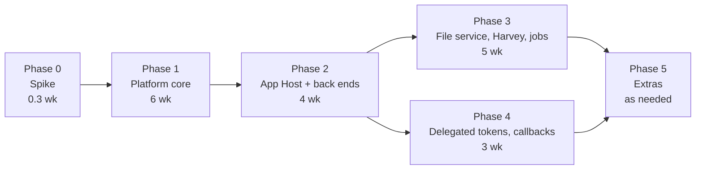

# 09 Phases, estimates and risks

Effort is in **agent-weeks** (one engineering agent/developer working full time for a week, including tests and review fixes), as used in `docs/architecture.md` 18. They assume a small trusted team, one environment, tens of apps, and reuse of existing patterns (permissions, audit, admin screens, workflow editor). Numbers are rough (+-40%).

## 1. Plan overview

Phases 3 and 4 are independent once Phase 2 exists and can run in parallel with two people. Release 1 = Phases 0-1 (static front-end apps such as `md-convert`, step/task/launcher entry points). Total 0-4: about **18 agent-weeks**; calendar 3 months with two people.

## 2. Phase 0: Spike (about 1-2 days)

| Item | Detail |
|---|---|
| Scope | Throw-away branch: `/apps/<slug>/` static serving from a folder with the sandbox header; IIS location with anonymous auth on a test IIS (or Linux Kestrel for the logic); a hand-made launch endpoint producing a JWT in the URL fragment; `md-convert` page. Verify in Edge and Chrome on a domain PC: no credential prompt; module scripts load with CORS `*`; `fetch('/api/v1/me')` from the app fails; storage throws; downloads work; popups/noopener behave. |
| Dependencies (IT) | A test IIS site with Windows auth + the anonymous `/apps` location (one hour of IT time) |
| Exit criteria | Written result on the five assumptions (anonymous location works, module-script CORS, downloads, `Origin: null` handling, SPA `/apps` vs `/apps/<slug>`); go/no-go; update `01` if reality differs (fallback mode B) |
| Tests | Manual checklist + a Playwright script reused later |
| Rollout | None (not merged) |

## 3. Phase 1: Platform core (6 agent-weeks)

| Scope | Notes |
|---|---|
| Registry and storage | `App`, `AppVersion`, scripts 25-27, `Apps` module (Domain/Application/Infrastructure/Api), `Apps:Enabled` flag, upload, validation (V1-V15 except dependency tooling), unzip to `\apps\<guid>\<ver>`, hash, approve/activate/rollback, optional second approver |
| Gateway | Apps branch, path guard, headers, static serving, SPA routing change, CORS, rate limits, disabled-app pages |
| Permissions | `App.Launch`, `App.Manage`, `AppRoleGrant`, Roles editor "Apps" section, `ICurrentUser.AppIds` |
| Identity | Signing keys + rotation, JWKS, launch endpoint, launch token, session redeem/refresh/logout, `AppSession` |
| Entry points | `AppStepLink` in step library and workflow draft/publish; step button and task Apps panel; Apps launcher page and menu item |
| Admin UI | Apps list, publish wizard, app detail (versions, access, configuration with secrets, usage), keys tab |
| Audit | Events in `05`, `AppLaunchAudit`, usage daily, `AuditStoreGuard` extension |
| Developer kit | Template repo, `mf-app` CLI (`init`, `validate`, `pack`, `dev`, `push`), sample `md-convert`, `docs` page |
| Rough split | Registry + validation 1.5, gateway + identity 1.5, permissions + roles UI 0.5, step/task/launcher UI 1.0, admin UI 1.0, kit + samples 0.5 |

Dependencies (IT): anonymous `/apps` location; `\apps` folder + backup. Test strategy: unit (manifest validator, zip extractor with hostile corpus, token service, path guard), API integration with Testcontainers (permission matrix: no grant, no `App.Launch`, disabled app, wrong step, replayed jti), architecture tests (gateway endpoints validate tokens, no role names), schema tests (immutability triggers, unique active version, DENY on audit tables), Playwright e2e (publish `md-convert` through the wizard, grant role, open from launcher and from a step, sandbox assertions: cannot call `/api`, headers present), security tests in `03` section 10, accessibility checks on new screens. Rollout: `Apps:Enabled=false` by default; enabled on a test server first; independent security review of Phase 1 before production; first production app `md-convert`. What can be cut: second approver, task Apps panel (keep step button), usage tab, README rendering, optional scanner, dependency report, `mf-app push`.

## 4. Phase 2: App Host and back ends (4 agent-weeks)

| Scope | Notes |
|---|---|
| App Host service | Install, control API, supervisor, job objects, health, logs, port leasing, config/secret pipe handshake, `Register-MfApp.ps1`, desired-state push, two-phase activation |
| Gateway | YARP proxy, identity assertion, on-demand start, 503 handling, WebSockets, per-app limits |
| SDK + template | `MatterFlow.App.Sdk` (identity, config), .NET back-end template, `FakeMatterFlow` |
| Admin UI | Health, start/stop/restart, logs, resource asks, "Shared account" warning |
| Rough split | Host 2.0, gateway/proxy 1.0, SDK/template 0.5, admin UI 0.5 |

Dependencies (IT): App Host service, accounts, rights, firewall, WebSocket feature (section 3 of `06`). Tests: unit (job limits via a test harness app: memory hog, fork bomb, crash loop), integration on a **Windows runner** (GitHub `windows-latest`) because job objects and `LogonUser` are Windows-only; contract tests for the control API; e2e with a sample back-end app; failure injection (kill process, port taken, unhealthy); security tests T-03/T-15/T-21. Rollout: flag per app (`HasBackend` apps require Phase 2 enabled: `Apps:BackendsEnabled`); pilot with one internal app; independent review of isolation. Cuts: always-on mode, WebSockets, disk quota check, on-demand idle stop.

## 5. Phase 3: Platform services (5 agent-weeks)

| Scope | Notes |
|---|---|
| File Broker + File Service | Service, signed loopback API, roots/grants admin UI, path safety, streaming, quotas, optional ACL probe, audit |
| Connector framework + Harvey | `IConnector`, SSRF guard, rate limits, secrets, error mapping, Harvey operations (after API confirmation), admin UI for connectors |
| Jobs | `AppJob`, progress API, UI helper in SDK, resumable pattern |
| Sample | `harvey-uploader` end to end |
| Rough split | Broker 1.5, file API + admin 1.0, connectors + Harvey 1.5, jobs 0.5, sample + hardening 0.5 |

Dependencies (IT/vendor): File Broker account + share ACLs; Harvey credentials and API documentation; AD read for the probe (optional). Tests: path-safety corpus, share integration tests on a Windows runner with a temp share, Harvey **fake server** contract tests plus a manual test against the real Harvey sandbox tenant, 5 GB soak test (memory flat, resume after kill), quota tests; security tests T-08/T-09/T-10. Rollout: per-root enablement; start with read-only roots; independent review of file/connector code. Cuts: ACL probe (use root grants only), convert hooks, SSE events (polling only).

## 6. Phase 4: Delegated tokens and callbacks (3 agent-weeks)

Scope: `POST /apps/_mf/v1/token`, `AppDelegated` scheme, Callback API (comments, values, complete), scope approval UI, "via <app>" audit rendering, rate limits, SDK helpers. Dependencies: Phase 2 (back ends) is helpful but front-end callbacks work with Phase 1. Tests: scope x permission matrix (every scope with and without the user's permission, bound-task enforcement, expiry, replay, wrong audience), CSRF/Origin tests, audit assertions, e2e where the sample app adds a comment and completes a step. Rollout: scopes enabled per app by admin approval; start with `comments:write`. Cuts: `form-values:write`, `step:complete` (keep read + comment).

## 7. Phase 5: Extras (pick as needed)

Embedded display mode (sandboxed iframe in the task page, `frame-src`), optional internal signature verification, usage dashboard, test/production URL pairing for one app, app categories admin screen, email notifications for crash loops, Kerberos delegation file model, `App.Publish` split from `App.Manage` for another internal team, store-and-forward of audit to SIEM. Each is 0.5-2 agent-weeks.

## 8. Cross-cutting test strategy

Unit and architecture tests run in CI as today (`docs/architecture.md` 15-16). New jobs: **Windows runner** job for App Host/File Broker integration (nightly); Playwright e2e for the Apps flows (the existing e2e is deferred to the end of the build; Apps e2e uses the same harness); a dedicated "sandbox conformance" Playwright spec that runs against the published package on every release; a hostile-zip corpus in `tests/fixtures/packages`; token vectors file shared by .NET and TS SDK tests (like `contracts/form-rules.vectors.json`).

## 9. Top risks and mitigations

| # | Risk | Likelihood / impact | Mitigation |
|---|---|---|---|
| 1 | IT refuses or delays the anonymous `/apps` location | M/H | Phase 0 spike first; fallback mode B (credentialed CORS from `null`, weaker); worst case separate host name |
| 2 | Sandbox behaviour in Edge/Chrome differs from assumptions (module scripts, downloads, auth) | M/H | Phase 0 checklist on real browsers; conformance Playwright suite |
| 3 | Uploaded back end code runs on the production server | M/H | Out-of-process, per-app account, no network, job limits, reviewed hash, admin approval, optional second approver, IT-provisioned account (two-key) |
| 4 | Confused deputy on network folders | M/H | Narrow roots, read-only default, probe, audit, quotas; revisit with model 1 |
| 5 | Per-app account provisioning is slow/manual | H/M | Script generated and reviewable; L1 shared-account fallback; open question on delegation |
| 6 | Harvey API differs from the assumed one or lacks per-user permissions | M/M | Confirm before Phase 3; vault allow-list; sandbox tenant tests |
| 7 | In-process YARP/gateway load or a gateway bug affects MatterFlow availability | L/H | Rate limits, timeouts, apps health is `Degraded` only; ability to move gateway to its own site |
| 8 | Key ring / secrets loss (Data Protection keys not backed up) | L/H | Back up key ring with the database; restore drill; documented in runbook |
| 9 | Vulnerable dependencies in apps (npm/NuGet) | H/M | CI audits, dependency report in wizard, Dependabot, per-app isolation |
| 10 | Scope creep into a general platform / marketplace | M/M | Explicit non-goals, trusted-internal assumption (`README` section 2), cut lists per phase |
| 11 | Windows-only features cannot be built or tested in the Linux dev environment | H/M | Windows CI runner, abstractions (`IProcessLauncher`, `IFileBroker`) with fake implementations, dev mode in-process |
| 12 | Static front end readable by anyone knowing a slug | M/L | Accepted (S1); capability-path option |

## 10. Rollout and feature flags

`Apps:Enabled` (master, default false; hides menu, routes, endpoints), `Apps:BackendsEnabled`, `Apps:Files:Enabled`, `Apps:Callbacks:Enabled`, `Apps:RequireSecondApprover` (default false), `Apps:Scanner` (`None|Defender`). Environments: dev (Dev auth, in-process back ends), test server (UAT, own `\apps`), production. One environment pair at most: an app that needs a test and a production instance simply has two registrations on two servers (or two codes, `x-test`) - no cross-environment promotion tooling.
