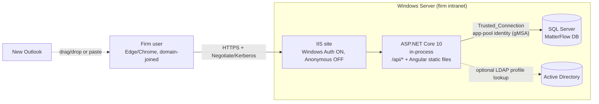
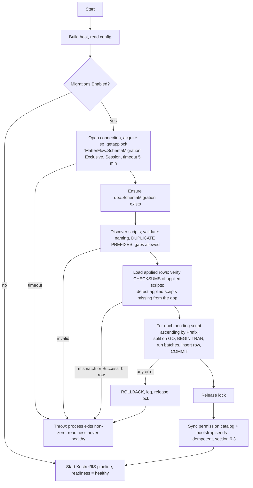
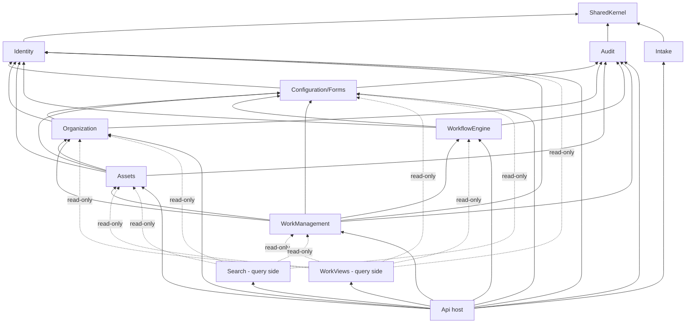
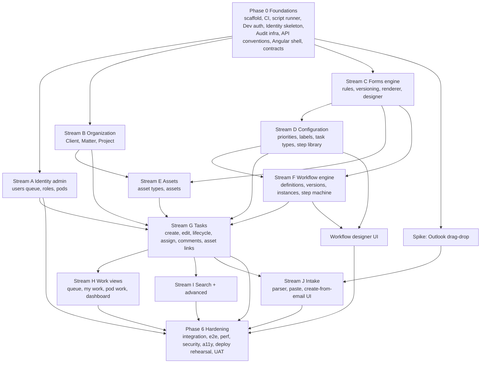

# MatterFlow - Solution Architecture

**Status:** v1.0 (architecture baseline for Phase 1) · **Date:** 2026-10-14 · **Branch:** dev
**Inputs:** `docs/requirements/baseline-v1.1.md`, `docs/requirements/decisions-addendum.md` (the addendum overrides the baseline on conflicts; section J of the addendum fixes the database migration approach). Companion: `docs/erd.md` (logical data model).
**Environment facts** (from `docs/dev-environment.md`): .NET 10 LTS SDK, Node 22, Angular CLI pinned to v21, SQL Server 2022 container for tests.

## Table of contents

1. [Decision log (ADR summary)](#1-decision-log-adr-summary)
2. [System context and deployment](#2-system-context-and-deployment)
3. [Solution and repository layout](#3-solution-and-repository-layout)
4. [Database schema management (SQL script runner)](#4-database-schema-management-sql-script-runner)
5. [Modular monolith: modules and dependency rules](#5-modular-monolith-modules-and-dependency-rules)
6. [Authentication and authorization](#6-authentication-and-authorization)
7. [Dynamic forms and custom-field engine](#7-dynamic-forms-and-custom-field-engine)
8. [Workflow engine and Task lifecycle](#8-workflow-engine-and-task-lifecycle)
9. [Audit strategy](#9-audit-strategy)
10. [Concurrency](#10-concurrency)
11. [API conventions](#11-api-conventions)
12. [Angular architecture](#12-angular-architecture)
13. [Outlook intake](#13-outlook-intake)
14. [Search](#14-search)
15. [Testing strategy](#15-testing-strategy)
16. [CI outline (GitHub Actions)](#16-ci-outline-github-actions)
17. [Observability and logging](#17-observability-and-logging)
18. [Phased build order](#18-phased-build-order)
19. [Assumptions and remaining open questions](#19-assumptions-and-remaining-open-questions)

---

## 1. Decision log (ADR summary)

Format: **Decision / Rationale.** Detailed designs follow in the numbered sections. Items marked *(baseline OPEN-nn)* resolve an open item from the baseline.

| ADR | Decision | Rationale |
|---|---|---|
| 001 | **Modular monolith**, one ASP.NET Core host, one SQL Server database, one `DbContext`. | 200-300 users and a few thousand Tasks/year (addendum H). Microservices add cost with no benefit. A single context keeps cross-module composite FKs and the audit write inside one transaction. |
| 002 | **.NET 10 (LTS)**, C# 14, ASP.NET Core **controllers** (not minimal APIs), **EF Core 10 for data access only**, FluentValidation, no MediatR (plain application-service/handler classes). | LTS available via apt in the dev image. Controllers give consistent filters, `[ApiController]` ProblemDetails and attribute-based policy metadata. MediatR is now commercial and not needed. |
| 003 | **Schema = hand-written numbered SQL scripts** applied by a startup runner (section 4). EF Core migrations are not used. *(addendum J)* | Product-owner decision. It also lets us write composite FKs, filtered indexes, CHECK constraints, triggers and DENY grants as plain DDL. |
| 004 | **Windows Integrated Auth** on IIS (in-process hosting), user key = Windows SID, JIT zero-permission provisioning, **`Dev` auth provider** off-domain (refuses to start in Production). | Baseline 6.4 and addendum I. Same-origin deployment (ADR 005). |
| 005 | **Same-origin**: the ASP.NET Core app serves `/api/*` and the built Angular app from one IIS site. No CORS in production. | Removes credential-forwarding/CORS issues (baseline OPEN-01). CSRF is handled by a required custom header (section 6.6). |
| 006 | Authorization by **permission codes** via dynamic policies. Role names are never checked in code. System Admin short-circuits to allow. | Baseline 6.2; roles are configurable. |
| 007 | Pod Lead is an ordinary **role**; `PodMember` has no lead flag. *(addendum E)* | Addendum. |
| 008 | `UserIdentity` table (Provider, TenantId, Subject) maps external logins to `AppUser.UserId`; every FK points to `UserId`. Entra ID is added later as a second provider with an admin-reviewed link. | Baseline 6.4. |
| 009 | Dynamic forms: **normalized, versioned form metadata**; values stored as **JSON on the owning row** plus a **typed `CustomFieldIndex`** table for fields flagged filterable (max 5 per form). *(baseline OPEN-11)* | No `ALTER TABLE` per form field; filtering without scanning JSON; plain indexes only. |
| 010 | Conditional rules are a **safe JSON expression tree** with a published JSON Schema and a **shared conformance test-vector file**. Two implementations (.NET authoritative, TypeScript for UX). | No executable code from admins; guaranteed parity by tests. |
| 011 | Task, form and workflow versions are **pinned by FK to immutable published rows**. No JSON snapshot copy. | Immutability is enforced by app + triggers; less duplication. |
| 012 | New Tasks may use only the **current published version** of an eligible Workflow and of the Task Type form. *(OPEN-04, OPEN-16)* | Simple. "Rollback" = clone an old version into a new draft and publish. |
| 013 | Task completion requires every step to be resolved (`COMPLETED`, or `SKIPPED` where skippable), but the user may click Complete with unresolved steps: a confirmation offers to **bulk-complete** them in one transaction (addendum K). Steps with missing required inputs cannot be bulk-completed and block completion. Workflows must have at least one step. *(OPEN-05)* | One validator; the bulk action is a convenience that still runs full step validation. |
| 014 | Full Task lifecycle matrix and step state matrix are defined in section 8. *(OPEN-07, OPEN-06)* | Needed to build and test. |
| 015 | **Audit** = transactional `AuditEvent`, written in the same `SaveChanges`: explicit semantic events from services plus an EF interceptor for generic field diffs. No separate status/assignment history tables. | One source for the Activity tab. |
| 016 | **Optimistic concurrency** with `rowversion`, sent as `rowVersion` in request bodies. Workflow/lifecycle commands also take a per-Task `UPDLOCK`. | Prevents lost updates and completion races. |
| 017 | **Angular 21 standalone + signals**, feature-folder layout, signal-based facade services; **no NgRx**. UI library **PrimeNG** (wrapped in `shared/ui`) with CDK drag-drop for designers. | Section 12. |
| 018 | **Outlook intake** = server-side, in-memory parse (`POST /api/v1/intake/parse-email`) of `.eml`/`.msg`, plus a paste path that always works. Nothing is stored or logged. Drag-drop from new Outlook is a spike. | Addendum C. |
| 019 | **Search** = SQL `LIKE` with normalized number handling and plain indexes. No full-text, no external engine. | Addendum H. |
| 020 | Task numbers `TSK-<n>` from a SQL `SEQUENCE`. | Baseline 7.1 (proposed). |
| 021 | `Matter.ClientNumber` is denormalized (kept in sync by `ON UPDATE CASCADE` composite FK) with a persisted computed `MatterRef` (`00343-00012`). | Search and display without joins; still a single source of truth. |
| 022 | Matter/Client/Project/Asset custom fields are validated against the **current published** form version at save time (living records). Task and Step values are pinned to their version. | Different lifecycle: records vs requests. |
| 023 | Asset link roles (Source, Destination, Subject, Result, Related) are an admin-editable lookup. *(OPEN-14)* | Cheap flexibility. |
| 024 | Projects are flat. *(OPEN-13)* A Task's assigned user need not be a member of the assigned Pod; the UI warns. *(OPEN-12)* | Baseline defaults. |
| 025 | Ethical walls/Matter ACLs deferred; all read paths go through `IAccessScope` (returns "all" in Phase 1) as the later hook. *(OPEN-02, addendum E)* | Cheap seam, no behavior now. |
| 026 | Matter status is `IsActive` only. A Matter can be deactivated only when all Tasks are Completed/Cancelled. Inactive Client blocks new Matters. Inactive Project blocks new Tasks. *(MAT-008)* | Addendum B plus consistent extension. |
| 027 | No attachments, no file storage anywhere in the system. | Addendum C. |
| 028 | Starter role/permission matrix is seeded but fully editable (section 6.3). *(OPEN-03, OPEN-18)* | Gives a runnable system. |

---

## 2. System context and deployment



- **Hosting:** one IIS site, ASP.NET Core Module in-process, framework-dependent publish (`win-x64`). The Angular production build is copied into `wwwroot/`; ASP.NET serves static files and falls back to `index.html` for client routes (`Hosting/SpaHosting.cs`: GET/HEAD without a file extension, excluding `/api`, `/health` and `/openapi`).
- **Authentication:** IIS Windows Authentication enabled, Anonymous disabled. The app uses `IISServerDefaults.AuthenticationScheme`. HTTPS only (HSTS). The site must be in the browser's Intranet zone for silent sign-in (deployment checklist item).
- **Database access:** app-pool identity (gMSA) with integrated security. Two SQL roles: `mf_app` (DML, EXEC, **no DDL**, **audit table INSERT/SELECT only**) for normal operation and `mf_migrator` (DDL) for the schema runner. In small installs one login may hold both, but the audit DENY must remain (section 9). The runner runs with the migrator connection string (`ConnectionStrings:Migrations`), falling back to the app connection string if unset.
- **Dev/test:** `Auth:Provider=Dev` (cross-platform, SQL Server in Docker, `ng serve` with a proxy to the API so the browser sees one origin). The Dev provider is an allow-list: it starts only when `ASPNETCORE_ENVIRONMENT` is `Development` or `Test`, and any other environment name is rejected at startup (security review SEC-10). The `?devUser=` query form works in Development only.
- **Config:** `appsettings.json` plus environment variables / IIS config. Key settings: `Firm:TimeZoneId` (IANA/Windows tz id, e.g. `America/New_York`), `Bootstrap:SystemAdmins`, `Auth:Provider`, `Migrations:*`, `Intake:MaxEmailBytes`.
- **Time:** all timestamps `datetime2` UTC. `IClock` and `IFirmTime` (firm timezone conversions) are the only time sources.
- **Backup/RPO/RTO:** not specified by the firm. Proposal (open question): nightly full + 15-minute log backups.

---

## 3. Solution and repository layout

```text
MatterFlow/
├── README.md
├── global.json                      # pin .NET 10 SDK
├── .editorconfig  .gitignore  .gitattributes
├── .github/
│   ├── workflows/ ci.yml  nightly-integration.yml  e2e.yml  release.yml  codeql.yml
│   ├── dependabot.yml  CODEOWNERS  pull_request_template.md
├── contracts/                       # cross-stack contracts: the glue for parallel work
│   ├── openapi/v1.json              # generated by the API build, committed, drift-checked in CI
│   ├── form-rules.schema.json       # JSON Schema of conditional-rule expressions
│   ├── form-rules.vectors.json      # shared conformance test vectors (.NET + TS both run these)
│   └── permissions.json             # permission catalog source (codes, groups, descriptions)
├── docs/                            # requirements/, architecture.md, erd.md, ux/, adr/
├── db/
│   └── scripts/                     # NUMBERED, IMMUTABLE SQL scripts (section 4)
│       ├── 01-init.sql              # SchemaMigration is created by the runner, not here
│       ├── 02-identity-authz.sql
│       ├── 03-organization.sql
│       ├── ...
│       └── README.md                # authoring rules
├── backend/
│   ├── MatterFlow.sln
│   ├── Directory.Build.props  Directory.Packages.props   # central package management, nullable, analyzers
│   ├── src/
│   │   ├── MatterFlow.Api/                      # host only: Program.cs, composition, middleware, auth wiring,
│   │   │                                        #   ProblemDetails, OpenAPI, web.config, appsettings*
│   │   ├── MatterFlow.SharedKernel/             # Result/Error, IClock, IFirmTime, paging, base entity, ICurrentUser,
│   │   │                                        #   IAccessScope, AuditAttributes, ErrorCodes, ValueObjects (BusinessNumber)
│   │   ├── MatterFlow.Data/                     # MatterFlowDbContext (one), cross-module relationship config,
│   │   │   │                                    #   SaveChanges interceptors (audit, rowversion mapping), NO migrations
│   │   │   └── SchemaMigrations/                # the script runner (section 4); scripts embedded from /db/scripts
│   │   └── Modules/
│   │       ├── MatterFlow.Identity/             # + .Contracts   (AppUser, UserIdentity, Role, Permission, Pod)
│   │       ├── MatterFlow.Audit/                # + .Contracts
│   │       ├── MatterFlow.Configuration/        # + .Contracts   (Priority, StatusLabel, TaskType, Forms engine, AssetLinkRole)
│   │       ├── MatterFlow.Organization/         # + .Contracts   (Client, Matter, Project)
│   │       ├── MatterFlow.Assets/               # + .Contracts   (AssetType, Asset)
│   │       ├── MatterFlow.WorkflowEngine/       # + .Contracts   (StepDefinition, Workflow*, instances)
│   │       ├── MatterFlow.WorkManagement/       # + .Contracts   (Task, TaskAsset, comments, lifecycle)
│   │       ├── MatterFlow.WorkViews/            # queue, my work, pod work, dashboard (query side)
│   │       ├── MatterFlow.Search/               # global + advanced (query side)
│   │       └── MatterFlow.Intake/               # email parse
│   │            (each module project is organised internally as:)
│   │            #   Domain/  Application/  Infrastructure/ (EF configs, query handlers)  Api/ (controllers, request/response DTOs)
│   └── tests/
│       ├── MatterFlow.UnitTests/                # per-module folders; domain, state machines, rule engine, validators
│       ├── MatterFlow.ArchitectureTests/        # NetArchTest: module dependency rules, no role-name checks, controllers have policies
│       ├── MatterFlow.IntegrationTests/         # WebApplicationFactory + Testcontainers.MsSql, Respawn
│       │   ├── Fixtures/ (SqlServerFixture, ApiFactory, DevAuth test users, builders)
│       │   └── <Module>/ ...
│       └── MatterFlow.SchemaTests/              # scripts apply cleanly, runner behavior, EF model matches DB (section 4.7)
├── frontend/
│   ├── angular.json  package.json  tsconfig*.json  eslint.config.js  proxy.conf.json
│   ├── projects/
│   │   └── form-engine/                         # Angular library: rule evaluator (pure TS), renderer, designer
│   │       └── src/lib/ { rules/ (evaluator, validator, vectors.spec.ts), renderer/, designer/, controls/ }
│   ├── src/
│   │   ├── main.ts  index.html  styles.scss  (PrimeNG preset + docs/ux/tokens.css)
│   │   ├── app/
│   │   │   ├── app.config.ts  app.routes.ts
│   │   │   ├── api/generated/                   # NSwag output from contracts/openapi/v1.json (committed)
│   │   │   ├── core/    # auth (me, permissions), http interceptors, error handling, firm-time, config
│   │   │   ├── shared/  # ui/ (PrimeNG wrappers), pipes (matter-ref, due-label), directives (hasPermission), layout
│   │   │   └── features/
│   │   │       ├── access-pending/  dashboard/  my-work/  task-queue/  pod-work/
│   │   │       ├── clients/  matters/  projects/  assets/
│   │   │       ├── tasks/ { create/, detail/ { details, workflow, comments, assets, activity } }
│   │   │       ├── intake/  search/
│   │   │       └── admin/ { users-roles-pods (one page, three tabs), priorities, status-labels, task-types, forms-custom-fields,
│   │   │                    step-library, workflows, asset-types, asset-link-roles, audit }
│   │   └── environments/
│   └── e2e/                                     # Playwright (deferred to the end of the build, section 15)
│       ├── playwright.config.ts  fixtures/  pages/  specs/
├── docker-compose.dev.yml                       # SQL Server 2022 (+ optional full stack for e2e)
└── tools/ { seed-dev-data/, spike-outlook-dnd/ }
```

Rules: scripts in `db/scripts` are the schema source of truth; `contracts/` files are reviewed like API changes (CODEOWNERS on both stacks); generated code is committed and CI fails on drift.

---

## 4. Database schema management (SQL script runner)

*Decision (addendum J):* schema is changed only by appending numbered SQL scripts. EF Core maps entities to tables for **data access only**; there is no `Add-Migration`, no `DbContext.Database.Migrate()`, no EF migrations history table.

### 4.1 Script conventions

- Location: `/db/scripts/`, embedded into `MatterFlow.Data` as resources (`<EmbeddedResource Include="..\..\..\db\scripts\*.sql" />`). Optional override: `Migrations:ScriptsFolder` (a directory path) for ops hotfix testing; embedded resources are the default in production.
- Name: `NN-kebab-description.sql`, regex `^(?<n>\d{2,6})-[a-z0-9][a-z0-9-]*\.sql$`. The numeric prefix is parsed as an integer (so `09` < `10` < `100`). Use at least two digits; the team standard is two digits until 99 then three.
- **Applied scripts are immutable.** To change anything, append a new script. The checksum guard enforces this.
- One logical change per script. DDL, seed data (permission catalog is **not** seeded here; see 4.6) and data fixes are all allowed. Scripts must be written to be run once, not idempotently.
- Batches are separated with a line containing only `GO` (case-insensitive, optional repeat count not supported). Do not rely on variables across batches.
- Encoding UTF-8 (BOM tolerated). Line endings are normalized before hashing (see checksum).
- Each script header comment: purpose and owner (convention, not enforced).

### 4.2 Tracking table

Created by the runner itself (outside any numbered script) if missing:

```sql
CREATE TABLE dbo.SchemaMigration (
  SchemaMigrationId INT IDENTITY(1,1) CONSTRAINT PK_SchemaMigration PRIMARY KEY,
  ScriptName        NVARCHAR(260) NOT NULL CONSTRAINT UQ_SchemaMigration_Name UNIQUE,
  Prefix            INT           NOT NULL CONSTRAINT UQ_SchemaMigration_Prefix UNIQUE,
  Checksum          CHAR(64)      NOT NULL,          -- SHA-256 hex of normalized content
  AppliedAtUtc      DATETIME2(3)  NOT NULL CONSTRAINT DF_SchemaMigration_Applied DEFAULT SYSUTCDATETIME(),
  DurationMs        INT           NOT NULL,
  Success           BIT           NOT NULL,          -- only rows with Success=1 count as applied
  AppliedBy         NVARCHAR(256) NULL,              -- SUSER_SNAME()
  AppVersion        NVARCHAR(64)  NULL
);
```

Failed scripts are rolled back and **not** recorded as applied; the failure is logged (and the startup aborts). `Success=0` rows are only written for scripts that cannot run in a transaction (4.4) so operators can see the partial state. A `Success=0` row blocks startup until an operator fixes the database and removes the row (documented runbook).

### 4.3 Startup sequence

Runs in `Program.cs` **before** the host starts listening (before `app.Run()`; not in a hosted service, so no request can arrive against an old schema).



Details:

1. **Concurrency:** `EXEC sp_getapplock @Resource='MatterFlow.SchemaMigration', @LockMode='Exclusive', @LockOwner='Session', @LockTimeout=300000`. Return code < 0 fails startup. The lock is session-scoped on a dedicated connection that stays open for the whole run and is released explicitly (`sp_releaseapplock`) and by connection close. Instances that lose the race wait, then find nothing pending (they re-read the table after acquiring the lock).
2. **Discovery:** enumerate embedded resources (or folder), parse prefix, sort ascending by integer prefix. **Duplicate prefix** (e.g. `05-a.sql`, `05-b.sql`, or `05-x.sql` and `005-x.sql`) fails startup, listing both names. Gaps in numbering are allowed. A new script whose prefix is **lower** than the highest applied prefix and not yet applied also fails (out-of-order merge; rename it to the next free number).
3. **Checksum:** SHA-256 of the file content after normalizing line endings to `\n`, trimming a UTF-8 BOM, and trimming trailing whitespace at end of file. For every applied row: the script must still exist, name and prefix must match, and checksum must be equal; otherwise fail with a message naming the script and both hashes. No override flag exists in Production; a documented break-glass procedure edits the table manually.
4. **Execution and transactions:** each script runs on the locked connection inside one explicit transaction (`SET XACT_ABORT ON; BEGIN TRAN`), batches executed in order, the `SchemaMigration` row inserted in the same transaction, then `COMMIT`. SQL Server DDL is transactional, so a failing script leaves nothing behind. Statements that cannot run in a transaction (`CREATE/ALTER DATABASE`, `CREATE FULLTEXT ...`, `ALTER INDEX ... ONLINE` variants as applicable, `BACKUP`) require a directive on the first line: `-- mf:no-transaction`. Such scripts run without a wrapping transaction, must be a single concern, and write `Success=0` first then update to `1` at the end. The directive is rare and reviewed.
5. **GO splitting:** a line matching `^\s*GO\s*(--.*)?$` (case-insensitive) outside block comments and string literals separates batches (a small tokenizer tracks `/* */` and `'...'`). Empty batches are skipped. Batch timeout `Migrations:CommandTimeoutSeconds` (default 600).
6. **Fail-fast:** any error (discovery, checksum, lock, script) throws `SchemaMigrationException` with script name, batch number, SQL error number and line; the host exits with non-zero code, Windows Event Log/Serilog gets the full message, and no HTTP traffic is served. The failing script's transaction is rolled back.
7. **Multi-instance behavior:** only one instance migrates; others wait on the lock. With a single IIS node (the Phase 1 target) the lock is a safeguard for overlapping app-pool recycles.
8. **Options (`Migrations:*`):** `Enabled` (default true), `ScriptsFolder` (default null = embedded), `LockTimeoutSeconds` (300), `CommandTimeoutSeconds` (600), `ConnectionStringName` (`Migrations`).
9. **Dev/test:** the same runner is used by local dev, integration tests (against the Testcontainers database) and CI, so there is exactly one way to create a schema. The CLI switch `dotnet MatterFlow.Api.dll --migrate-only` (or `MATTERFLOW_MIGRATE_ONLY=true`) runs migrations with the `Migrations` connection and exits 0/1 without starting the web host (used by deploy scripts and the DBA to migrate before swapping binaries; implemented in `Hosting/MigrateOnlyCommand.cs`, procedure in `docs/runbook.md` section 7).

### 4.4 Authoring rules (in `db/scripts/README.md`)

- Name constraints and indexes explicitly (`PK_`, `FK_`, `UQ_`, `CK_`, `IX_`, `DF_`) so later scripts can reference them.
- Never edit an applied script; fix forward. Rebase conflicts on the prefix are resolved by renumbering **unmerged** scripts only.
- Prefix allocation: each PR that adds a script takes the next free number at merge time; the duplicate-prefix check in CI catches collisions on `dev`.
- Seed data owned by code (permission catalog, fixed `TaskStatusLabel` codes) is synchronized by the app (4.6) rather than by script; scripts seed only structural lookups needed by FKs (the five status codes, default priorities, default asset link roles, default Admin role row).
- Destructive changes (drop/rename column) use the expand-then-contract pattern across two releases.

### 4.5 Initial script plan

| Script | Contents | Owner stream |
|---|---|---|
| `01-init.sql` | Schemas conventions, `SEQUENCE dbo.TaskNumberSeq`, `AuditEvent` + DENY, lookup `TaskStatusLabel` (5 rows) | Platform |
| `02-identity-authz.sql` | `AppUser`, `UserIdentity`, `Role`, `Permission`, `RolePermission`, `UserRole`, `Pod`, `PodMember`, `UserPreference`, System Admin role row | Identity |
| `03-forms.sql` | `FormDefinition`, `FormVersion`, `FormField`, `FormFieldOption`, `CustomFieldIndex`, immutability triggers | Forms |
| `04-organization.sql` | `Client`, `Matter`, `Project` (+ composite keys, checks) | Organization |
| `05-configuration.sql` | `Priority` (+ defaults), `TaskType`, `AssetLinkRole` (+ defaults) | Configuration |
| `06-assets.sql` | `AssetType`, `Asset` | Assets |
| `07-workflow.sql` | `StepDefinition`, `WorkflowDefinition`, `WorkflowVersion`, `WorkflowVersionStep`, `TaskTypeWorkflow` | Workflow |
| `08-tasks.sql` | `Task`, `WorkflowInstance`, `StepInstance`, `TaskAsset`, `TaskComment`, `TaskCommentRevision`, immutability triggers, indexes | Tasks |
| `09+` | Indexes tuned after seeding, search helper indexes, later changes | any |

Parallel work note: because order matters, early scripts are written by the platform developer in Phase 0/1 from `docs/erd.md`, so streams do not collide on numbering; later additions follow the prefix rule above.

### 4.6 What the app (not scripts) seeds at startup (after migrations, idempotent)

- Sync the `Permission` catalog from `contracts/permissions.json` (insert new codes, mark removed codes inactive). Grant all permissions to the System Admin role implicitly (handler short-circuit, no `RolePermission` rows needed).
- Create default starter roles and role-permission grants **only if the `Role` table has no non-system roles** (first install), so admin edits are never overwritten.
- Apply `Bootstrap:SystemAdmins` at first login of a matching identity (section 6.4).

### 4.7 Keeping EF mappings and SQL in sync

Because EF no longer generates the schema, drift is a real risk. Controls:

- `MatterFlow.SchemaTests` applies all scripts to a fresh Testcontainers database (via the runner) and then (a) asserts every EF entity/property maps to an existing table/column with a compatible type and nullability (reading `INFORMATION_SCHEMA`/`sys.*` against `IModel`), (b) smoke-queries each `DbSet`, (c) asserts key constraints exist (see `docs/erd.md`).
- Runner tests: pending scripts run in order; second run is a no-op; duplicate prefix fails; changed checksum fails; failing script rolls back and does not record; concurrent starts serialize (two runners, one DB); GO splitting edge cases (comments, strings, `GO` inside identifiers).
- Entity configurations in modules map to names explicitly (`ToTable`, `HasColumnName`, `HasConstraintName` where tests inspect them); `rowversion` columns are mapped with `IsRowVersion()`; computed columns with `ValueGeneratedOnAddOrUpdate()`.

---

## 5. Modular monolith: modules and dependency rules

### 5.1 Modules

| Module | Owns | Public surface (`.Contracts`) |
|---|---|---|
| **Identity/Authz** | AppUser, UserIdentity, Role, Permission, RolePermission, UserRole, Pod, PodMember, UserPreference; JIT provisioning; permission policies | `ICurrentUser`, `IPermissionChecker`, `IUserDirectory` (lookup names/active), permission constants |
| **Audit** | AuditEvent, history read API | `IAuditWriter`, `AuditEntry`, `[Audited]`/`[AuditExplicit]` attributes (also in SharedKernel) |
| **Configuration/Forms** | Priority, TaskStatusLabel, TaskType, AssetLinkRole, FormDefinition/Version/Field/Option, CustomFieldIndex, rule engine, `IFormValueService` | `IFormValidator`, `IFormSchemaProvider`, `IPriorityLookup`, `ITaskTypeLookup` |
| **Organization** | Client, Matter, Project, number normalization | `IMatterLookup` (exists, active, ref), `IProjectLookup`, `BusinessNumber` |
| **Assets** | AssetType, Asset | `IAssetLookup` (asset belongs to matter) |
| **WorkflowEngine** | StepDefinition, WorkflowDefinition/Version/VersionStep, WorkflowInstance, StepInstance, step state machine | `IWorkflowInstantiator`, `IWorkflowProgress` (completion check), `IStepCommands` |
| **WorkManagement** | Task, TaskAsset, TaskComment(+Revision), lifecycle state machine, assignment | `ITaskLookup`, `ITaskLifecycle` (used by WorkflowEngine callbacks via contract interface `ITaskStatusGate`) |
| **WorkViews** | Queue/My Work/Pod Work/Dashboard queries | none (leaf) |
| **Search** | Global/advanced queries | none (leaf) |
| **Intake** | Email parsing | none (leaf) |

### 5.2 Dependency rules (enforced by `MatterFlow.ArchitectureTests`)



1. A module may reference **only** `MatterFlow.SharedKernel` and **other modules' `.Contracts` projects**. Never another module's internals. Dependencies must follow the layer arrows above (no cycles). Example: WorkflowEngine needs to know Task status; it depends on `ITaskStatusGate` (declared in WorkflowEngine.Contracts, implemented by WorkManagement) instead of referencing WorkManagement (inversion).
2. Entities have **no navigation properties across modules**; cross-module links are scalar IDs. Cross-module relationships (FKs, composite FKs) are configured centrally in `MatterFlow.Data` (`CrossModuleRelationships.cs`) which is the only project that references all module assemblies.
3. **Query-side exception:** `WorkViews` and `Search` may read other modules' `Domain` entity types through `MatterFlowDbContext` using `AsNoTracking()` projections. They may not call other modules' Application classes, may not write, and may not reference `Infrastructure`/`Api` namespaces. Rationale: efficient joins for queues without a read-model layer at this scale.
4. All state-changing operations happen inside the owning module's application service and its transaction; modules call each other synchronously through Contracts (no message bus; in-process domain notifications only if needed).
5. Every controller action declares an authorization policy (`[Authorize(Policy="Perm:...")]`) or explicit `[AllowAuthenticated]`; the architecture test fails otherwise.
6. No code branches on role **names**. Only permission codes.
7. Controllers contain no business logic; they map DTOs to commands and results to ProblemDetails.
8. Query-side access passes through `IAccessScope` (all rows in Phase 1) so ethical walls can be added in one place later.

### 5.3 Intra-module structure

`Domain/` entities and pure rules (state machines, no EF types), `Application/` command/query handlers and validators (FluentValidation), `Infrastructure/` EF `IEntityTypeConfiguration`s and query implementations, `Api/` controllers and DTOs. Each module exposes `AddXxxModule(this IServiceCollection)` and `MapXxx` is not needed (controllers via ApplicationPart).

---

## 6. Authentication and authorization

### 6.1 Request pipeline

`UseHttpsRedirection → UseHsts → static files → UseRouting → UseAuthentication → ClaimsTransformation (AppUserResolver) → UseAuthorization → request-size/CSRF guards → controllers`.

1. **Authentication handler** (provider-specific, replaceable): `Windows` (IIS) in production, `Dev` in dev/test, `Entra` later. Each produces a `ClaimsPrincipal` and an `ExternalIdentity(provider, tenant, subject, username, displayName?, email?)` through `IExternalIdentityAccessor`.
2. **`AppUserResolver`** (Identity module) turns the external identity into `AppUser.UserId`:
   - Lookup `UserIdentity (Provider, TenantId, Subject)`. Found and active: load user.
   - Not found: **JIT provision** `AppUser` (zero roles) and `UserIdentity` in one transaction (unique index makes concurrent first requests safe: catch duplicate-key and re-read). Profile enrichment (display name, email) from AD via `IDirectoryProfileProvider` (LDAP on Windows; no-op elsewhere) - failures are tolerated; fallback display name = `DOMAIN\sam`.
   - Disabled user (`AppUser.IsActive=false`): authentication succeeds but every protected endpoint returns 403 `ACCOUNT_DISABLED`.
   - Emits provisioning to Audit (`USER_PROVISIONED`).
3. The resolver adds claims `mf:uid` and builds a request-scoped `ICurrentUser` (`UserId`, `DisplayName`, `IsSystemAdmin`, permission set). Permission sets are cached in `IMemoryCache` per user for 60 s and **invalidated immediately** on any role/user-role/role-permission change (single node). This is the "permission refresh policy": effective within one request after an admin change on the same node, within 60 s worst case if scaled out.

### 6.2 Identity abstraction for Entra ID

- Everything references `AppUser.UserId`. `UserIdentity(Provider 'Windows'|'Dev'|'Entra', TenantId '' for Windows, Subject, Username, ...)` has a unique index on `(Provider, TenantId, Subject)`. Windows subject = SID string (`WindowsIdentity.User.Value`); `Username` keeps `DOMAIN\sam` for display.
- Entra migration path (no work in Phase 1 beyond the seam): add an `Entra` authentication scheme; add an admin tool (CLI or admin page `Identity reconciliation`) that produces a **dry-run matching report** (candidates by UPN/email) and requires an admin to confirm each link, which inserts a `UserIdentity(Entra, tid, oid)` row for the **existing** `UserId`. No auto-merge on name/email. Windows identities can remain active during cutover and be deactivated afterwards.
- Only the Identity module's auth plumbing knows about providers; all other code uses `ICurrentUser`.

### 6.3 Permission catalog and starter roles

Source of truth: `contracts/permissions.json` (code, group, description), generated into C# constants (`Permissions.Task.Create` = `"Task.Create"`) and a TypeScript union type. Rows are synced into `Permission` at startup (4.6). Adjustments from the baseline: `Task.Reassign` merged into `Task.Assign`; `Task.Attach` removed (no attachments); `Workflow.StepEdit` merged into `Workflow.Execute`; added `Task.Cancel`, `Client.EditNumber`, `Matter.EditNumber`, `Matter.SetActive`, `User.View`, `User.Manage`.

| Group | Codes |
|---|---|
| Client/Matter | `Client.View/Create/Edit/EditNumber`, `Matter.View/Create/Edit/EditNumber/SetActive` |
| Project | `Project.View/Create/Edit/Archive` |
| Task | `Task.View/Create/Edit/Assign/SetPriority/ChangeStatus/Complete/Cancel/Reopen/Comment` |
| Workflow execution | `Workflow.Execute` (start, save inputs, complete, skip), `Workflow.StepReopen` |
| Assets | `Asset.View/Create/Edit/Link` |
| Organization | `Pod.View/Manage/ManageMembers`, `User.View/Manage` (access queue, activate/disable, assign roles) |
| Configuration | `Role.Manage`, `TaskType.Manage`, `Workflow.Manage`, `AssetType.Manage`, `CustomField.Manage`, `Priority.Manage`, `StatusLabel.Manage` |
| Dashboard | `Dashboard.View` (open the Dashboard: menu item and route), `Dashboard.ViewSummary`, `Dashboard.ViewUnassigned`, `Dashboard.ViewBreakdowns`, `Dashboard.ViewTrends`, `Dashboard.ViewSwimlane`, `Dashboard.ViewUsers` (one per tab, `ViewUnassigned` is the unassigned queue alone; see below) |
| Oversight | `Audit.View` |

**Starter role matrix** (seeded once, editable; `X` = granted; System Admin implicitly has all):

| Permission group | Director | Project Manager | Pod Lead | Data Technician | Data Scientist |
|---|---|---|---|---|---|
| Client/Matter/Project/Asset View | X | X | X | X | X |
| Client/Matter Create/Edit | X | X | X | - | - |
| EditNumber, Matter.SetActive | X | X | - | - | - |
| Project Create/Edit/Archive | X | X | X | X | - |
| Asset Create/Edit/Link | X | X | X | X | X |
| Task.View/Create/Comment | X | X | X | X | X |
| Task.Edit/Assign/SetPriority/ChangeStatus/Complete/Cancel/Reopen | X | X | X | X | X |
| Workflow.Execute / StepReopen | X | X | X | X | X |
| Pod.View | X | X | X | X | X |
| Pod.Manage/ManageMembers | X | - | X | - | - |
| User.View | X | - | - | - | - |
| Dashboard.View | X | X | X | X | X |
| Dashboard.ViewSummary | X | X | X | - | - |
| Dashboard.ViewUnassigned (the unassigned queue only) | - | - | - | X | X |
| Dashboard.ViewBreakdowns, ViewTrends | X | - | - | - | - |
| Dashboard.ViewSwimlane | X | X | X | - | - |
| Dashboard.ViewUsers | X | - | X | - | - |
| Audit.View | X | - | - | - | - |
| Role/TaskType/Workflow/AssetType/CustomField/Priority/StatusLabel.Manage, User.Manage | - | - | - | - | - |

**Dashboard permissions ("the Dashboard is not for everyone").** `Dashboard.View` opens the Dashboard (navigation item and route; without it the route is a 403 and the post-login landing page is My Work or the Task Queue). Each tab has its own permission and only has effect together with `Dashboard.View`: the role editor selects `Dashboard.View` when a tab permission is ticked and clears the tab permissions (with a short note) when `Dashboard.View` is cleared, and the server requires both (two stacked `Perm:` policies). Endpoints: `GET /api/v1/dashboard` needs `Dashboard.View` and any of `ViewSummary|ViewUnassigned|ViewBreakdowns|ViewTrends` (`Perm:` any-of syntax) and **redacts the payload on the server**: the headline counts (Open ... Created) only with `ViewSummary`, the `unassigned` count (the size of the queue) with `ViewSummary` or `ViewUnassigned` (a `ViewUnassigned`-only caller gets zeros for everything else, and the cache key carries the section flags), `byTaskType`/`byPriority`/`byStatus`/`aging` only with `ViewBreakdowns`, the trend is not part of this payload any more (it moved to `GET /dashboard/trend`, section 8.6; a Trends-only user still gets this request answered, with an empty payload, because the page reads its refresh time from it); `GET /dashboard/swimlane` needs `Dashboard.View` + `Dashboard.ViewSwimlane`; `GET /dashboard/workload` needs `Dashboard.View` + `Dashboard.ViewUsers`; `GET /dashboard/scopes` needs `Dashboard.View` and any tab permission (8.6.0). The Summary tab has two layers: `ViewSummary` shows the Needs attention and Overview tiles and the Overdue and Due soon lists (plus the unassigned queue when the person also holds `Task.Assign` or `ViewUnassigned`); `ViewUnassigned` alone shows the Summary tab with only the Unassigned queue (no tiles, no other lists). The queue rows themselves come from the Task Queue endpoint (`Task.View`), which already lists unassigned tasks to anyone with that right; the Dashboard permissions control what the Dashboard payload and page reveal (department counts, deadlines). Replaces `Dashboard.ViewDepartment` (migration `24-dashboard-permissions.sql`: `Dashboard.View` to every role, all five tabs to roles that held the old right, `ViewSummary` to roles with `Task.Assign`, old code removed). Seeded roles: Director all tabs; Pod Lead Summary + Swimlane + Users; Project Manager Summary + Swimlane; Data Technician and Data Scientist (and the SME Intake Coordinator) `ViewUnassigned` only (the unassigned queue to pick work from, no department-wide counts). Migration `27-dashboard-unassigned.sql` adds `ViewUnassigned` and moves roles that hold `ViewSummary` and `Task.Assign` but none of Breakdowns, Trends, Swimlane, Users from `ViewSummary` to `ViewUnassigned`. The Dashboard page shows one icon-only Refresh button in the tab row (right end) for every tab.

(Configuration and user management are System Admin only by default.) Whether technicians may create Clients/Matters is an open question (section 19).

### 6.4 Bootstrap System Admin

`Bootstrap:SystemAdmins: ["CORP\\jsmith", ...]` (SAM names, case-insensitive). On the first successful resolution of a `UserIdentity` whose `Username` matches, **while the system has no active System Admin**, **and** `AppUser.BootstrapAppliedAt IS NULL`, the user receives the System Admin role (security review SEC-06: the account name is mutable and can be recycled, so the list is a first-install and recovery mechanism, never a standing entitlement; a listed name seen while an admin exists is logged at Warning and ignored), `BootstrapAppliedAt` is set, and an audit event `ADMIN_BOOTSTRAPPED` is written. Because it is applied once per user, an admin can later revoke it without it re-granting on the next login. In Dev, `Dev:Users` config defines seeded users and roles.

### 6.5 Policies and handlers

- `PermissionRequirement(code)` + `PermissionAuthorizationHandler` (checks `ICurrentUser.IsSystemAdmin || permissions.Contains(code)`).
- A custom `IAuthorizationPolicyProvider` resolves policy names of the form `Perm:Task.Create` on demand (no per-policy registration). Controllers use `[RequirePermission(Permissions.Task.Create)]` (a thin `AuthorizeAttribute` subclass).
- Multi-permission endpoints (e.g. a task details update that includes priority) check each sub-permission in the application service via `IPermissionChecker.Require(code)`; failure → 403 `PERMISSION_DENIED` with the missing code.
- **Access Pending:** a user with zero effective permissions can call only `GET /api/v1/me` (returns `{userId, displayName, status:"ACCESS_PENDING"}`); every other endpoint returns 403 `ACCESS_PENDING`. Enforced by a global authorization filter: all endpoints require a permission policy, and `/me` is the only `[AllowAuthenticated]` action.
- Read endpoints: `Task.View` for task data, `Asset.View`, `Client.View`, etc. Search results per type require that type's View permission. All list queries pass through `IAccessScope`.
- Guard rails: the last active System Admin cannot be disabled or have the role removed (409 `LAST_ADMIN`). The System Admin role cannot be deleted or have its permission set edited.
- The Angular app gates routes and controls on the permission list from `/me`; this is usability only.

### 6.6 Request-forgery and transport protections

Windows auth credentials are sent automatically by browsers, so state-changing requests require protection: every non-GET/HEAD request must carry `X-MatterFlow-Client: web` (added by the Angular interceptor) and `Content-Type: application/json` (or multipart for intake); anything else gets 400. With CORS disabled, a cross-site page cannot add that header without a preflight, which fails. Additionally the `Sec-Fetch-Site` header is validated (`same-origin`, `none` or absent; an `Origin` allow-list is not implemented because the custom header already defeats cross-site forms). Security headers are set by `SecurityHeadersMiddleware` (CSP, `X-Content-Type-Options`, `X-Frame-Options`, `Referrer-Policy`, `Permissions-Policy`, `Cache-Control: no-store` on `/api`), HSTS outside Development, request bodies are capped at 2 MB (intake raises its own limit) and `AllowedHosts` restricts the host header (security review SEC-08, SEC-19).

---

### 6.7 User availability and work hours

Each user may keep an availability profile (`dbo.UserAvailability`, `dbo.UserWorkHour`, script 22; see `docs/erd.md` section 4): `Available` or `Out of office` (optional from/until dates and a plain-text note up to 200 characters), an optional IANA time zone (default `Firm:TimeZoneId`) and weekly work hours (default Mon-Fri 09:00-17:00 in the user's zone). It is operational capacity information: the product never ranks or evaluates people with it (addendum: dashboard counts are not performance metrics).

- **Evaluator.** `UserAvailabilityEvaluator.Evaluate(profile, nowUtc)` (SharedKernel, pure, unit tested for DST, zones, multi-day ranges, work-hour edges and midnight) returns `{ state: AVAILABLE | OUT_OF_OFFICE | OFF_HOURS, outUntilUtc?, note?, nextWorkStartUtc? }`. Out of office wins over everything; without dates it lasts until the user sets Available again; with dates it covers the whole local days From..Until in the user's zone. `OFF_HOURS` is a soft state (outside the work hours, or a weekday without a schedule row), never "unavailable". Work-hour end times are exclusive.
- **API.** `GET/PUT /api/v1/me/availability` (policy `Task.View`, i.e. every user who can work Tasks edits their own) and `GET/PUT /api/v1/users/{userId}/availability` (`User.Manage`, edit on behalf). The PUT replaces the whole profile (`status, from, until, note, timeZoneId, workHours[]` with `HH:mm` times and ISO weekdays 1-7; `workHours: null` = default schedule, `[]` = no working days) and needs the `rowVersion` of the last read (`NEW` while no profile exists). Stable validation codes: `STATUS_INVALID`, `OOO_RANGE_INVALID`, `WORK_HOURS_INVALID`, `TIMEZONE_UNKNOWN`, `NOTE_TOO_LONG`; a stale version is 409 `CONCURRENCY_CONFLICT`. Setting Available clears the dates and the note.
- **Audit.** Changes write `USER_AVAILABILITY_CHANGED` ("Set out of office until Oct 20", "Set available"), `USER_WORK_HOURS_CHANGED` and `USER_TIME_ZONE_CHANGED` (`ObjectType = User`, `ObjectId` = the person concerned, actor = whoever edited; on-behalf edits end with "(on behalf)"). An unchanged save writes nothing.
- **Other modules.** `IUserAvailabilityReader` (Identity.Contracts) evaluates many users with two queries; `GET /users` and `GET /users/lookup` carry the compact `availability { state, outUntil, note }`, and the Dashboard Swimlane and Team workload endpoints use the same evaluator.

---

## 7. Dynamic forms and custom-field engine

### 7.1 Scope and metadata model

One engine serves six scopes: `TASK_TYPE` (the request form), `STEP` (step inputs, owned by a Step Definition), `ASSET_TYPE` (type-specific asset fields), and the singletons `CLIENT`, `MATTER`, `PROJECT` (custom fields). No global Task custom fields (addendum F). Entities (details in `docs/erd.md` section 4):

- `FormDefinition` (one per owner; exactly one owner key set) → many `FormVersion` (`DRAFT` | `PUBLISHED` | `RETIRED`, `VersionNo`) → `FormField` (stable `FieldKey`, control type, label, help, order, section, static required flag, default, validation JSON, `ShowWhenJson`, `RequiredWhenJson`, `IsFilterable`) → `FormFieldOption` (stable `OptionKey`, label, order, `AvailableWhenJson`).
- Controls (File Upload removed): `TEXT, TEXTAREA, NUMBER, CHECKBOX, SELECT, RADIO, MULTISELECT, DATE, DATETIME, URL, ASSET_REF, USER_REF, SECTION_HEADING, HELP_TEXT`.
- `FieldKey` is lowercase snake case (`^[a-z][a-z0-9_]{0,63}$`), immutable across versions, and its control **data type may not change** between versions (publish validation).

### 7.2 Versioning lifecycle

- `DRAFT → PUBLISHED → RETIRED`. At most one DRAFT and one PUBLISHED per definition (filtered unique indexes). "New draft" clones the PUBLISHED (or latest) version. **Publish** runs the validator (7.5), marks the version PUBLISHED, and moves the previous PUBLISHED to RETIRED, atomically. Published/retired versions and their fields/options are immutable (service guard + `INSTEAD OF`-style triggers raising an error on UPDATE/DELETE when the parent version is not DRAFT).
- New Tasks pin `Task.FormVersionId` to the current published version of the Task Type's form; the same for `StepInstance.FormVersionId` (the version pinned in the published `WorkflowVersionStep`). Retired versions stay readable forever.
- Core-object (Client, Matter, Project, Asset) values are not pinned; they are validated against the current published version on every save. Values for keys no longer in the published form are preserved but hidden.
- Parsed schemas of immutable versions are cached forever in memory (`FormSchema` by `FormVersionId`).

### 7.3 Conditional-rule JSON schema

Rules are expression trees. Where used: `FormField.ShowWhenJson` (absent = always shown), `FormField.RequiredWhenJson` (absent = rely on static `IsRequired`), `FormFieldOption.AvailableWhenJson` (absent = always available); JSON `null` and an omitted member are the same. The normative contract is `contracts/form-rules.md`; the JSON Schema is `contracts/form-rules.schema.json` (root = one rule node). Node kinds: `and`/`or` (`args`, 1..8), `not` (`arg`), scalar comparison `eq neq gt gte lt lte contains` (`field`, scalar `value`), set comparison `in notIn` (`field`, `value` array of 1..50 scalars) and unary `isEmpty isNotEmpty isTrue isFalse` (`field`). Field keys match `^[a-z][a-z0-9_]{0,63}$`.

Example: `{"op":"and","args":[{"op":"isTrue","field":"requires_ocr"},{"op":"neq","field":"ocr_language","value":"eng"}]}`.

Semantics (identical in both implementations, locked by vectors):
- Value types: CHECKBOX bool; NUMBER finite JSON number compared as an IEEE-754 double; DATE `yyyy-MM-dd`; DATETIME `yyyy-MM-ddTHH:mm:ss[.f]Z` (UTC); SELECT/RADIO option key string; MULTISELECT array of distinct option keys; ASSET_REF/USER_REF integer id 1..2^53-1; TEXT/TEXTAREA/URL string. There is no implicit coercion.
- `eq/neq/in/notIn` on text compare ASCII-case-insensitively (option keys exactly); ordering operators (`gt/gte/lt/lte`) apply to NUMBER and DATE only, never to text. `contains`: MULTISELECT array contains the key.
- `isEmpty`: null, a string of only ASCII whitespace (including `""`), or `[]`. `isTrue/isFalse`: boolean fields only.
- A reference to a hidden or absent field reads as `null`. Comparisons against `null` return `false`, except `neq`, `notIn`, `isEmpty` which return `true` (no three-valued logic).
- Max nesting depth 3 (publish validator, not the schema). A rule may reference only fields in the same form version.
- `SECTION_HEADING` fields may carry `ShowWhenJson`; fields assigned to that section (`SectionKey`) inherit its hidden state.

**Evaluation algorithm** (`evaluate(schema, values) → {visible:{key:bool}, required:{key:bool}, options:{key:[optionKey]}}`):
1. Topologically order fields by rule dependencies (publish guarantees a DAG; ties keep display order).
2. For each field in order: `visible = sectionVisible && (showWhen == null || eval(showWhen, effectiveValues))`; hidden fields' values are treated as `null` for later rules; `required = visible && (isRequired || (requiredWhen != null && eval(requiredWhen)))`; option sets filtered by `availableWhen`.
3. Validation (`validate`): for each visible field: required → non-empty; type check; range/length/pattern (portable regex subset, `contracts/form-rules.md` 3.1; timeout on server); selected options must be available; unknown keys rejected; `ASSET_REF` must exist and belong to the Task's Matter (server context), `USER_REF` must be an active user. Hidden fields' submitted values are **dropped** (not persisted, not an error).
4. Result: normalized values (only visible keys) + `ValidationError[] {fieldKey, code, message}` with codes `REQUIRED, INVALID_TYPE, OUT_OF_RANGE, TOO_LONG, PATTERN, OPTION_NOT_ALLOWED, UNKNOWN_FIELD, REF_INVALID, CROSS_MATTER_REFERENCE`.

### 7.4 Shared server/client evaluation

- **.NET is authoritative**: `IFormValidator.Validate(formVersionId, values, context)` is called by every write path (Task create/edit, step complete, core-object save). Angular never decides what is persisted.
- TypeScript implementation lives in `projects/form-engine` (pure functions, no Angular dependency) used by the renderer for live show/hide/required UX.
- Parity: `contracts/form-rules.vectors.json` contains cases `{name, schema, values, expected:{visible,required,options,errors}}` (initial set about 120, grows with each bug). Both test suites load the same file; a PR that changes rule semantics must change the vectors, which forces both sides to update. The JSON Schema is also used to validate rule JSON at publish time (.NET `JsonSchema.Net`) and in the designer (`ajv`).
- Server error responses map `errors` by `fieldKey`, which the renderer shows inline.

### 7.5 Publish-time validation

Unique keys/option keys; known control types; SELECT/RADIO/MULTISELECT have at least one option; rule JSON valid against schema and depth ≤ 3 (full list of definition codes: `contracts/form-rules.md` section 4); referenced fields exist and are not `SECTION_HEADING`/`HELP_TEXT`; no dependency cycles (including through sections); a field cannot reference itself; type of existing `FieldKey` unchanged from previous versions; defaults valid; `validation` bounds typed to the control and patterns in the portable subset; `IsFilterable` only on TEXT, NUMBER, CHECKBOX, SELECT, RADIO, MULTISELECT, DATE, DATETIME, URL, ASSET_REF, USER_REF, max 5 per form version; the Task Type has at least one eligible workflow with a published version before a Task Type form is considered "usable".

### 7.6 Storage of values: JSON plus typed filter columns

- Values live in a JSON column on the owner row: `Task.FormValuesJson`, `StepInstance.ValuesJson`, `Client|Matter|Project|Asset.CustomFieldsJson` (`nvarchar(max)` with `CHECK (ISJSON(col)=1)`). **Decision (ticket 59, as for Assets):** Client, Matter and Project custom values are stored only through `IFormValueStore` in `FormValueSet` under the published version of the object's singleton form (no denormalized copy); `CustomFieldsJson` stays nullable and unused. The Organization services validate on create (full) and on update as a patch where only changed fields are validated (FND-07), so a field made required later never blocks editing old records; hidden values are dropped, returned in `droppedFields` and audited (`FORM_VALUES_DROPPED`, one `FIELD_CHANGED` per `form:<key>`). Shape: `{"requires_ocr":true,"ocr_language":"eng","volume":120.5,"outputs":["pdf","tiff"],"src_asset":42}`.
- For fields with `IsFilterable`, the same transaction rewrites rows in `CustomFieldIndex(OwnerKind, OwnerId, FormDefinitionId, FieldKey, ValueText, ValueNumber, ValueDate, ValueDateTime, ValueBool)` - one row per scalar (multi-select = one row per selected key). Indexed by `(OwnerKind, FormDefinitionId, FieldKey, <typed column>)`. Only Task, Client, Matter, Project and Asset owners are indexed in Phase 1 (not Step inputs). Advanced search and queue filters join this table. Non-filterable fields are visible but not searchable (baseline OPEN-11 answered).
- `CustomFieldIndex` is derived data: it can be rebuilt from JSON by an admin tool (`tools/`), and its drift is covered by an integration test.
- Dates stored as ISO strings in JSON; the index holds typed values.

---

## 8. Workflow engine and Task lifecycle

### 8.1 Configuration model and instantiation

- `StepDefinition` (library): title, description, instructions, documentation URL, owns a step `FormDefinition`, and carries free-form **tags** (`StepTag` + `StepDefinitionTag`, script 23). Tags are normalised by `StepTagRules` (trim, collapse whitespace, 40 characters, 20 per step, no control characters, case-insensitive uniqueness with the first spelling kept; the key is the lower-cased text, so a tag is one tag across steps) and are library metadata only: they are not copied into `WorkflowVersionStep`, so editing them never changes a published version. `GET /step-definitions?tags=a&tags=b&tagMatch=all|any&q=` filters (`q` also matches tag text; the page's tags are loaded with one extra query, no N+1) and `GET /step-definitions/tags?q=&isActive=&limit=` lists existing tags with usage counts (both `Workflow.Manage`). Validation errors use the stable codes `TAG_TOO_LONG`, `TOO_MANY_TAGS` and `TAG_INVALID`; a change of tags is audited as `FIELD_CHANGED` / `Tags` and moves the step's row version.
- `WorkflowDefinition` (named) → `WorkflowVersion` (`DRAFT|PUBLISHED|RETIRED`, `IsOrdered`) → `WorkflowVersionStep` (sequence, **copies** of title/description/instructions/URL from the library at the time the step is added, plus a **pinned published `StepFormVersionId`**, `IsSkippable`, `SkipCommentRequired`). Editing the library later never alters a published version (addendum A). Publishing validates ≥ 1 step, all pinned forms published, sequence contiguous. Publishing moves the old PUBLISHED to RETIRED.
- `TaskTypeWorkflow(TaskTypeId, WorkflowDefinitionId, IsDefault)` lists eligible workflows. The admin screens show the model Task Type -> eligible Workflows -> Steps as three tabs of one page; the Workflows list embeds each workflow's task types, which WorkflowEngine reads through `ITaskTypeCatalog.ListWorkflowLinksAsync` (Configuration.Contracts; one grouped query for the whole page, no N+1, no reference to Configuration internals), and the `taskTypeId` filter resolves through the same call. The step list counts distinct workflows per step in the same query as the versions count, and `stepId` matches workflows whose versions contain the step (an EXISTS over `WorkflowVersion` and `WorkflowVersionStep`). At Task creation the user selects one eligible definition; the engine resolves its **current PUBLISHED version** (409 `WORKFLOW_NOT_PUBLISHED` if none).
- Instantiate in the Task-creation transaction: `WorkflowInstance(TaskId, WorkflowVersionId)` and one `StepInstance` per `WorkflowVersionStep` with status `PENDING`. Since the version rows are immutable, no snapshot copy is needed.

### 8.2 Step state machine

States: `PENDING, IN_PROGRESS, COMPLETED, SKIPPED`. "Resolved" = `COMPLETED` or `SKIPPED`.

| From | To | Action | Guards |
|---|---|---|---|
| PENDING | IN_PROGRESS | `start` or `save` (draft inputs) | ordering guard; task editable-for-workflow; values type-valid (required not enforced) |
| PENDING / IN_PROGRESS | COMPLETED | `complete` | ordering guard; full form validation (visible required values present) |
| PENDING / IN_PROGRESS | SKIPPED | `skip` | ordering guard; step `IsSkippable` else 409 `STEP_NOT_SKIPPABLE`; skip comment if `SkipCommentRequired` else 400 `SKIP_COMMENT_REQUIRED` |
| COMPLETED / SKIPPED | IN_PROGRESS | `reopen` | `Workflow.StepReopen`; no ordering guard; no reason required; retains values/comment; sets task IN_PROGRESS if COMPLETED (8.4) |
| any | same | `save` while IN_PROGRESS | updates values/skip comment |
| COMPLETED ↔ SKIPPED | - | not allowed directly (reopen first) | - |
| IN_PROGRESS | PENDING | not allowed | - |

**Ordering guard** (only for ordered workflows): the transition is permitted only if `step.FirstResolvedAt IS NOT NULL` (re-completing a step that was resolved earlier and later reopened) **or** every step with a lower `SequenceNo` is resolved. This means reopening step 2 preserves resolved steps 3-4, lets step 2 be re-resolved, blocks any *never-resolved* step (e.g. 5) until step 2 is resolved again, and the UI flags step 2 as "reopened prerequisite". Unordered workflows have no ordering guard. On first resolve, `FirstResolvedAt` is set once.

Editing values of a resolved step requires reopening it first (this is the only audited edit path; each reopen/complete is an event). Step actions take the per-Task lock (10.2) and the step's `rowVersion`.

### 8.3 Task lifecycle (fixed internal states)

`NEW, IN_PROGRESS, ON_HOLD, COMPLETED, CANCELLED` (labels configurable via `TaskStatusLabel`; code is stable).

**Full transition matrix** (rows = from, columns = to; entries are the trigger, `X` = forbidden, `-` = n/a):

| From \ To | NEW | IN_PROGRESS | ON_HOLD | COMPLETED | CANCELLED |
|---|---|---|---|---|---|
| **NEW** | - | manual `Task.ChangeStatus`; **auto** on assigning a user | manual `Task.ChangeStatus` | `Task.Complete` + completion rule (bulk-complete offered, addendum K) | `Task.Cancel` + comment |
| **IN_PROGRESS** | X | - | manual `Task.ChangeStatus` | `Task.Complete` + completion rule | `Task.Cancel` + comment |
| **ON_HOLD** | X | manual `Task.ChangeStatus` ("resume") | - | X (resume first) | `Task.Cancel` + comment |
| **COMPLETED** | X | `Task.Reopen` (matter active) or **auto** on step reopen | X | - | `Task.Cancel` + comment (direct; product owner: cancel at any time) |
| **CANCELLED** | X | `Task.Reopen` (matter active) | X | X | - |

Rules:
1. **Completion rule:** every `StepInstance` is resolved (`COMPLETED`, or `SKIPPED` where skippable), checked inside the transaction under the Task lock. Failure → 409 `COMPLETION_BLOCKED` listing unresolved step ids. No approval gate. **Bulk complete (addendum K):** `POST /tasks/{id}/complete` accepts `completeUnresolvedSteps: true`; the server then completes every unresolved step that has all required inputs (in workflow order, as `COMPLETED`, never `SKIPPED`), and completes the Task in the same transaction. If any unresolved step lacks required inputs, respond 409 `COMPLETION_BLOCKED` with `meta.stepsMissingInputs` and change nothing. Audit: one `STEP_COMPLETED` per step (flag `bulk=true`) plus the Task status event, sharing one correlation id.
2. **Cancel:** allowed from NEW, IN_PROGRESS, ON_HOLD and COMPLETED regardless of step state; requires a non-empty `comment`, stored as a `TaskComment` with `Purpose='CANCEL'` and referenced by the audit event.
3. **Reopen (Completed/Cancelled → In Progress):** requires the Matter to be active (409 `MATTER_INACTIVE`); no reason; clears `CompletedAt`. Reopening a step on a COMPLETED Task performs the same transition in the same transaction and writes both audit events (`STEP_REOPENED`, `TASK_STATUS_CHANGED` with cause `STEP_REOPEN`); it needs `Workflow.StepReopen`, not `Task.Reopen`. Reopening a step on a CANCELLED task is not allowed (reopen the task first). Reopening a step on a COMPLETED task also requires an active Matter.
4. **Auto start:** assigning a user (not Pod-only) to a NEW Task moves it to IN_PROGRESS. Unassigning never reverts. Step actions on a NEW Task are allowed and do NOT change its status (product owner decision; assignment is the only auto-start trigger; assumption A-5).
5. **Editability:** the table below. "Edit" means any field/value change on the Task.

| Operation | NEW | IN_PROGRESS | ON_HOLD | COMPLETED | CANCELLED |
|---|---|---|---|---|---|
| Edit details, form values, project, due date, requestor | yes | yes | yes | no (409 `TASK_NOT_EDITABLE`; reopen first) | no |
| Assign/unassign Pod or user, set priority | yes | yes | yes | no | no |
| Link/unlink assets | yes | yes | yes | no | no |
| Step start/save/complete/skip | yes (auto-start) | yes | no (resume first) | no | no |
| Step reopen | n/a | yes | no | yes (auto-moves task) | no |
| Add comment; edit/delete own comment | yes | yes | yes | yes | yes |
| Change status | per matrix | per matrix | per matrix | per matrix | per matrix |

6. **Immutable after create:** `MatterId`, `TaskTypeId`, the Workflow (via `WorkflowInstance`), and `FormVersionId`. No endpoint accepts them on update; a DB trigger (`TR_Task_Immutable`, `TR_WorkflowInstance_Immutable`) rejects changes as defense in depth. `ProjectId` may change within the same Matter (composite FK enforces it).
7. **Matter rules:** creating a Task requires an active Matter and active Project (if any); a Matter can be set inactive only if it has no Task in NEW, IN_PROGRESS or ON_HOLD (409 `MATTER_HAS_OPEN_TASKS`). Both checks lock the Matter row (`UPDLOCK`) to avoid races between "deactivate" and "create Task".
8. `CompletedAt` is set on COMPLETED and cleared on leaving it; `StatusChangedAt` always updates.
9. A transition to the same status is a 409 `INVALID_STATUS_TRANSITION`. The pure function `TaskLifecycle.Evaluate(from, to, context)` is table-driven and unit-tested against this matrix (every cell).

### 8.4 Overdue and sorting

Stored fields: `DueDate` (date, optional), `DueTime` (time, optional, requires DueDate), and `DueSortKey` (computed by the application when saving: date-only → 23:59:59.9999999 of that date in firm timezone converted to UTC; with time → that instant). NULL due date = ASAP, never overdue. `IsOverdue = DueSortKey < now AND StatusCode IN (NEW, IN_PROGRESS, ON_HOLD)`. Default queue sort: `Priority.SortOrder ASC`, then ASAP (due date NULL) first, then `DueSortKey ASC`, then `CreatedAt ASC` (oldest first for ASAP).

### 8.5 Dashboard Swimlane and Team workload (epic #68)

Two read endpoints of the WorkViews module for the Dashboard tabs, `Perm:Dashboard.View` plus `Perm:Dashboard.ViewSwimlane` (swimlane) or `Perm:Dashboard.ViewUsers` (workload), both evaluated in the viewer's zone (`X-Time-Zone`), both built on `TaskQueueRules` and the Task Queue filter so the numbers agree with the Task Queue (a few grouped reads, no per-row queries; about 5,000 Tasks stay under 450 ms at the median (190 to 350 ms measured on an idle 4 vCPU machine), covered by `BoardPerformanceTests`). They are an operational capacity view, not a performance evaluation: no completion statistics, speed or ranking of people anywhere.

- **`GET /api/v1/dashboard/swimlane`.** Query: `completedDays` (default 7, max 30, counting today in the viewer's zone), `groupBy` (`none` | `priority` | `assignee` | `clientMatter`), `sort` (`priority` default = rank, ASAP above due dates, due ascending, oldest; `due`; `clientMatter`; `created` newest first), `podScope` (8.6.0; `podId` is the deprecated spelling of a Pod id), `assigneeId` (a user id or `unassigned`), `taskTypeId`, `priorityId`, `q` (title or Task number), `overdueOnly` (the Completed lane is then empty), `mine`. Response: four lanes `NEW`, `IN_PROGRESS`, `ON_HOLD`, `COMPLETED` (completed and cancelled Tasks whose last status change is inside the window), each with `count`, `total`, `truncated` and up to 200 `cards` (`laneCap`). A card: `taskId`, `ref`, `title`, `status`/`statusLabel`, `priority {priorityId, label, color, rank}`, `assignee {userId, displayName, isActive, availability {state, outUntil, note}}`, `pod`, `clientId/clientNumber/clientName`, `matterId/matterRef/matterName`, `taskTypeId/taskTypeName/taskTypeIconKey`, `dueDate`, `dueAtUtc`, `isOverdue`, `isAsap`, `stepsResolved/stepsTotal`, `rowVersion` (for the inline menus). `groups` carries exact counts for the requested `groupBy` (`counts` per lane and `count`; `clientMatter` is a tree: client groups with their matters in `children`). Priority colour: `priority.color` is the Priority's badge token (`critical`, `high`, `normal`, `low`, `neutral`) or a `#RRGGBB` override, exactly what the priority badge takes; `rank` is its sort order (lower is more urgent).
- **Swimlane tab (frontend, issue #72).** `features/dashboard/swimlane/*` and `ui/dash-swimlane-tab.ts`, lazy-loaded through `@defer` in the Dashboard page so the initial bundle is unchanged. `swimlane-model.ts` holds the pure parts (the view and its address mapping, lane layout including the client > matter tree, card edits, the Task Queue link of a capped lane), `swimlane-prefs.ts` the remembered choices, `swimlane-lane.ts` / `swimlane-card.ts` / `swimlane-drawer.ts` / `swimlane-toolbar.ts` the components. Cards reuse `mf-row-edit` (they are mapped to Task Queue rows), `UndoService`, the priority and status badges and `mf-matter-ref`. A lane draws 40 cards at a time; the server caps a lane at 200.
- **`GET /api/v1/dashboard/workload`.** Query: `podScope` (8.6.0: members of the scope's Pods; their counts still cover all their open Tasks; `podId` is the deprecated spelling of a Pod id), `includeNoPod` (8.6.0), `availability` (`all` | `available` = not out of office, off hours included | `out`), `q` (name). Response: `priorities` (legend: all active priorities in rank order), `users` (active users holding a role with an active permission; Access Pending and inactive users are left out) with `initials`, `pods`, `availability` (from `UserAvailabilityEvaluator`, see 6.7), `byPriority` (one entry per legend priority, zero counts included), `openTotal`, `overdue`, `dueSoon` (due within `TaskQueueRules.DueSoonDays`, not yet overdue), `onHold`, `topPriority`, `nextDue`, `loadLevel`; `summary` (`available`: not out of office with no open Tasks, `busy`: not out of office with open Tasks, `outOfOffice`, `unassignedTasks` (the unassigned open Tasks of the scope), `total`; unaffected by the availability and name filters), `thresholds` and `hiddenCount`. Load level: `IDLE` (0 open), `LIGHT` up to `Dashboard:Workload:LightMax` (default 3), `NORMAL` up to `Dashboard:Workload:NormalMax` (default 8), otherwise `HEAVY`. Default order: available, then off hours, then out of office; then lighter load; then name.

- **`GET /api/v1/dashboard/coverage` (task type coverage, addendum Q, issue #73).** The one place completion counts per person exist, so it has its own permission, `Dashboard.ViewCoverage` on top of `Dashboard.View` (two stacked `Perm:` policies; Director and Pod Lead by default; script `25-dashboard-coverage.sql` inserts the permission row, grants it to roles named Director and Pod Lead and adds the covering index `IX_Task_CompletedCoverage`). Query: the period (`period`, or `from` and `to`, see 8.6.1; `PERIOD_INVALID`, `PERIOD_TOO_LONG`; `periodDays` is the deprecated spelling), `podScope` (8.6.0: only members of the scope's Pods; `podId` is the deprecated spelling of a Pod id), `includeInactive` (default true: inactive users with completions in the period are listed and marked). One grouped read counts Tasks with status COMPLETED and `CompletedAt` inside the period (start of `from` to end of `to` in the viewer's zone) by assigned user and task type. The person is the assignee (Tasks keep no separate "completed by"); cancelled and unassigned Tasks never count. Response: `timeZone`, `from`, `to`, `days`, `taskTypes` (`taskTypeId`, `name`, `iconKey`, `isActive`, `total`, `peopleWhoHandledIt`; every active task type, so a type nobody completed is still a row), `users` (`userId`, `displayName`, `initials`, `pods`, `isActive`, `availability` as a marker only, `total`), `cells` (sparse: only counts above zero) and `summary` (`typesWithFewerThanTwoPeople`, `totalCompleted`). `CoveragePerformanceTests` (5,000 Tasks, 300 people, 12 types) keeps the median under 400 ms. The Coverage view (`features/dashboard/users/coverage-*.ts`) is lazy inside the Users tab chunk. **`groupBy` (UX review 2, WP11, #134; `matrix` default, `type`; anything else is 400 `UNKNOWN_GROUP_BY`):** `type` runs the same grouped read, then answers `byType` (per task type `people[]` with `userId`, `displayName`, `isActive`, `completed`, alphabetical, never by count), empty `users` and `cells`, the availability and pod lookups are skipped, and `scopePeople` (the active people of the scope for "who has not handled it"; null for all pods). The counts are those of the matrix, so per-type sums equal the matrix and the Completed figure. No new index: profiling at 5,000 Tasks, 300 people and 12 types stays well under the 400 ms budget (`CoveragePerformanceTests`, both orientations); the UI bounds rendering (30 people, 60 task types, "Show more"), so script 28 is not used.

---

### 8.6.0 The Dashboard Scope (issue #89, UX review 2 P1)

One page-wide scope says which Tasks every Dashboard number is about: `all` (every Task, including those with no Pod), `mine` (the union of the caller's active Pods) or one Pod id. It means the Task's Pod field (`AssignedPodId`), exactly the Task Queue `pod` filter, so a scoped count equals the Task Queue count behind its link. `GET /api/v1/dashboard`, `/dashboard/trend`, `/dashboard/swimlane`, `/dashboard/workload` and `/dashboard/coverage` take the optional `podScope` (`all` is the default when it is omitted; the legacy `podId` of Swimlane, Workload and Coverage is read as `podScope=<id>` and `podScope` wins). `DashboardScopeResolver` (WorkViews, scoped service) resolves it on the server and never trusts the client for what "mine" is: it is the caller's active Pod membership (`IPodDirectory.GetUserPodsAsync`; with no Pod the scope matches nothing and its queries carry `pod=0`). A number is a Pod id that must exist (400 `VALIDATION_FAILED`, field code `UNKNOWN_POD`) and be a Pod the caller may see: one they belong to, or any Pod with `Pod.View` (403 `PERMISSION_DENIED`, "That pod is not available to you."); anything else (`0`, `-3`, `x`, a list) is 400 `INVALID_POD_SCOPE`. A scope only narrows: the Dashboard tab permissions and the redaction of the payload (8.5) apply first, so a scope never reveals a section the caller may not read. Effects: the summary, the trend and the swimlane read `DashboardScope.Apply(tasks)` instead of all Tasks and every Task Queue query they hand out (`DashboardCount.query`, breakdown rows, aging buckets, trend legend rows and the three trend queries) carries the same `pod` parameters through `DashboardScope.Scoped(query)`; Workload and Coverage list the members of the scope's Pods (a person's own open counts still cover all of their open Tasks) and the Workload `summary.unassignedTasks` counts the unassigned open Tasks of the scope. The summary answer carries `scope {scope, podIds, unassignedNoPod}`: `unassignedNoPod` is the number of open unassigned Tasks with no Pod, which belong to no Pod scope and so are only in All pods (the Summary says so in a quiet line with a link to All pods). The summary and trend cache keys end with the scope key (`all` or the resolved Pod ids), so an answer is never served for another scope or, because `mine` is resolved per caller, to another person. `GET /api/v1/dashboard/scopes` (`Dashboard.View` plus any Dashboard tab permission) feeds the Scope select: `defaultScope` (`mine` for a member of at least one active Pod, else `all`: membership only, never role names, so it survives custom roles), `hasPods` and `pods {podId, name, isMine}` (own Pods first, then, only with `Pod.View`, every other active Pod). Workload also takes `includeNoPod` (U4, #130): `false` lists only active users who are in at least one active Pod or hold at least one open Task and reports the others in the response's `hiddenCount`; `true` lists everyone; omitted lists everyone (the population before the rule, so nothing changes until the client sends the parameter); under a Pod scope the list is that scope's members and `hiddenCount` is 0. No index script was needed: `IX_Task_Pod (AssignedPodId, StatusCode)` supports the scope predicate (`DashboardPerformanceTests` keeps the scoped summary at the same number of statements). The frontend (`dash-scope.ts`, `ui/scope-control.ts`) is described in `docs/ux/ux-spec.md` S01.

### 8.6.1 The Dashboard period (issue #91)

`GET /api/v1/dashboard`, `/dashboard/trend` and `/dashboard/coverage` take one period vocabulary, resolved on the server from the viewer's local "today" (`X-Time-Zone`) by `DashboardPeriods.Resolve`. `period` is `7d`, `30d` (default), `90d`, `this-month` (the 1st to today), `last-month` (the whole previous calendar month), `6m` (183 days), `12m` (365 days) or `custom`; `custom` (or `from` and `to` alone) takes `yyyy-MM-dd` days in the viewer's zone, both ends included, at most 366 days. Answers carry the resolved range: `period {key, from, to, days}` on the summary and trend, `from`, `to`, `days` on the board. Errors are 400 `VALIDATION_FAILED` with the field code `PERIOD_INVALID` (unknown key, `custom` without dates, one date, `from` after `to`, a key together with dates) or `PERIOD_TOO_LONG`. Precedence: `from`/`to`, then `period`, then the deprecated `periodDays` (1 to 366, still accepted for one release), then the default. The queries behind the Created and Completed counts add `createdTo` / `completedTo` only when the period ended before today. The summary and trend cache keys contain the resolved range and key next to user, zone, local date and visible sections. The frontend (`dashboard-period.ts`, `DashboardPrefs`, `ui/period-control.ts`) shares one period among Summary, Trends and Coverage through `?period=&from=&to=`; the default is not written, the address wins over the remembered choice (`mf.dashboard.v2.<user>`, where the old values week, month and quarter are migrated to `7d`, `this-month` and `90d`), and Summary and Trends, which have no 6 and 12 month item, read those two as the default.

### 8.6 Dashboard Trends: task types and due dates

`GET /api/v1/dashboard/trend` (WorkViews, `DashboardTrendService`, `Perm:Dashboard.View` plus `Perm:Dashboard.ViewTrends`, two stacked policies like the other tab endpoints; evaluated in the viewer's zone via `X-Time-Zone`) feeds the Trends tab. Query: the period (see 8.6.1: `period`, or `from` and `to`; `periodDays` is the deprecated spelling), `taskTypeIds` (repeat the parameter; at most 8, otherwise 400 `TOO_MANY_TYPES`; an id that is not a Task Type, 400 `UNKNOWN_TASK_TYPE`; active and inactive types are accepted, duplicates collapse), `podScope` (8.6.0), `metric` (`created`, `completed`, `overdue`, `ontime` or `late` computes only that count, the others are 0; omitted computes all), `fresh` (skips the short `DashboardCache`, which stores trend answers too under their own key per user, period, zone, local date, metric, type set and scope). Unknown parameters are 400 like everywhere else on the Dashboard.

Response: `all` (one `DashboardTrendDay` per local day of the period: `created`, `completed`, `overdue`, `onTime`, `late`), `byTaskType` (the same days per requested type, in the requested order, zeros for a type without Tasks), `types` (the legend: every Task Type that is active or has Tasks created, completed or overdue in the period, with `created`, `completed`, `overdue` (now), `onTime`, `late`, its `iconKey`, `isActive` and the Task Queue queries `createdQuery`, `completedQuery`, `overdueQuery` that list exactly those Tasks; largest `created` first) and the department queries (`createdQuery`, `completedQuery`, `overdueQuery`). The per-type series add up to `all` for every measure, and the sums of `all.created` / `all.completed` equal the Created and Completed counts of the summary for the same period (days are assigned by the `QueueClock.StartOfDayUtc` edges of the viewer's zone, so DST days and half-hour zones work). The summary no longer carries a `trend` (removed with this endpoint; its two reads are gone from the summary request).

Measures. *Created* and *Completed* are events of the local day (completed = status `COMPLETED`, by its last status change). *Overdue* is a snapshot: for each local day, the Tasks that at the end of that day (for today: now) were created, had a due moment that had passed and were not yet closed. A timed due is the instant `DueAtUtc`; a date-only due passes after 23:59:59 of that date in the viewer's zone (addendum M, the same rule as `TaskQueueRules.Overdue`, so today's value equals the Overdue tile). Closed means `COMPLETED` or `CANCELLED` from the Task's last status change. Tasks without a due date (ASAP) are in no due-date measure. *On time* / *Late* count, per local day, the Tasks with a due date completed that day on or before / after their due moment (date-only: on or before the end of the due date locally).

Approximations (documented in the UI help text): the status history is not replayed, so a Task that is open now counts as open for its whole life (a reopened Task is overdue in the days it was actually closed), and the current due date is used for every day, so editing a due date changes the past. Neither needs an audit read.

Cost. A fixed number of statements whatever the number of Tasks, types or days: the Task Type catalogue, then one read each of (type, created instant), (type, completed instant) and the Tasks with a due date that were open at some time in the period (type, created, due, status, last change). The days are assigned in memory (`DashboardRules.TrendByTaskType`: binary search of the day edges; the overdue snapshots by a difference array, one increment per Task and a prefix sum per series), because the viewer's day edges are not UTC days and a date-only due depends on the viewer's date. `DashboardPerformanceTests` covers it at 5,000 Tasks spread over 8 types (median under 300 ms for 90 days with 8 types, at most 4 statements, a 365 day period under 600 ms).

Frontend (`features/dashboard/ui`): `dash-trends-tab.ts` (lazy through `@defer`, so the initial bundle is unchanged; owns the choices, the address, the memory and the request), `trend-legend.ts` (the legend that is also the control: Due dates group, Task types group), `trend-chart.ts` (the SVG chart, tooltip, read-out and table), `trend-model.ts` (pure: measures, line styles, palette, address and storage mapping, lines, legend rows, Task Queue day queries), `trend-prefs.ts` (localStorage), `trend-sample.ts` (line sample). The address carries `types`, `metric`, `all=0` and `due`; the page clears them when another tab is shown.

## 9. Audit strategy

**Decision: hybrid, transactional.**

- `AuditEvent` rows are added to the same `DbContext` and persisted by the same `SaveChanges` (one transaction) as the change they describe. A failing audit write fails the business operation.
- **Explicit events** from application services via `IAuditWriter` for semantic actions: `TASK_CREATED, TASK_STATUS_CHANGED (cause), TASK_ASSIGNED (old/new pod and user), STEP_STARTED/COMPLETED/SKIPPED/REOPENED/VALUES_EDITED, COMMENT_ADDED/EDITED/DELETED, ASSET_LINKED/UNLINKED, USER_PROVISIONED, ROLE_GRANTED/REVOKED, ADMIN_BOOTSTRAPPED, FORM_PUBLISHED, WORKFLOW_PUBLISHED, CLIENT_NUMBER_CHANGED`, etc.
- **Interceptor** (`AuditSaveChangesInterceptor`, in `MatterFlow.Data`) generates generic `FIELD_CHANGED` events (old/new per property) for entities marked `[Audited]` for properties **not** marked `[AuditExplicit]`. JSON value columns (`FormValuesJson`, `CustomFieldsJson`, step `ValuesJson`) are diffed per field key (`FieldKey = "form:ocr_language"`). Properties covered by explicit events are marked `[AuditExplicit]` so nothing is double-written. Excluded: rowversion, computed columns, `CustomFieldIndex`, `ModifiedAt/By`.
- Row shape: `AuditEventId bigint, OccurredAtUtc, ActorUserId (null = system), EventType, ObjectType, ObjectId, MatterId?, TaskId? (denormalized for scoped reads), FieldKey?, OldValue, NewValue, CorrelationId (one per SaveChanges/request), Summary`.
- **Append-only:** `mf_app` has `INSERT, SELECT` only on `AuditEvent` (`DENY UPDATE, DELETE`); retention and purge are open (no purge job). Tamper-resistance beyond DB permissions (hash chaining) is out of Phase 1.
- Reads: `GET /tasks/{id}/activity` for `Task.View` holders (all events with `TaskId`); `GET /api/v1/audit/events` (all events, filters) requires `Audit.View`. Sensitive text (description, comment bodies) appears in OldValue/NewValue; truncated to 4000 chars with a "truncated" marker for display, full value kept.
- The audit browser (`GET /audit/search`) returns readable summaries, actor names and object labels. The Audit module cannot reference the modules that own those names (Identity already depends on Audit), so it asks `IAuditDisplayLookup` (Audit.Contracts) whose implementation lives in the host (`MatterFlow.Api`) and composes the other modules' Contracts. Secrets and tokens are never returned: values of secret-named fields and credential-looking text are masked (`[REDACTED]`). `17-audit-indexes.sql` adds `IX_Audit_EventType`.
- Read access logging is out of scope (addendum F). Config changes (roles, forms, workflows, priorities, labels) are audited through the interceptor plus explicit publish events.
- No `TaskAssignmentHistory`/`TaskStatusHistory` tables: the Activity tab and any history UI read `AuditEvent`.
- **Pod assignment of a user (Users grid, Pods column).** `PUT /api/v1/users/{userId}/pods` (`Perm:Pod.ManageMembers`) replaces the Pods a user belongs to and the primary Pod in one transaction: body `{ podIds, primaryPodId?, expectedPodIds?, expectedPrimaryPodId? }`, response all of the user's Pods (inactive ones too). Rules: `primaryPodId` must be in `podIds` (400 `VALIDATION_FAILED`, one primary at most), unknown Pod ids are a 400, a Pod the user is already in may be inactive and stays, but an inactive Pod cannot be newly assigned or made primary (409 `POD_INACTIVE`), a disabled user cannot be added to Pods (400), and when `expectedPodIds` is sent and the user's memberships (or primary) differ now the call is a 409 `CONCURRENCY_CONFLICT` (nothing changes). A no-op call succeeds. `GET /users` returns each listed user's `pods` (`UserPodDto`: id, name, isActive, isPrimary; one extra query per page, no N+1).
- **Pod membership audit.** `PodMember.IsPrimary` is `[AuditExplicit]`; membership changes (the Pod endpoints and the batch endpoint above) write readable events on the Pod (`ObjectType` `Pod`, `ObjectId` the Pod id) in the same transaction: `POD_MEMBER_ADDED` "Added Jamal Okafor to Processing Pod", `POD_MEMBER_REMOVED` "Removed Jamal Okafor from Processing Pod (it was their primary pod)", `POD_PRIMARY_SET` "Set Review Pod as the primary pod of Jamal Okafor (was Processing Pod)", `POD_PRIMARY_CLEARED`. A Pod's own fields (name, description, active) stay field-level `FIELD_CHANGED` events. The events of one batch call share one correlation id.

---

## 10. Concurrency

1. **Optimistic:** `rowversion` column on Task, StepInstance, TaskComment, Client, Matter, Project, Asset, Pod, Role, TaskType, and all draft-editable configuration entities (FormVersion, WorkflowVersion, StepDefinition, etc.). EF maps `IsRowVersion()`. DTOs expose `rowVersion` (base64). Update/command requests must send it; mismatch → 409 `CONCURRENCY_CONFLICT` (ProblemDetails includes `currentRowVersion`; the UI offers "reload"). GET responses also set an `ETag` for convenience.
2. **Per-Task serialization:** workflow and lifecycle commands start with `SELECT ... FROM Task WITH (UPDLOCK, ROWLOCK) WHERE TaskId=@id` inside the transaction, so two technicians completing the last two steps of an unordered workflow, or a Task completion racing a step reopen, are evaluated serially and the completion check is correct.
3. **Matter lock** for Task create/reopen vs Matter deactivation (8.3 rule 7).
4. Transactions use READ COMMITTED (default) with the locks above; `READ_COMMITTED_SNAPSHOT ON` set in `01-init.sql` to avoid reader/writer blocking in queues.
5. Concurrent JIT provisioning relies on the unique index and retry (6.1).

---

## 11. API conventions

- **Style:** REST over JSON, base path `/api/v1`. Plural kebab-case resources (`/tasks`, `/task-types`, `/step-definitions`). Actions that are not CRUD are sub-resource POSTs: `POST /tasks/{id}/status`, `/assignment`, `/priority`, `/steps/{stepId}/complete`, `/steps/{stepId}/skip`, `/steps/{stepId}/reopen`.
- **DTOs:** explicit request/response records per endpoint, never entities. JSON `camelCase`, enums as strings, dates `yyyy-MM-dd`, instants ISO-8601 UTC with `Z`, ids as numbers, `rowVersion` as string. Matter refs always include both parts: `{clientNumber:"00343", matterNumber:"00012", matterRef:"00343-00012"}`. Number inputs accept 1-5 digits (`"343"`) and are normalized by `BusinessNumber` (400 `INVALID_NUMBER_FORMAT` for non-digits or > 5 digits).
- **Errors:** RFC 9457 `application/problem+json`:
  ```json
  { "type": "urn:matterflow:error:invalid-status-transition", "title": "Invalid status transition",
    "status": 409, "code": "INVALID_STATUS_TRANSITION", "detail": "Cannot move a Completed task to On Hold.",
    "traceId": "00-...", "errors": { "fieldKey": [ { "code": "REQUIRED", "message": "..." } ] },
    "meta": { "unresolvedStepIds": [1,2] } }
  ```
  A single exception-handling middleware maps `Result<T>`/domain exceptions to ProblemDetails; unhandled exceptions return 500 with `traceId` only (no internals).
- **Status codes:** 200/201 (with `Location`)/204; 400 validation (including form validation, `errors` keyed by DTO property path or `form:<fieldKey>`); 401 unauthenticated; 403 permission; 404 not found; 409 state/concurrency/uniqueness; 413 too large; 415; 500.
- **Error codes** (stable strings, also in the OpenAPI doc): `VALIDATION_FAILED, FORM_VALIDATION_FAILED, INVALID_NUMBER_FORMAT, UNAUTHENTICATED, ACCESS_PENDING, ACCOUNT_DISABLED, PERMISSION_DENIED, NOT_FOUND, CONCURRENCY_CONFLICT, DUPLICATE_NUMBER, DUPLICATE_NAME, MATTER_INACTIVE, MATTER_HAS_OPEN_TASKS, CLIENT_INACTIVE, PROJECT_INACTIVE, TASK_NOT_EDITABLE, INVALID_STATUS_TRANSITION, COMPLETION_BLOCKED, CANCEL_COMMENT_REQUIRED, STEP_ORDER_VIOLATION, STEP_NOT_SKIPPABLE, SKIP_COMMENT_REQUIRED, CROSS_MATTER_REFERENCE, IMMUTABLE_FIELD, WORKFLOW_NOT_ELIGIBLE, WORKFLOW_NOT_PUBLISHED, FORM_NOT_PUBLISHED, ASSET_TYPE_INACTIVE, ASSET_INACTIVE, PUBLISH_VALIDATION_FAILED, LAST_ADMIN, EMAIL_PARSE_FAILED, PAYLOAD_TOO_LARGE, TAG_TOO_LONG, TOO_MANY_TAGS, TAG_INVALID`.
- **Pagination:** offset paging: `page` (1-based), `pageSize` (default 25, max 100) → `{items, total, page, pageSize}`. Lists with expected tens of thousands of rows (audit) use `afterId` keyset paging.
- **Sorting:** `sort=priority,-dueAt,createdAt` (whitelisted per resource; `-` = descending). The default Task Queue sort is a named sort `sort=default` implementing 8.4.
- **Filtering:** flat query params, comma lists for multi-values: `status=NEW,IN_PROGRESS&podId=3&assigneeId=7&matterId=..&clientId=..&projectId=..&taskTypeId=..&workflowDefinitionId=..&priorityId=..&createdBy=..&dueFrom=&dueTo=&asap=true&overdue=true&q=text&field.<fieldKey>=value` (custom-field filters only for `IsFilterable` fields; unknown filters → 400). `assigneeId` filter includes inactive users.
- **Idempotency/validation:** FluentValidation for shape; domain/application services for rules. Every write returns the updated resource (with new `rowVersion`).
- **Key endpoint groups (summary):**

| Area | Endpoints |
|---|---|
| Identity | `GET /me`; `GET/PUT /users`, `PUT /users/{id}/roles`, `GET/POST/PUT /roles`, `GET /permissions`, `GET/POST/PUT /pods`, `PUT /pods/{id}/members`, `GET/PUT /users/{id}/pods` |
| Organization | `/clients`, `/matters`, `/projects` (CRUD, `lookup?ref=343-12`), `POST /matters/{id}/active` |
| Assets | `/asset-types`, `/matters/{id}/assets`, `/assets/{id}` |
| Config | `/priorities`, `/status-labels`, `/task-types`, `/task-types/{id}/workflows`, `/asset-link-roles` |
| Forms | `/forms/{definitionId}`, `/forms/{definitionId}/versions`, `POST .../versions/{id}/publish`, `POST .../versions/{id}/clone`, `GET /forms/versions/{id}/schema` |
| Workflow config | `/step-definitions`, `/workflows`, `/workflows/{id}/versions`, `POST .../publish` |
| Task Types page (three tabs) | `GET /task-types?workflowId=` (the types a workflow is eligible for), `GET /workflows?taskTypeId=&stepId=` (workflows of a task type; workflows with a version containing a step), each workflow row carries `taskTypes[]` (id, name, isActive, isDefault), `GET /step-definitions` rows carry `usedInWorkflows` (distinct workflows, sort `usedInWorkflows`). |
| Tasks | `POST/GET /tasks`, `GET/PUT /tasks/{id}`, status/assignment/priority actions, `/tasks/{id}/assets`, `/tasks/{id}/comments`, `/tasks/{id}/workflow`, step actions, `/tasks/{id}/activity` |
| Views | `GET /my-work`, `/pod-work`, `/dashboard`, `/dashboard/trend`, `/dashboard/swimlane`, `/dashboard/workload` (sections 8.5 and 8.6); Task Queue = `GET /tasks` with filters |
| Search | `GET /search?q=` (grouped), `GET /search/{type}` (paged) |
| Intake | `POST /intake/parse-email` (multipart), no persistence |
| Audit | `GET /audit/events` (one object, chronological), `GET /audit/search` (browser: object, actor, event type, date range in the viewer's zone, free text, correlation; cursor paging newest first, page size at most 200), `GET /audit/facets` |

- **OpenAPI:** built-in `Microsoft.AspNetCore.OpenApi` document generation at build time → `contracts/openapi/v1.json` (committed; CI fails if regenerating changes it). Schema transformers add the error-code enum and permission requirement (`x-permission`). Swagger UI/Scalar served only in Development. Angular client generated by NSwag CLI (`nswag run`) into `src/app/api/generated`.
- **Contract-first parallelism:** DTO + controller skeletons returning `501` are merged first so the OpenAPI file and Angular client exist before implementations; frontend work uses MSW mocks until the backend endpoint lands.

---

## 12. Angular architecture

- **Version/stack:** Angular 21 (CLI pinned to v21 per dev notes), standalone components only (no NgModules), `ChangeDetectionStrategy.OnPush`, new control flow (`@if/@for`), strict TypeScript, ESLint (`angular-eslint`), Prettier. Zoneless is adopted once PrimeNG and the form-engine pass the test suite zoneless (default is to follow the Angular 21 scaffold).
- **State decision: signals + per-feature facade services, no NgRx.** Server data via `HttpClient`/RxJS at the edge, exposed as signals (`toSignal`, `resource`-style helpers). Cross-cutting singletons (`AuthStore` with `/me`, `ConfigCache` for priorities/status labels/asset link roles) are signal stores in `core`. Rationale: modest client-side state, no complex cross-feature event flows, the team stays on one idiom; NgRx adds ceremony that slows 4-6 parallel developers. Revisit only if offline or multi-tab sync appears.
- **Feature folders:** `features/<area>/{pages, components, data (facade + api adapters), models, <area>.routes.ts}`; lazy-loaded via `loadChildren`. Features import from `core`, `shared`, `api/generated` and `form-engine`, never from other features (ESLint restricted-imports rule); shared pieces are promoted to `shared`.
- **Routing and permission gating:** `canMatch: [permissionGuard('Task.Create')]` on routes; `accessGuard` at root sends users with status `ACCESS_PENDING` to `/access-pending` (the only route they can reach); `*mfHasPermission="'Task.Assign'"` structural directive and a `PermissionService.has()` signal for controls. Admin menu items are hidden unless the user has a relevant `*.Manage` permission. Permissions refresh on app start, on window focus (throttled 60 s) and after any 403 `PERMISSION_DENIED`/`ACCESS_PENDING`.
- **HTTP layer:** interceptors for `X-MatterFlow-Client` header, ProblemDetails → typed `ApiError`, global toast for non-field errors, 409 `CONCURRENCY_CONFLICT` handler (reload prompt), `withCredentials` not needed (same origin), request-id propagation. Reactive forms with server `errors` mapped back to controls.
- **Form renderer (`projects/form-engine`):** `<mf-dynamic-form [schema] [values] [mode]="edit|view" [context]="{matterId}" (valuesChange) (validityChange)>`. Builds a `FormGroup` from the schema, runs the TS rule evaluator in a `computed` to drive visible/required/options, maps control types to components (`TEXT`→`mf-text` …, `ASSET_REF`→ asset picker restricted to the Matter, `USER_REF`→ user picker), keeps typed-but-hidden values in memory for the session but omits them from output. Also exports `<mf-form-designer>` (CDK DragDrop, property panel, rule builder with a live preview using the same renderer) used by Task Type forms, Step forms, Asset Types and custom-field admin.
- **UI library: PrimeNG (Aura preset, themed with `docs/ux/tokens.css`).** Rationale: back-office data-heavy UI; lazy server-paged `p-table` with column templates/filters/reorder, multiselect, date/time pickers, tree, dialogs and the Quill-based `p-editor` for comments exist out of the box; mainstream and actively maintained. Mitigation for lock-in/accessibility: components are used through thin wrappers in `shared/ui`, Playwright runs axe-core on key screens, and CDK is used for drag-drop and overlays where needed. Alternative considered: Angular Material (better a11y baseline, weaker table/filter components).
- **Rich text (comments, Task description, email intake body):** the in-house `mf-rich-text-editor` (contenteditable; bold, italic, lists, links and tables; paste and drop are rebuilt from an allow-list in the lazy `rich-tools` chunk). Output HTML is sanitized on the server by one shared sanitizer, `MatterFlow.SharedKernel.Text.RichHtml` (HtmlSanitizer/AngleSharp; allow-list `p, br, strong, em, b, i, u, ul, ol, li, a[href], table, thead, tbody, tfoot, tr, th, td, caption, colgroup, col` with `colspan`/`rowspan` 1-100 and `scope`, `rel=noopener noreferrer` and `https|http|mailto` schemes), after a linear structural pre-scan (`RichHtmlGuard`: tags, nesting depth, table cells), with a verified fixpoint on every result, and rendered through Angular's sanitizer as well. Limits per field kind are `RichHtmlLimits` (comment, description, email); see addendum R and `docs/qa/security-review-2-resolutions.md` Addendum 3. `Task.Description` is stored with `DescriptionFormat` (`TEXT` for rows from before script 26, `HTML` otherwise).
- **Conventions:** matter refs rendered via `matterRef` pipe (`00343-00012`), `dueLabel` pipe (date/time in firm tz or **ASAP**), priority badge and status chip components, lifecycle labels from `ConfigCache`. Number inputs for Client/Matter accept 1-5 digits and show the padded form on blur.
- **Desktop-first** responsive layout, keyboard navigable tables/dialogs, focus management on dialogs.
- **Testing:** component tests with Vitest + Angular Testing Library (the Angular 21 default runner), rule-evaluator vectors, MSW for API mocks.

---

## 13. Outlook intake

**Requirement:** extract Subject, Body, From (name/email) and sent date from an Outlook email; prefill Title, Description, Requestor Name/Email and `RequestedAt`; **store nothing** (no file, no attachment names). The manual/paste path always works.

### 13.1 Design

- `POST /api/v1/intake/parse-email` (multipart, field `file`, ≤ `Intake:MaxEmailBytes` default 25 MB, `Task.Create` permission). The server reads the stream **in memory only** (`MemoryStream`, never writes to disk, `DisableRequestBuffering`/no temp files, no logging of content), parses `.eml` with **MimeKit** and `.msg` with **MsgReader**, and returns `{subject, bodyText, fromName, fromEmail, sentAtUtc, warnings[]}`. HTML bodies are converted to plain text (links kept as `text (url)`; scripts/styles dropped). Attachment parts are skipped without reading names. Parse failures → 400 `EMAIL_PARSE_FAILED` (no details of content). The stream and parsed objects are discarded when the request ends; request bodies are excluded from logging.
- Description is plain text (a long body is truncated at 20,000 chars with a warning). Title = Subject truncated to 300 chars; both editable.
- **Paste path (always available):** the Create Task page has a "Paste email" box; pasted text (or HTML from the clipboard) is parsed client-side by a deterministic helper: header-block regex for `From:`, `Sent:`/`Date:`, `Subject:` lines (English Outlook layout; unrecognized text just goes to Description), and `Name <email>` splitting. The user can always type fields manually. Task Type and Workflow remain manual.
- **File picker fallback:** "Choose .eml/.msg" uses the same server endpoint, for users who save the message first.

### 13.2 Drag-and-drop spike (new Outlook)

Unvalidated; the firm uses **new Outlook** (WebView2-based, also Outlook on the web behaviour). Spike tool: `tools/spike-outlook-dnd/` (static page that logs `dataTransfer.types`, `items` (kind/type), `files` (name/type/size), and `getData` for `text/html`, `text/plain`, `text/uri-list`, `message/rfc822`).

| Step | Detail |
|---|---|
| Matrix | new Outlook desktop, Outlook on the web (OWA), classic Outlook (for reference) × Edge, Chrome × drag one message / several / from list vs from reading pane × drop on page vs on dropzone |
| Record | which `dataTransfer` types appear; whether a `File` (`.eml`/`.msg`) is present; whether `text/html` content contains the message body and header block; any URL-only payload |
| Pass criteria | a drop yields either a parsable file or a payload from which Subject, From, Sent and Body can be deterministically extracted |
| Outcomes | (A) file drop works → ship as primary; (B) text/html payload only → parse via the paste parser; (C) nothing usable → keep paste and file-picker only and mark drag-drop "not supported in new Outlook"; optional follow-up: an Outlook add-in ("Create MatterFlow task") calling the same endpoint is estimated separately and **not** committed in Phase 1 |
| Timebox | 2 days in Phase 0, owned by one developer; result recorded as an ADR in `docs/adr/` |

Phase 1 ships the paste and file-picker paths regardless; the UI dropzone is added when the spike passes.

---

## 14. Search

- At the expected scale (hundreds of thousands of Assets at most, a few thousand Tasks/year) plain SQL with ordinary indexes is sufficient; no full-text, no search service.
- **Global search** `GET /search?q=`: min 2 chars, 250 ms debounce in the UI, top 5 per type, grouped Clients, Matters, Projects, Tasks, Assets. Each type query runs only if the user has that type's View permission. Case-insensitive collation columns; `LIKE 'term%'` on indexed columns first, `LIKE '%term%'` for names/titles/external references; user input is escaped for LIKE wildcards.
- **Number-aware:** if `q` matches `^\d{1,5}$` it also matches `ClientNumber = pad(q)` and `MatterNumber = pad(q)`; if it matches `^\d{1,5}-\d{1,5}$` it looks up `Matter.MatterRef = pad(a)-pad(b)` (indexed unique); `TSK-1042` or `1042` hit `Task.TaskNumber`. Padded and unpadded inputs both work.
- **Per-type columns:** Client (Number, Name), Matter (MatterRef, Name), Project (Name), Task (TaskNumber, Title, RequestorName), Asset (DisplayName, ExternalReference, asset type name).
- **Advanced search:** `GET /search/{type}` with typed filters and paging, including `field.<key>` filters against `CustomFieldIndex` for filterable fields. Lower priority; built in Phase 4.
- Indexes: see ERD. If measured performance on seeded data (300k assets) misses 300 ms p95, add a persisted lower-cased column or SQL Server Full-Text as a later script - not planned.

---

## 15. Testing strategy

| Layer | Tooling | Scope | When it runs |
|---|---|---|---|
| Unit (.NET) | xUnit, Shouldly, NSubstitute | Domain rules; **task lifecycle matrix (every cell, table-driven)**; step state machine and ordering guard; rule evaluator against `form-rules.vectors.json`; `BusinessNumber` normalization; due/overdue calculation incl. DST; validators; comment sanitizer; script-runner pure parts (GO splitter, checksum) | every PR |
| Architecture | NetArchTest | Module dependency rules, policy on every action, no role-name checks, no cross-module navigation properties | every PR |
| Angular unit/component | Vitest + Angular Testing Library, MSW | form-engine (vectors), renderer, guards, pipes, facades, key pages | every PR |
| Schema/runner | xUnit + Testcontainers.MsSql | Script runner behavior, scripts apply cleanly, EF-model ↔ DB check (4.7) | PR smoke subset + nightly |
| API integration | xUnit, WebApplicationFactory, **Testcontainers.MsSql** (SQL Server 2022 image), Respawn reset, Dev auth with test users per role | Per-module endpoint tests: auth matrix (zero-permission user gets 403 everywhere except `/me`), CRUD, uniqueness, composite-FK invariants (cross-Matter Project/Asset rejected), concurrency 409, audit rows written transactionally, immutability triggers | authored with each feature; **run nightly** and on demand |
| E2E | Playwright (Chromium; full stack via docker compose with Dev auth) | Journeys SCN-001..020 in the baseline; axe-core accessibility checks | **deferred to the end** (Phase 6); smoke spec added earlier |

**Deferral policy:** full cross-module integration and e2e hardening are scheduled in the last phase. To limit late surprises: (1) every developer still writes module-level integration tests with the feature, (2) a minimal PR-gate smoke integration job (apply scripts, boot API with Dev auth, `/health/ready`, `/me`, create Client/Matter) runs on every PR, (3) the nightly job runs the whole integration suite, and (4) contracts (OpenAPI, rule vectors) are checked on each PR. Coverage target: ≥ 80% line coverage on Domain/Application of WorkflowEngine, WorkManagement, Configuration (rules).

Test data: builders per aggregate; `tools/seed-dev-data` loads realistic volumes (about 300 users, 1,000 matters, 5,000 tasks, 300k assets) for performance checks in Phase 6.

---

## 16. CI outline (GitHub Actions)

Default branch `dev`; PRs required, `ci` check required, CODEOWNERS on `contracts/`, `db/scripts/`.

- **`ci.yml`** (on PR and push to `dev`; ubuntu-latest):
  - *backend job:* `actions/setup-dotnet` (10.0.x), restore (NuGet cache), `dotnet build -warnaserror`, `dotnet format --verify-no-changes`, unit + architecture tests with coverage, **script checks** (`tools/check-scripts`: naming regex, duplicate prefixes, no edits to previously merged scripts via `git diff --name-status origin/dev` flagging `M` on existing files), generate OpenAPI and `git diff --exit-code contracts/openapi/v1.json`, smoke integration (Testcontainers; Docker is available on ubuntu runners).
  - *frontend job:* `actions/setup-node` (22), `npm ci`, lint, `ng test` (Vitest, headless), `nswag` regeneration and `git diff --exit-code src/app/api/generated`, production `ng build`.
  - *contracts job:* form-rule vectors run in both stacks (reported separately for clarity).
- **`nightly-integration.yml`:** cron + `workflow_dispatch`: full Testcontainers integration and schema suites; uploads TRX/logs. 
- **`e2e.yml`:** `workflow_dispatch` + nightly once enabled (Phase 6): docker compose (SQL Server + published API serving Angular build, Dev auth), Playwright with traces/videos as artifacts.
- **`release.yml`:** on tag `v*`: `dotnet publish -c Release -r win-x64 --self-contained false`, copy Angular `dist` into `wwwroot`, zip with `db/scripts` embedded, upload as release artifact (deployment to IIS is manual or via a self-hosted runner later).
- **`codeql.yml`** (C# and JS), **dependabot** (NuGet, npm, Actions), secret scanning on.
- No secrets in repo; connection strings via environment.

---

## 17. Observability and logging

- **Serilog** structured logging (JSON to rolling files under a configurable path; Windows Event Log for startup/migration failures; optional Seq/OTLP sink by config). Enrichers: `RequestId/TraceId`, `UserId` (id only), module name, machine.
- **Redaction rules:** never log request/response bodies, task titles/descriptions, comment bodies, form values, email subject/body/addresses, Requestor data, or audit old/new values. Log identifiers (`TaskId`, `MatterId`, `UserId`) and error codes only. Enforced by: (a) no body-logging middleware, (b) a Serilog destructuring policy that masks properties marked `[Sensitive]` and emails (regex), (c) DTOs with sensitive fields annotated, (d) an architecture/analyzer test that bans `ILogger` calls with DTO objects (`{@Dto}` destructuring) in controllers, (e) ProblemDetails `detail` never echoes input values. EF `EnableSensitiveDataLogging` is off outside Development.
- ASP.NET request logging at Information with route template (not query string values for `q` and `field.*`).
- **Health:** `/health/live` and `/health/ready` (DB reachable, migrations complete, permission catalog synced); anonymous-allowed but return no detail.
- **Metrics/traces:** OpenTelemetry instrumentation (ASP.NET, SqlClient, HttpClient) registered but exporter off unless configured. Key counters: migration duration, unhandled errors, concurrency conflicts, slow queries (> 500 ms logged with the SQL template only).
- **Client errors:** Angular `ErrorHandler` posts sanitized errors (message + route + traceId, no payloads) to `POST /api/v1/client-log` (rate limited). **Not implemented yet** (no such endpoint exists; security review SEC-27).

---

## 18. Phased build order

Goal: 4-6 developers working in parallel with minimal blocking. Contracts (OpenAPI skeletons, rule schema/vectors, permission catalog, SQL scripts for a stream's tables) are merged first, then each stream implements behind them.

### 18.1 Dependency graph



### 18.2 Phases

| Phase | Content | Exit criteria |
|---|---|---|
| **0 Foundations** (about 2 weeks) | Repo scaffold; CI; **script runner + `01-init.sql`/`02-*.sql`**; SharedKernel; DbContext; Dev auth + Windows auth wiring; JIT provisioning; `/me`; permission catalog sync; policy handlers; Audit infra; ProblemDetails; OpenAPI + NSwag pipeline; Angular shell (layout, auth store, guards, interceptors, PrimeNG theme, `shared/ui`); form-rules schema and first vectors; Outlook spike; walking skeleton: login → Access Pending → admin grants role → empty dashboard | Skeleton runs end to end in Dev and on a test IIS; CI green |
| **1 Core data and engines** (about 3 weeks, parallel A, B, C) | A: users queue, roles, role-permissions, pods and members. B: Client/Matter/Project incl. number normalization, activation rules. C: form schema persistence, versioning, publish validator, .NET + TS rule evaluators, renderer, designer (basic) | Streams demo on CRUD + designer; vectors pass both sides |
| **2 Configuration, assets, workflow** (about 3 weeks) | D: priorities, status labels, task types (+ form linkage), step library, asset link roles. E: asset types (using forms), assets per Matter. F: workflow definitions/versions/publish, instantiation, step state machine + engine API | Task Type with form and eligible workflow publishable |
| **3 Task management** (about 3 weeks) | G: create task (form + workflow instantiation, one transaction), edit, lifecycle matrix, assignment rules, priority, due/ASAP, comments (rich text), asset links, task detail UI, Activity tab; admin workflow designer UI (K) in parallel | SCN-004..016, 018 pass at module level |
| **4 Views, search, intake** (about 3 weeks) | H: Task Queue, My Work, Pod Work, Dashboard; I: global search then advanced; J: parser endpoint, paste UI, file-picker, dropzone if spike passed; admin audit browser | Queues usable with seeded volume |
| **5 Admin completion and polish** (about 1-2 weeks) | Remaining admin screens, empty/error states, UX polish, copy, help text | UX review complete |
| **6 Hardening (end)** (about 3 weeks) | Full integration suite, Playwright e2e for SCN-001..020, performance with seeded data, security review (permission matrix, CSRF, redaction), accessibility, Windows-auth/IIS deployment rehearsal, backup/restore test, UAT | All gates in section 15 green, UAT sign-off |

### 18.3 Developer allocation

| Dev | 6-developer plan | Folded into 4 developers |
|---|---|---|
| 1 Platform/backend lead | Phase 0 backend, script runner, Identity + Audit, Stream A (BE), later Search/security review | Dev 1 as left, plus Assets BE |
| 2 Frontend lead | Angular shell, core, Stream A (FE), Org screens shell, Task detail shell, Views FE | Dev 2 as left, plus Org FE |
| 3 Forms engine (full-stack) | Stream C (BE + TS + designer), later workflow designer UI, step forms | Dev 3 as left, plus Config (D) |
| 4 Organization + Assets + Config | Streams B, E, D | merged into Devs 1 and 3 |
| 5 Workflow engine | Stream F, then Tasks lifecycle integration | Dev 4: Workflow engine then Tasks (BE) |
| 6 Tasks + Views + Intake | Streams G, H, J | shared between Devs 2 and 4 |

Rules of engagement: contract PRs first; at most one open DB script PR per stream; module owners review cross-module Contracts changes; trunk-based short-lived branches off `dev`.

---

## 19. Assumptions and remaining open questions

### 19.1 Assumptions (change only by ADR)

| ID | Assumption |
|---|---|
| A-1 | Production is a single IIS node (a second node would require swapping `IMemoryCache` permission/form caches for a distributed cache or version stamps). |
| A-2 | Users' browsers (Edge/Chrome) are domain-joined and the site is in the Intranet zone, so Negotiate works silently. |
| A-3 | `Firm:TimeZoneId` = `America/New_York` is only the fallback; all times display in the viewer's local zone sent via `X-Time-Zone`, and overdue is judged per viewer (addendum M, which supersedes the ET-only wording of L); changing it later does not recompute `DueSortKey` automatically (a maintenance script would). |
| A-4 | AD profile lookup (display name, email) is optional, off by default (`ActiveDirectory:LookupEnabled`), uses the app-pool identity, and is used only if it needs no extra access from IT (addendum L); otherwise users show as `KE\sam` until an admin edits names. |
| A-5 | Step actions on a NEW Task are allowed and do not change its status; only assigning a user auto-starts a Task (product owner decision). |
| A-6 | Step actions are blocked while a Task is ON_HOLD; Completed -> Cancelled and ON_HOLD -> COMPLETED require going through IN_PROGRESS. |
| A-7 | Comments (add/edit/delete own) are allowed in every Task status and even on inactive Matters. |
| A-8 | `RequestedAt` (email sent time) is stored on Task as optional metadata; no other email data is retained. |
| A-9 | Task descriptions are plain text; only comments are rich text. |
| A-10 | Task Types and Workflows are never hard-deleted (deactivate/retire only). |
| A-11 | Pod membership never restricts assignment; the UI warns when the assignee is not in the assigned Pod. |
| A-12 | Client/Matter number edits are allowed with `*.EditNumber`, audited; Matter numbers cascade through `MatterRef`. |
| A-13 | Role changes on a signed-in user take effect within one request on the same node (cache invalidation). |
| A-14 | No data-retention/purge job in Phase 1; audit growth (a few hundred thousand rows/year) is acceptable. |
| A-15 | The `Dev` auth provider is permitted in test/staging environments only. |

### 19.2 Remaining open questions for the product owner

1. May **Data Technicians** create Clients and Matters (starter matrix says no)? Who owns that data entry?
2. Should **Cancelled -> Completed** or **Completed -> Cancelled** ever be direct, or is "reopen first" acceptable (assumed)?
3. Should step work be allowed while a Task is **On Hold** (assumed blocked)?
4. Audit **retention/purge** and any legal-hold requirement.
5. **Backup/RPO/RTO** and expected availability window (proposal: nightly full + 15-minute log backups).
8. After the Outlook spike: is an **Outlook add-in** acceptable as follow-up if drag-drop fails in new Outlook?
9. Should an inactive Client also be blockable only when all its Matters are inactive (assumed), and should Matters be reactivatable by the same permission (assumed `Matter.SetActive`)?

