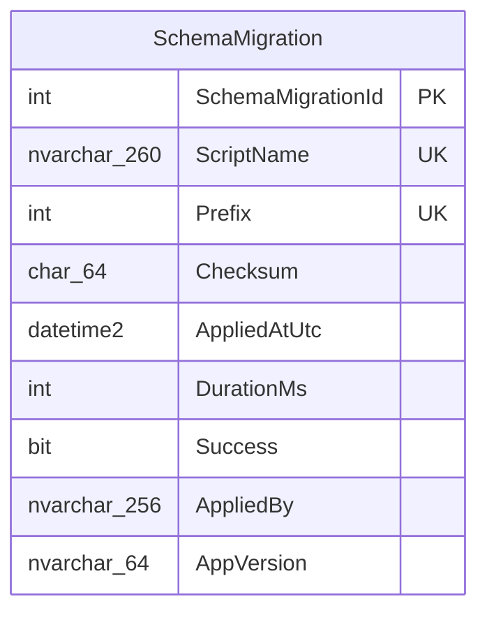
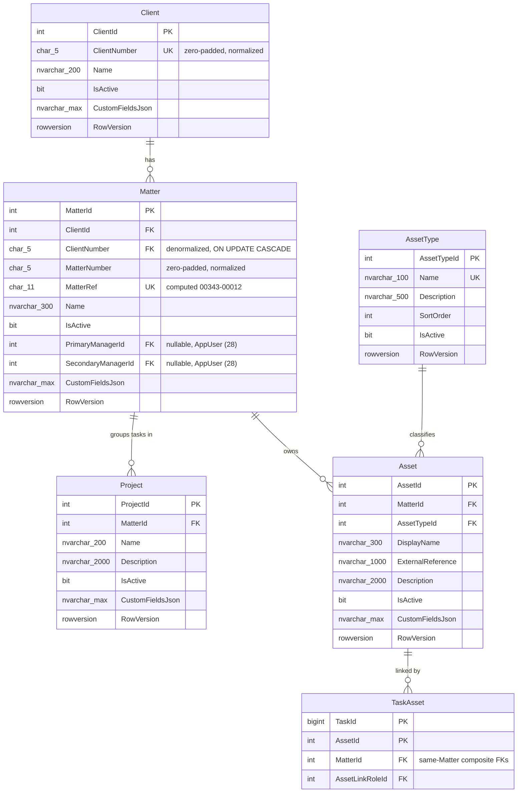
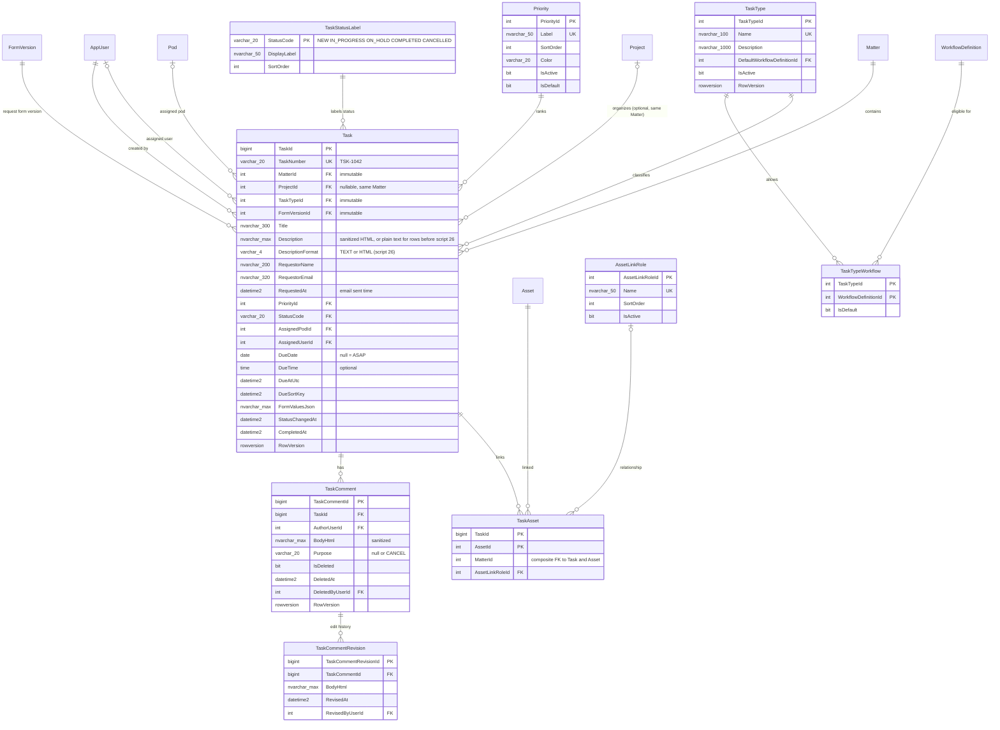
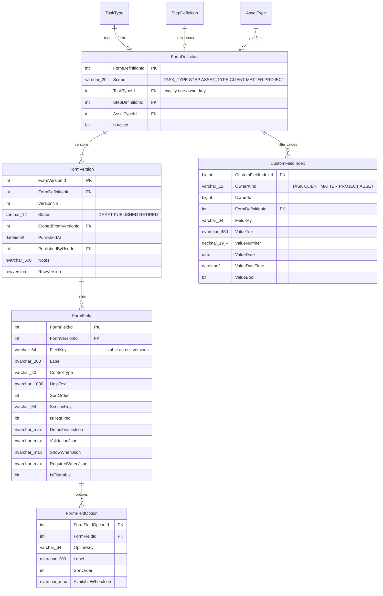
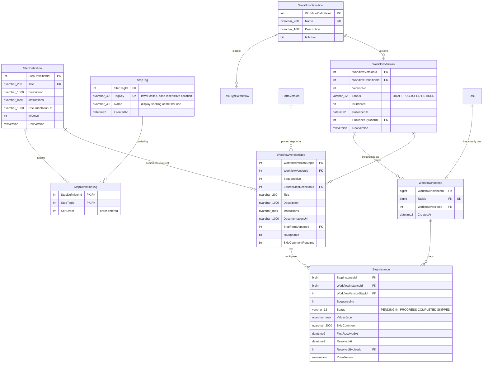
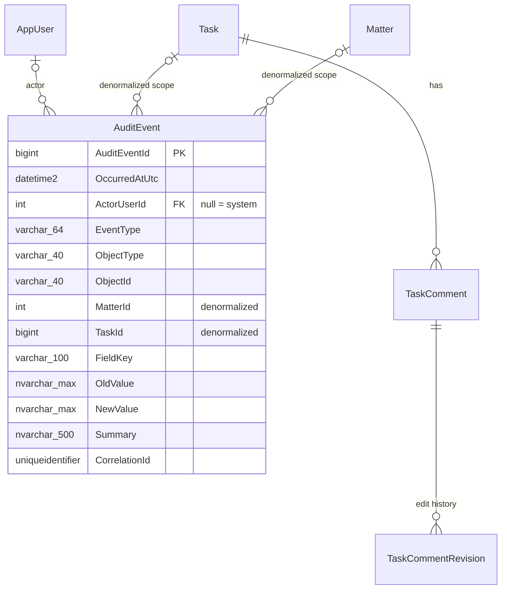

# MatterFlow - Logical ERD

**Status:** v1.0 · **Date:** 2026-10-14 · **Companion to:** `docs/architecture.md`
**Inputs:** `docs/requirements/baseline-v1.1.md`, `docs/requirements/decisions-addendum.md` (overrides the baseline).

**Schema ownership:** the physical DDL lives in **hand-written, numbered SQL scripts** under `db/scripts/` (`01-init.sql`, `02-...sql`, ...), applied at startup by the schema runner described in architecture section 4. **EF Core is used for data access only** (no EF migrations). This document is the logical model those scripts implement; the script plan is in architecture 4.5.

## Table of contents

1. [Conventions](#1-conventions)
2. [Schema management table](#2-schema-management-table)
3. [Organization and Assets](#3-organization-and-assets)
4. [Identity, Authz and Pods](#4-identity-authz-and-pods)
5. [Task core](#5-task-core)
6. [Forms and custom fields](#6-forms-and-custom-fields)
7. [Workflow configuration and instances](#7-workflow-configuration-and-instances)
8. [Audit and Comments](#8-audit-and-comments)
9. [Cross-entity invariants](#9-cross-entity-invariants)
10. [Index summary and query patterns](#10-index-summary-and-query-patterns)
11. [Addendum compliance checklist](#11-addendum-compliance-checklist)

---

## 1. Conventions

- Schema `dbo`. Tables singular PascalCase. PK `<Entity>Id`: `int IDENTITY` for master/config data, `bigint IDENTITY` for high-volume tables (`Task`, `StepInstance`, `TaskComment`, `AuditEvent`, `CustomFieldIndex`).
- Standard columns on mutable entities (omitted from the tables below unless special): `CreatedAt datetime2 NOT NULL` (UTC), `CreatedByUserId int NULL FK AppUser`, `ModifiedAt`, `ModifiedByUserId`. `RowVersion rowversion NOT NULL` is listed where present.
- All timestamps UTC `datetime2(3)` (or `(7)` for `DueSortKey` where noted). Booleans `bit`. Text `nvarchar`. Business numbers `char(5)`.
- Constraint names: `PK_`, `FK_`, `UQ_`, `CK_`, `IX_`, `DF_`, `TR_`. Cascade deletes are avoided (`NO ACTION`); records are deactivated, not deleted. Child rows that are pure parts of an aggregate (`FormField` of a DRAFT version, `PodMember`) may delete explicitly through the app.
- JSON columns are `nvarchar(max)` with `CHECK (ISJSON(col) = 1)`.
- Diagram legend: `PK`, `FK`, `UK`. Type names like `char(5)` are logical; comma-containing types are written with underscores.
- Cross-module FKs are configured in `MatterFlow.Data`; there are no cross-module navigations in code (architecture 5.2).

---

## 2. Schema management table

Created and maintained by the schema runner (not by a numbered script). See architecture 4.2 for behavior (discovery, ordered execution, `sp_getapplock`, checksum and duplicate-prefix checks, GO splitting, fail-fast).

| Column | Type | Null | Notes |
|---|---|---|---|
| SchemaMigrationId | int identity | no | PK `PK_SchemaMigration` |
| ScriptName | nvarchar(260) | no | e.g. `04-organization.sql`; UNIQUE `UQ_SchemaMigration_Name` |
| Prefix | int | no | numeric prefix (`04` -> 4); UNIQUE `UQ_SchemaMigration_Prefix` (guards duplicate prefixes at DB level too) |
| Checksum | char(64) | no | SHA-256 hex of normalized content; mismatch on an applied script fails startup |
| AppliedAtUtc | datetime2(3) | no | default `SYSUTCDATETIME()` |
| DurationMs | int | no | |
| Success | bit | no | only `1` rows count as applied; `0` rows (from `-- mf:no-transaction` scripts) block startup until fixed by an operator |
| AppliedBy | nvarchar(256) | yes | `SUSER_SNAME()` |
| AppVersion | nvarchar(64) | yes | assembly informational version |

No FKs; no EF entity relationships (the runner uses plain ADO.NET, and the table is excluded from the audit interceptor). Not part of any module.

---

## 3. Organization and Assets

### Client
| Column | Type | Null | Notes |
|---|---|---|---|
| ClientId | int identity | no | PK; immutable internal key |
| ClientNumber | char(5) | no | **normalized zero-padded** (input `343` -> `00343`); UNIQUE `UQ_Client_Number`; CHECK `CK_Client_Number`: `ClientNumber NOT LIKE '%[^0-9]%' AND LEN(ClientNumber)=5` (digits only, length 5) |
| Name | nvarchar(200) | no | |
| IsActive | bit | no | default 1; deactivation allowed only when all its Matters are inactive (app rule) |
| CustomFieldsJson | nvarchar(max) | yes | **Unused (ticket 59):** kept nullable to avoid a destructive script. The values of the CLIENT custom-field form are stored by the forms value store in `FormValueSet` (OwnerKind CLIENT) with the form version captured at save time |
| RowVersion | rowversion | no | |

Also: UNIQUE `(ClientId, ClientNumber)` `UQ_Client_IdNumber` - target of the Matter composite FK. Index `IX_Client_Name (Name)`.

### Matter
| Column | Type | Null | Notes |
|---|---|---|---|
| MatterId | int identity | no | PK |
| ClientId | int | no | |
| ClientNumber | char(5) | no | denormalized copy; composite FK `FK_Matter_Client (ClientId, ClientNumber) -> Client(ClientId, ClientNumber) ON UPDATE CASCADE` guarantees it always equals the Client's number |
| MatterNumber | char(5) | no | normalized zero-padded; CHECK digits-only length 5; UNIQUE `UQ_Matter_ClientMatterNumber (ClientId, MatterNumber)` |
| MatterRef | char(11) | no | **persisted computed** `ClientNumber + '-' + MatterNumber`; UNIQUE `UQ_Matter_Ref` (also implied by the above; makes `00343-00012` lookups one seek). Not an independently entered business identifier. |
| Name | nvarchar(300) | no | |
| IsActive | bit | no | default 1. Set to 0 only if no Task of the Matter is in NEW/IN_PROGRESS/ON_HOLD (app rule + Matter row lock) |
| PrimaryManagerId, SecondaryManagerId | int | yes | script 28 (epic #667). Optional Primary and Secondary project manager, FKs to `AppUser` (no cascade, like the other user references); `CK_Matter_ManagersDiffer` rejects the same user in both. A matter without a manager is normal (existing rows stay NULL), a Secondary without a Primary is allowed. Who may be named (active user holding `Matter.BeManager`) is an API rule, so a manager who later loses the role stays. |
| CustomFieldsJson, RowVersion | | | |

Indexes: `IX_Matter_Client (ClientId, IsActive)`, `IX_Matter_Name (Name)`, filtered `IX_Matter_PrimaryManager (PrimaryManagerId) INCLUDE (IsActive) WHERE PrimaryManagerId IS NOT NULL` and the same for `IX_Matter_SecondaryManager`.

### Project
| Column | Type | Null | Notes |
|---|---|---|---|
| ProjectId | int identity | no | PK |
| MatterId | int | no | FK -> Matter |
| Name | nvarchar(200) | no | UNIQUE `UQ_Project_MatterName (MatterId, Name)` |
| Description | nvarchar(2000) | yes | |
| IsActive | bit | no | archived = 0; inactive Project cannot receive new Tasks |
| CustomFieldsJson, RowVersion | | | |

Also: UNIQUE `UQ_Project_IdMatter (ProjectId, MatterId)` - target of `Task` composite FK. Flat (no parent column).

### AssetType
`AssetTypeId` PK; `Name` UNIQUE; `Description`; `SortOrder`; `IsActive`; `RowVersion`. Its type-specific fields are the `FormDefinition` with `AssetTypeId = this` (section 6), created with the type.

### Asset
| Column | Type | Null | Notes |
|---|---|---|---|
| AssetId | int identity | no | PK |
| MatterId | int | no | **NOT NULL**: exactly one owning Matter; no Client ownership, no sharing |
| AssetTypeId | int | no | FK -> AssetType |
| DisplayName | nvarchar(300) | no | |
| ExternalReference | nvarchar(1000) | yes | URL, workspace id, media label |
| Description | nvarchar(2000) | yes | |
| IsActive | bit | no | |
| CustomFieldsJson | nvarchar(max) | yes | **Not created (script 10):** the values of the Asset Type's form are stored by the forms value store in `FormValueSet` (OwnerKind ASSET) with the form version captured at save time |
| RowVersion | rowversion | no | |

Also: UNIQUE `UQ_Asset_IdMatter (AssetId, MatterId)` - target of `TaskAsset` composite FK. Indexes: `IX_Asset_Matter (MatterId, AssetTypeId) INCLUDE (DisplayName, IsActive)`, `IX_Asset_Name (DisplayName)`, `IX_Asset_Type (AssetTypeId)`. `ExternalReference` is not indexed (1000-char free text exceeds the index key limit); search by it is a bounded contains scan inside one Matter (200-300 assets). Trigger `TR_Asset_Guard` rejects any change of `MatterId` and any hard delete.

### TaskAsset
Defined with the Task core (section 5) because it is bound to `Task`; shown here for the Asset side.

---

## 4. Identity, Authz and Pods

```mermaid
erDiagram
  AppUser ||--o{ UserIdentity : "signs in as"
  AppUser ||--o{ UserRole : "holds"
  Role ||--o{ UserRole : "granted via"
  Role ||--o{ RolePermission : "contains"
  Permission ||--o{ RolePermission : "granted by"
  Pod ||--o{ PodMember : "has"
  AppUser ||--o{ PodMember : "belongs to"
  AppUser ||--o| UserPreference : "has"
  AppUser ||--o| UserAvailability : "has (script 22)"
  AppUser ||--o{ UserWorkHour : "works (script 22)"

  AppUser {
    int UserId PK
    nvarchar_200 DisplayName
    nvarchar_320 Email
    bit IsActive
    datetime2 BootstrapAppliedAt
    datetime2 LastLoginAt "obsolete since script 13; see UserIdentity.LastLoginAt"
    rowversion RowVersion
  }
  UserIdentity {
    int UserIdentityId PK
    int UserId FK
    varchar_20 Provider "Windows or Dev or Entra"
    varchar_64 TenantId "empty for Windows"
    nvarchar_200 ProviderSubject "SID or oid"
    nvarchar_256 Username "DOMAIN-sam display"
    bit IsActive
    datetime2 VerifiedAt
    datetime2 LastLoginAt "throttled sign-in stamp (script 13)"
  }
  Role {
    int RoleId PK
    nvarchar_100 Name UK
    nvarchar_500 Description
    bit IsSystemAdmin "built-in, locked"
    bit IsActive
    rowversion RowVersion
  }
  Permission {
    int PermissionId PK
    varchar_64 Code UK
    varchar_40 GroupName
    nvarchar_300 Description
    bit IsActive
  }
  RolePermission {
    int RoleId PK
    int PermissionId PK
  }
  UserRole {
    int UserId PK
    int RoleId PK
    datetime2 GrantedAt
    int GrantedByUserId FK
  }
  Pod {
    int PodId PK
    nvarchar_100 Name UK
    nvarchar_500 Description
    bit IsActive
    rowversion RowVersion
  }
  PodMember {
    int PodId PK
    int UserId PK
    bit IsPrimary "one primary pod per user"
  }
  UserPreference {
    int UserId PK
    nvarchar_max PreferencesJson
  }
  UserAvailability {
    int UserId PK "FK AppUser"
    varchar_20 Status "AVAILABLE or OUT_OF_OFFICE"
    date OutOfOfficeFromDate
    date OutOfOfficeUntilDate "CHECK until >= from"
    nvarchar_200 Note "plain text"
    varchar_64 TimeZoneId "IANA; NULL = Firm:TimeZoneId"
    bit HasCustomWorkHours
    datetime2 UpdatedAtUtc
    int UpdatedByUserId FK
    rowversion RowVersion
  }
  UserWorkHour {
    int UserId PK
    tinyint DayOfWeek PK "ISO 1 Mon to 7 Sun"
    time StartTime
    time EndTime "CHECK End > Start"
  }
```

| Entity | Key columns and constraints | Notes |
|---|---|---|
| AppUser | PK `UserId`; `DisplayName` not null; `Email` null; `IsActive` default 1; `BootstrapAppliedAt` null; `LastLoginAt` (obsolete, no longer written: the last sign-in lives on `UserIdentity.LastLoginAt` since script 13, so that sign-in bookkeeping never changes the row version an administrator edits, SEC-13); `RowVersion` | Referenced by every actor/assignee FK. "Access Pending" = no effective permissions (derived, not stored). Never deleted. Index `IX_AppUser_Display (DisplayName)`. |
| UserIdentity | PK `UserIdentityId`; FK `UserId`; UNIQUE `UQ_UserIdentity_Provider (Provider, TenantId, ProviderSubject)`; CHECK `Provider IN ('Windows','Dev','Entra')`; `TenantId` NOT NULL default `''` (so uniqueness works for Windows) | `LastLoginAt` (script 13) is the throttled last-sign-in stamp. Windows subject = SID (a host that supplies no SID falls back to the upper-cased account name and the API logs a warning). Entra later: `(Entra, tid, oid)` linked to an **existing** `UserId` by admin review; never auto-merged on name/email. Index `IX_UserIdentity_User (UserId)`, `IX_UserIdentity_Username (Username)`. |
| Role | PK `RoleId`; UNIQUE `Name`; `IsSystemAdmin` bit; filtered UNIQUE index `UQ_Role_SystemAdmin (IsSystemAdmin) WHERE IsSystemAdmin = 1` | Pod Lead, Director, etc. are rows here (no Pod Lead flag anywhere). The System Admin row is locked: rename/delete/permission-edit blocked in app; it has implicit all permissions. |
| Permission | PK `PermissionId`; UNIQUE `Code` | Synced from `contracts/permissions.json` at startup. |
| RolePermission | PK `(RoleId, PermissionId)`; FKs | |
| UserRole | PK `(UserId, RoleId)`; FKs; `GrantedAt`, `GrantedByUserId` | Multiple roles per user, additive. Index `IX_UserRole_Role (RoleId)`. |
| Pod | PK `PodId`; UNIQUE `Name` | |
| PodMember | PK `(PodId, UserId)`; filtered UNIQUE `UQ_PodMember_Primary (UserId) WHERE IsPrimary = 1` | A user can be in many Pods; at most one primary (default filter in Pod Work). No lead flag (Pod Lead is a role). Index `IX_PodMember_User (UserId)`. |
| UserPreference | PK/FK `UserId`; `PreferencesJson` (column layouts, saved filters) | |
| UserAvailability | PK/FK `UserId` (script 22); `Status` CHECK `IN ('AVAILABLE','OUT_OF_OFFICE')`; CHECK `OutOfOfficeUntilDate >= OutOfOfficeFromDate` when both set; `Note` nvarchar(200); `TimeZoneId` IANA id or NULL (firm zone); `HasCustomWorkHours`; `UpdatedAtUtc`, `UpdatedByUserId`; `RowVersion` | Optional, at most one row per user; no row = available, default hours, firm zone. Out of office with no dates lasts until the user sets Available again; with dates it runs from the start of the From date (or now) to the end of the Until date in the user's zone. Edited by the user or, on behalf, by `User.Manage`; every change audited (`USER_AVAILABILITY_CHANGED`, `USER_WORK_HOURS_CHANGED`, `USER_TIME_ZONE_CHANGED`). Operational capacity only, never a performance measure. Index `IX_UserAvailability_Status`. |
| UserWorkHour | PK `(UserId, DayOfWeek)`; FK `UserId`; `DayOfWeek` 1-7 (Monday = 1); CHECK `EndTime > StartTime` | Rows exist only when `UserAvailability.HasCustomWorkHours = 1`: one row per working day, a weekday without a row is a day off (a custom schedule with no rows = no working days). Without custom hours the default Mon-Fri 09:00-17:00 in the user's zone applies. Times are local wall-clock; DST is handled when evaluated. |

Invariant (app): the last active System Admin cannot be disabled or unassigned (`LAST_ADMIN`). Offboarding: set `AppUser.IsActive = 0` and `UserIdentity.IsActive = 0`; assigned Tasks remain assigned until an admin reassigns them manually; the Queue assignee filter includes inactive users.

---

## 5. Task core

### Task
| Column | Type | Null | Notes |
|---|---|---|---|
| TaskId | bigint identity | no | PK |
| TaskNumber | varchar(20) | no | `'TSK-' + CAST(NEXT VALUE FOR dbo.TaskNumberSeq AS varchar)`; UNIQUE `UQ_Task_Number` |
| MatterId | int | no | FK -> Matter; **immutable** |
| ProjectId | int | yes | optional; composite FK `(ProjectId, MatterId) -> Project(ProjectId, MatterId)`; may change within the Matter |
| TaskTypeId | int | no | FK -> TaskType; **immutable** |
| FormVersionId | int | no | FK -> FormVersion (the Task Type form version at creation); **immutable** |
| Title | nvarchar(300) | no | |
| Description | nvarchar(max) | yes | sanitized rich text (basic formatting and tables, decision R) when `DescriptionFormat = 'HTML'`; plain text when `'TEXT'` |
| DescriptionFormat | varchar(4) | no | `'TEXT'` (default; every row before script 26, shown escaped) or `'HTML'` (new and edited descriptions); `CK_Task_DescriptionFormat`; script 26 |
| RequestorName | nvarchar(200) | **no** | required (addendum C). Not an app user. |
| RequestorEmail | nvarchar(320) | yes | CHECK `RequestorEmail LIKE '%_@_%'` when not null |
| RequestedAt | datetime2(3) | yes | sent time from the source email, or null |
| PriorityId | int | no | FK -> Priority |
| StatusCode | varchar(20) | no | FK -> TaskStatusLabel; default `'NEW'`; CHECK `IN ('NEW','IN_PROGRESS','ON_HOLD','COMPLETED','CANCELLED')` |
| AssignedPodId | int | yes | FK -> Pod |
| AssignedUserId | int | yes | FK -> AppUser; no requirement to be a member of the assigned Pod |
| DueDate | date | yes | floating calendar date; null = ASAP, never overdue |
| DueAtUtc | datetime2(3) | yes | absolute due instant, set only when the user chose a time (addendum M); CHECK `DueAtUtc IS NULL OR DueDate IS NOT NULL` |
| DueSortKey | datetime2(3) | yes | ordering only: `DueAtUtc`, else `DueDate` 23:59:59 treated as UTC. Exact overdue is computed at query time in the viewer's timezone (addendum M); CHECK `(DueDate IS NULL) = (DueSortKey IS NULL)` |
| FormValuesJson | nvarchar(max) | yes | values per the pinned Task Type form version; ISJSON check |
| IsMatterSensitive | bit | no | **denormalised copy of `Matter.IsSensitive`**, default 0, never written by the application (script 37, issue #810): `TR_Matter_SensitivityToTask` copies a change of the matter's flag to its tasks, `TR_Task_MatterSensitivityInsert` sets it for new tasks. The sensitive-matter rule tests it instead of joining the matter (`docs/ux/sensitive-matters/README.md`, `docs/qa/sensitive-matters-performance.md`) |
| AssignedAt | datetime2(3) | yes | when the current `AssignedUserId` was assigned; NULL while no user is assigned; Pod-only changes do not move it (script 20) |
| StatusChangedAt | datetime2(3) | no | |
| CompletedAt | datetime2(3) | yes | set on COMPLETED, cleared on leaving it |
| CreatedAt/By, ModifiedAt/By | | | |
| RowVersion | rowversion | no | |

Keys and constraints:
- UNIQUE `UQ_Task_IdMatter (TaskId, MatterId)` - target of the `TaskAsset` composite FK.
- `FK_Task_Project_SameMatter (ProjectId, MatterId) -> Project (ProjectId, MatterId)`: SQL Server skips a composite FK when any column is NULL, so Tasks without a Project are valid while a Project of another Matter is rejected.
- `TR_Task_Immutable` (AFTER UPDATE): raises error if `MatterId`, `TaskTypeId`, `FormVersionId` or `TaskNumber` changed (defense in depth; the API has no such input).
- Indexes (queue/My Work/Pod Work/dashboard/search): `IX_Task_Queue (StatusCode, PriorityId, DueSortKey, CreatedAt) INCLUDE (MatterId, AssignedUserId, AssignedPodId, TaskTypeId, DueDate, DueAtUtc, IsMatterSensitive)`; `IX_Task_AssignedUser (AssignedUserId, StatusCode) INCLUDE (PriorityId, DueSortKey, DueDate, DueAtUtc, CreatedAt, StatusChangedAt, MatterId, IsMatterSensitive)`; `IX_Task_Pod (AssignedPodId, StatusCode) INCLUDE (AssignedUserId, PriorityId, DueSortKey, DueDate, DueAtUtc, CreatedAt, MatterId, IsMatterSensitive)` (widened by `18-performance-indexes.sql` so the overdue rule, which reads `DueDate` and `DueAtUtc`, is answered from the index); `IX_Task_Matter (MatterId, StatusCode)`; `IX_Task_Project (ProjectId) WHERE ProjectId IS NOT NULL`; `IX_Task_Creator (CreatedByUserId, CreatedAt) INCLUDE (StatusCode, MatterId, AssignedUserId, IsMatterSensitive)`; `IX_Task_StatusChanged`, `IX_Task_CreatedAt` and `IX_Task_CompletedCoverage` carry `MatterId, AssignedUserId, IsMatterSensitive` too (script 37, so the rule is answered from the index); `IX_Task_AssignedSensitive (AssignedUserId) INCLUDE (MatterId) WHERE IsMatterSensitive = 1 AND AssignedUserId IS NOT NULL`; `IX_Task_Type (TaskTypeId, StatusCode)`; `IX_Task_Completed (CompletedAt) WHERE CompletedAt IS NOT NULL`; `IX_Task_Title (Title)` for prefix search; `IX_Task_Requestor (RequestorName)`.
- Immutable Workflow: the Task's workflow is `WorkflowInstance.WorkflowVersionId` (1:1 by `TaskId`), protected the same way (section 7).
- No attachment table, no source-email table, no global Task custom field definitions exist.

### TaskStatusLabel
Fixed 5 rows seeded in `01-init.sql` (`NEW, IN_PROGRESS, ON_HOLD, COMPLETED, CANCELLED`); admins edit only `DisplayLabel`. Codes are stable and immutable (trigger or app guard blocks insert/delete/code change).

### Priority
`PriorityId`; `Label` UNIQUE; `SortOrder` (lower = more urgent); `Color`; `IsActive`; `IsDefault` with filtered UNIQUE `UQ_Priority_Default (IsDefault) WHERE IsDefault = 1`. Seed: Critical(1), High(2), Normal(3, default), Low(4). Deactivation never invalidates historical Tasks (FK stays).

### TaskType and TaskTypeWorkflow
`TaskType`: `Name` UNIQUE, `Description`, `IconKey` (VARCHAR(50) NOT NULL DEFAULT 'file-text'; a key of the curated icon library `contracts/task-type-icons.json`, validated by the application, script 19; script 21 moved rows off retired keys; see `docs/ux/task-type-icons.md`), `DefaultWorkflowDefinitionId` (nullable; must be among the eligible set - app check), `IsActive`. Its request form is the `FormDefinition` with `TaskTypeId = this`. `TaskTypeWorkflow (TaskTypeId, WorkflowDefinitionId)` PK; at most one `IsDefault = 1` per type (filtered unique index `UQ_TTW_Default (TaskTypeId) WHERE IsDefault = 1`). Eligibility refers to the **definition**; the current PUBLISHED version is resolved at Task creation.

### AssetLinkRole
Lookup (`Name` UNIQUE, `SortOrder`, `IsActive`), seeded: Source, Destination, Subject, Result, Related.

### TaskAsset
| Column | Notes |
|---|---|
| TaskId bigint, AssetId int | composite PK `(TaskId, AssetId)` |
| MatterId int NOT NULL | the shared Matter |
| AssetLinkRoleId int NULL | FK -> AssetLinkRole |
| LinkedAt, LinkedByUserId | |
| FKs | `FK_TaskAsset_Task (TaskId, MatterId) -> Task (TaskId, MatterId)` and `FK_TaskAsset_Asset (AssetId, MatterId) -> Asset (AssetId, MatterId)`: **both rows must have the same MatterId**, so cross-Matter links are impossible at the database level (the API also returns `CROSS_MATTER_REFERENCE`). |
| Index | `IX_TaskAsset_Asset (AssetId)` for "tasks using this asset" |

### TaskComment
| Column | Type | Notes |
|---|---|---|
| TaskCommentId | bigint identity | PK |
| TaskId | bigint | FK -> Task; indexes `IX_TaskComment_Task (TaskId, CreatedAt) WHERE IsDeleted = 0` (the thread) and `IX_TaskComment_TaskAll (TaskId)` (the 2,000-comment limit counts deleted comments too; script 18) |
| AuthorUserId | int | FK -> AppUser |
| BodyHtml | nvarchar(max) | basic formatting (bold, italic, lists, links) and tables (decision R), **sanitized server-side** before storage; no attachments; internal only |
| Purpose | varchar(20) | null or `'CANCEL'` (mandatory cancel comment) |
| IsDeleted, DeletedAt, DeletedByUserId | | **soft delete**: hidden in UI, retained |
| RowVersion | rowversion | |

### TaskCommentRevision
Append-only history of each edit: `BodyHtml` as it was before the edit, `RevisedAt`, `RevisedByUserId`. Index `(TaskCommentId, RevisedAt)`. Created when a comment is edited and when it is deleted (final body).

Task Type / Workflow / Matter immutability summary: no update DTO exposes them; `TR_Task_Immutable`; `TR_WorkflowInstance_Immutable` (see section 7).

---

## 6. Forms and custom fields

| Entity | Constraints and notes |
|---|---|
| FormDefinition | `Scope` CHECK in the six values. Owner keys: `TaskTypeId`, `StepDefinitionId`, `AssetTypeId` nullable FKs; CHECK `CK_FormDefinition_Owner`: Scope `TASK_TYPE` => only `TaskTypeId` set, `STEP` => only `StepDefinitionId`, `ASSET_TYPE` => only `AssetTypeId`, `CLIENT/MATTER/PROJECT` => none set. Filtered UNIQUE indexes enforce one definition per owner: `UQ_FormDef_TaskType (TaskTypeId) WHERE TaskTypeId IS NOT NULL`, same for Step and AssetType; `UQ_FormDef_Singleton (Scope) WHERE Scope IN ('CLIENT','MATTER','PROJECT')`. Created together with its owner. No Scope for global Task fields (addendum F). |
| FormVersion | UNIQUE `(FormDefinitionId, VersionNo)`; filtered UNIQUE `UQ_FormVersion_Published (FormDefinitionId) WHERE Status='PUBLISHED'` and `UQ_FormVersion_Draft (FormDefinitionId) WHERE Status='DRAFT'`; CHECK Status in the three values. Published/retired versions immutable (see triggers). Never deleted once published. |
| FormField | UNIQUE `UQ_FormField_Key (FormVersionId, FieldKey)` and `UQ_FormField_Order (FormVersionId, SortOrder)`; CHECK `FieldKey` pattern (lowercase letters, digits, underscore, starts with a letter) and `ControlType IN ('TEXT','TEXTAREA','NUMBER','CHECKBOX','SELECT','RADIO','MULTISELECT','DATE','DATETIME','URL','ASSET_REF','USER_REF','SECTION_HEADING','HELP_TEXT')` (no file upload); ISJSON checks on JSON columns; `ShowWhenJson`/`RequiredWhenJson` hold the rule tree defined in architecture 7.3. |
| FormFieldOption | UNIQUE `(FormFieldId, OptionKey)`, `(FormFieldId, SortOrder)`. Only for SELECT/RADIO/MULTISELECT (app rule). |
| CustomFieldIndex | Derived, rebuildable. Polymorphic owner (`OwnerKind`, `OwnerId`) with no FK by design (rewritten in the owner's transaction). CHECK exactly one typed value column non-null. Indexes: `IX_CFI_Text (OwnerKind, FormDefinitionId, FieldKey, ValueText) INCLUDE (OwnerId)`, `IX_CFI_Number (..., ValueNumber)`, `IX_CFI_Date (..., ValueDate)`, `IX_CFI_Bool (..., ValueBool)`, `IX_CFI_Owner (OwnerKind, OwnerId)` (to rewrite rows). Max 5 `IsFilterable` fields per form version (publish validation). |

Triggers (defense in depth): `TR_FormVersion_Immutable` (blocks UPDATE of anything except `Status` PUBLISHED->RETIRED, DELETE of non-DRAFT), `TR_FormField_Immutable` and `TR_FormFieldOption_Immutable` (block INSERT/UPDATE/DELETE when the parent version is not DRAFT).

Value storage: JSON on owner rows (`Task.FormValuesJson`, `StepInstance.ValuesJson`); Client, Matter, Project and Asset values live only in `FormValueSet` (the nullable `Client|Matter|Project.CustomFieldsJson` columns are unused, ticket 59) keyed by `FieldKey`; typed copies for filterable fields in `CustomFieldIndex`.

---

## 7. Workflow configuration and instances

| Entity | Constraints and notes |
|---|---|
| StepDefinition | Library template; `Title` UNIQUE among active. Owns a step `FormDefinition`. **Editing never changes published workflow versions** because `WorkflowVersionStep` copies the text fields and pins a published form version (addendum A). |
| StepTag | One row per distinct tag (script 23). `TagKey` is the normalised, lower-cased text with an explicit case-insensitive collation (`Latin1_General_100_CI_AS`) and `UQ_StepTag_Key`, so "relativity" and "Relativity" are one tag across steps; `Name` keeps the display spelling of the first use. CHECKs: key and name not blank. The application deletes a tag when no step carries it any more. |
| StepDefinitionTag | Link table, PK `(StepDefinitionId, StepTagId)` (a step has a tag at most once), FKs to `StepDefinition` and `StepTag`, `SortOrder` (CHECK >= 0) keeps the order the admin entered. `IX_StepDefinitionTag_Tag (StepTagId, StepDefinitionId)` answers the tag filter and usage counts. Tags are library metadata: `WorkflowVersionStep` has no tag column, so tags are not part of a published version snapshot. Rules (trim, collapse whitespace, 40 characters, 20 per step, no control characters) are enforced by the application (`StepTagRules`); changes are audited as a `FIELD_CHANGED` event with field `Tags`. |
| WorkflowDefinition | `Name` UNIQUE. Reusable across Task Types (via `TaskTypeWorkflow`). |
| WorkflowVersion | UNIQUE `(WorkflowDefinitionId, VersionNo)`; filtered UNIQUE one PUBLISHED and one DRAFT per definition; CHECK Status. Published/retired immutable (`TR_WorkflowVersion_Immutable`, same pattern as forms). |
| WorkflowVersionStep | UNIQUE `(WorkflowVersionId, SequenceNo)` (1..n contiguous, validated at publish); `StepFormVersionId` NULL or a PUBLISHED FormVersion of a STEP definition (checked at publish; immutable afterwards). `SourceStepDefinitionId` is informational. Ordered/unordered is `IsOrdered` on the version. `SkipCommentRequired` implies `IsSkippable` (CHECK). No assignee, no approval columns. |
| WorkflowInstance | UNIQUE `UQ_WorkflowInstance_Task (TaskId)` (exactly one per Task); FK to the pinned `WorkflowVersion`; `TR_WorkflowInstance_Immutable` blocks changing `TaskId`/`WorkflowVersionId`. The pinned version row cannot be deleted. |
| StepInstance | UNIQUE `(WorkflowInstanceId, WorkflowVersionStepId)` and `(WorkflowInstanceId, SequenceNo)`; CHECK Status in the four values; CHECK `SkipComment IS NULL OR Status IN ('SKIPPED','IN_PROGRESS')`-style rule is left to the app (a reopened skipped step keeps its comment). `FirstResolvedAt` is set once and drives the ordering guard (re-resolution of a previously resolved step is not blocked by an unresolved earlier step). `ValuesJson` validated against the version's pinned form. No assignee column. Indexes: `IX_StepInstance_Workflow (WorkflowInstanceId, SequenceNo)`, `IX_StepInstance_Status (Status) WHERE Status IN ('PENDING','IN_PROGRESS')` for current-step display. |

`TaskTypeWorkflow` is shown in section 5. Eligible Workflows reference definitions; a Task chooses exactly one at creation. No schema change backs the Task Types page tabs: the cross-links read `TaskTypeWorkflow` (task types of a workflow, workflows of a task type) and `WorkflowVersionStep.SourceStepDefinitionId` through `WorkflowVersion` (workflows that use a step, counted distinct), answered by the existing indexes `IX_TaskTypeWorkflowEligibility_Workflow` and `IX_WVS_Source`.

---

## 8. Audit and Comments

| Column | Type | Null | Notes |
|---|---|---|---|
| AuditEventId | bigint identity | no | PK |
| OccurredAtUtc | datetime2(3) | no | |
| ActorUserId | int | yes | FK -> AppUser; null for system/bootstrap |
| EventType | varchar(64) | no | e.g. `TASK_CREATED`, `TASK_STATUS_CHANGED`, `TASK_ASSIGNED`, `STEP_REOPENED`, `FIELD_CHANGED`, `COMMENT_EDITED`, `ROLE_GRANTED`, `USER_PROVISIONED`, `FORM_PUBLISHED` |
| ObjectType / ObjectId | varchar(40) / varchar(40) | no | target entity (string id keeps the table generic) |
| MatterId, TaskId | int / bigint | yes | **no FKs** (audit must outlive references and avoid lock coupling); indexed for scoped reads |
| FieldKey | varchar(100) | yes | property name or `form:<fieldKey>` |
| OldValue, NewValue | nvarchar(max) | yes | full values; display truncated |
| Summary | nvarchar(500) | yes | human-readable line (cause, e.g. `STEP_REOPEN`) |
| CorrelationId | uniqueidentifier | no | one per request/SaveChanges |

Indexes: `IX_Audit_Task (TaskId, AuditEventId)`, `IX_Audit_Matter (MatterId, AuditEventId)`, `IX_Audit_Object (ObjectType, ObjectId, AuditEventId)`, `IX_Audit_Time (OccurredAtUtc)`, `IX_Audit_Actor (ActorUserId, AuditEventId)`.
Permissions (`13-security-hardening.sql`, security review SEC-04): the database roles `mf_app` and `mf_migrator` have `INSERT, SELECT` only, with `DENY UPDATE, DELETE` (and `DENY ALTER` for `mf_app`, which also denies TRUNCATE and trigger changes); the INSTEAD OF trigger rejects UPDATE/DELETE for everybody; the empty `dbo.AuditEventGuard` table references the table so `TRUNCATE TABLE` is impossible even for sysadmin; a database DDL trigger refuses DROP TABLE of the audit tables and DROP/ALTER of the append-only trigger. Written in the same transaction as the audited change. Column text is clipped to the column widths before saving (SEC-20). `dbo.SeedMarker (Name, AppliedAt)` records one-time startup seeds (starter roles, SEC-18). Retention/purge policy open. Comments and cancel comments are in `TaskComment` (section 5); comment edits also emit `COMMENT_EDITED` audit events. Read-access logging is not implemented (addendum F).

---

## 9. Cross-entity invariants

| # | Invariant | Enforced by |
|---|---|---|
| I-1 | Client Number globally unique, normalized to 5 zero-padded digits; Matter Number unique per Client | `UQ_Client_Number`, `UQ_Matter_ClientMatterNumber`, digit-only CHECKs, `BusinessNumber` normalization in API (1-5 digits in, padded out; >5 digits or non-digits rejected) |
| I-2 | `Matter.ClientNumber` always equals its Client's number; `MatterRef = ClientNumber-MatterNumber` | composite FK `(ClientId, ClientNumber)` with `ON UPDATE CASCADE`; persisted computed column |
| I-3 | A Task's Project belongs to the Task's Matter | composite FK `(ProjectId, MatterId) -> Project(ProjectId, MatterId)` (NULL ProjectId allowed) |
| I-4 | A TaskAsset's Task and Asset belong to the same Matter | two composite FKs on `(TaskId, MatterId)` and `(AssetId, MatterId)` |
| I-5 | An Asset has exactly one Matter | `Asset.MatterId NOT NULL`, no Client/shared owner column |
| I-6 | Task Type, Workflow and Matter never change after create; Project may change within the Matter | no update DTO fields; `TR_Task_Immutable`, `TR_WorkflowInstance_Immutable`; I-3 |
| I-7 | Exactly one WorkflowInstance per Task, pinned to an immutable published version | `UQ_WorkflowInstance_Task`; version immutability triggers |
| I-8 | Published form/workflow versions never change; at most one DRAFT and one PUBLISHED per definition | filtered unique indexes; immutability triggers; app publish validator |
| I-9 | A Task is created only on an active Matter (and active Project); a Matter becomes inactive only when all Tasks are COMPLETED/CANCELLED; reopening is blocked while inactive | application services with `UPDLOCK` on the Matter row (cannot be a pure constraint); integration tests |
| I-10 | Task lifecycle transitions follow the matrix (architecture 8.3); editing Completed/Cancelled Tasks is blocked until reopened | `TaskLifecycle` domain function + CHECK on valid status codes; unit tests per matrix cell |
| I-11 | Ordered workflows: a never-resolved step cannot progress until all earlier steps are resolved; previously resolved steps may be re-resolved after reopen | `StepInstance.FirstResolvedAt` + step state machine under the per-Task lock |
| I-12 | Task completion requires all steps resolved (SKIPPED only if skippable); Cancel requires a comment and ignores step state | `COMPLETION_BLOCKED` check in the same transaction; `TaskComment.Purpose = 'CANCEL'` |
| I-13 | Form values reference only fields of the Task's pinned form version; ASSET_REF values must belong to the Task's Matter | form validator; `CROSS_MATTER_REFERENCE` |
| I-14 | Priority required; at most one default Priority; no hard delete of referenced lookups | `Task.PriorityId NOT NULL`, filtered unique index, `NO ACTION` FKs |
| I-15 | Requestor Name required, Requestor Email optional | `Task.RequestorName NOT NULL`; email CHECK |
| I-16 | No attachments or source-email storage anywhere | no such tables/columns exist; no File Upload control type; intake endpoint stores nothing |
| I-17 | All actor/assignee references use `AppUser.UserId`; external identities live in `UserIdentity` | FKs to `AppUser`; unique `(Provider, TenantId, ProviderSubject)` |
| I-18 | Audit rows are append-only and written with the change | `DENY UPDATE/DELETE`; same-transaction `SaveChanges` |
| I-19 | Last System Admin cannot be removed; System Admin role is locked | application guard; filtered unique index on `IsSystemAdmin` |
| I-20 | Soft-deleted comments are retained; edits keep revisions | `IsDeleted` flag; `TaskCommentRevision` append-only |

---

## 10. Index summary and query patterns

| Query | Supporting index |
|---|---|
| Task Queue default sort (priority, ASAP first, deadline, oldest) | `IX_Task_Queue`; sort expression `PriorityId order -> (DueDate IS NULL) DESC -> DueSortKey -> CreatedAt` joined to `Priority.SortOrder` |
| My Work (assigned to me, active) | `IX_Task_AssignedUser` |
| My Work "Created by me" | `IX_Task_Creator` |
| Pod Work (assigned to Pod, not individual) | `IX_Task_Pod` |
| Dashboard counts by status/Pod/Type/Priority | `IX_Task_Queue`, `IX_Task_Pod`, `IX_Task_Type`, `IX_Task_Completed` |
| Matter detail (projects, tasks, assets) | `IX_Task_Matter`, `IX_Project` unique name index, `IX_Asset_Matter` |
| Lookup by `343` / `00343-00012` / `343-12` | `UQ_Client_Number`, `UQ_Matter_Ref` after padding |
| Global search by name/title/reference | `IX_Client_Name`, `IX_Matter_Name`, `IX_Task_Title`, `IX_Asset_Name`, `IX_Asset_ExternalRef` (prefix seeks; contains is a scan, compared as `LOWER(column) COLLATE Latin1_General_100_BIN2` for Assets, Tasks and the audit text, about five times cheaper than the case-insensitive collation; see `docs/qa/performance-round-1.md`) |
| Custom-field filters | `IX_CFI_*` |
| Task Activity tab | `IX_Audit_Task` |
| Permission check | `IX_UserRole_Role`, PK lookups, cached per user |

Sizing (addendum H): 200-300 users, a few thousand Tasks per year, 200-300 Assets per Matter; no partitioning or full-text required.

---

## 11. Addendum compliance checklist

| Addendum item | Where satisfied |
|---|---|
| Normalized zero-padded 5-char Client/Matter numbers, uniqueness on the padded value | Client, Matter (section 3), I-1 |
| Requestor Name (required) / Email (optional) on Task | Task (section 5) |
| No attachments table, no file upload control, no source-email storage | I-16; `FormField.ControlType` list |
| No global Task custom fields (per-Task-Type forms only) | `FormDefinition.Scope` list |
| Task Type / Workflow / Matter immutable; Project changeable within Matter | I-3, I-6 |
| Comments: sanitized rich text, soft delete, edit history, internal only | TaskComment, TaskCommentRevision |
| Cancel requires comment; reopen rules; step reopen moves Task | `Purpose='CANCEL'`, I-10, I-11; architecture 8.3 |
| Due date optional with optional time, firm timezone, UTC storage, ASAP never overdue | `DueDate`, `DueAtUtc`, `DueSortKey` |
| Pod Lead is a role; no per-Pod lead flag | `PodMember` has no lead column |
| Phase 1 visibility: `Task.View` sees all; no ACL tables | no ACL/ethical-wall entities |
| Step library edits do not change published workflows | `WorkflowVersionStep` copies + pinned form version |
| Hand-written numbered SQL scripts; migration tracking table; EF for data access only (section J) | section 2 `SchemaMigration`; architecture section 4 |
