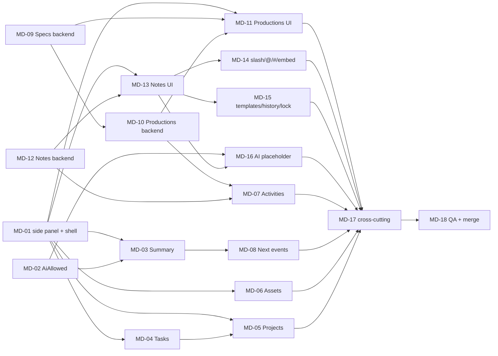

# Matter detail redesign: work plan (epic #1001, branch `matter-detail`)

Written 2026-11-01 (MD-00). Owner decisions: `docs/requirements/decisions-addendum.md` section AQ. Mockups: `docs/ux/mockups/matter-detail/` and `docs/ux/mockups/notes-mockup-r3.html` (branch `matter-detail-mockups`). Progress: `progress.md`.

## 1. Goal and scope

The Matter detail page becomes seven tabs in the new theme: **Summary, Tasks, Projects, Assets, Productions, Notes, Activities**. The Calendar tab is gone. One new Matter field (AI allowed). Create and edit move to the shared right side panel (standard from now on). Productions (with Specs) and Notes are new features with their own backend modules.

Out of scope: Bates overlap check, QC items, production status workflow, any AI function, note attachments, converting other screens to the side panel, new keyboard shortcuts (#420).

## 2. Issues and hours (agent-hours)

| Issue | Code | What | Hours | Agent |
| --- | --- | --- | --- | --- |
| #1002 | MD-01 | Side-panel standard, tab shell, compact header, fixed layout | 10.0 | A |
| #1003 | MD-02 | Matter.AiAllowed (script 51, API, OpenAPI, UI) | 4.0 | A |
| #1004 | MD-03 | Summary tab | 10.0 | A |
| #1005 | MD-04 | Tasks tab restyle, View dropdown | 8.0 | A |
| #1006 | MD-05 | Projects: panel, project task panel, bulk link/unlink | 11.0 | A |
| #1007 | MD-06 | Assets tab restyle | 6.0 | A |
| #1008 | MD-07 | Activities tab restyle | 6.0 | A |
| #1009 | MD-08 | Summary Next events, Add event, My Matters link | 5.0 | A |
| #1010 | MD-09 | Production spec backend (script 52) | 7.0 | B |
| #1011 | MD-10 | Productions backend (script 53) | 9.0 | B |
| #1012 | MD-11 | Productions tab UI and Specs sub-view | 12.0 | B |
| #1013 | MD-12 | Notes backend (scripts 54 to 56) | 12.0 | B |
| #1014 | MD-13 | Notes tab UI | 12.0 | B |
| #1015 | MD-14 | Slash commands, @, #, linked note embed | 10.0 | B |
| #1016 | MD-15 | Templates, history panel, lock UI | 10.0 | B |
| #1017 | MD-16 | AI button placeholder, AI states, warning dialog (flag off) | 5.0 | A |
| #1018 | MD-17 | Cross-cutting: OpenAPI/nswag, permissions, report access, e2e, a11y, docs | 10.0 | both |
| #1019 | MD-18 | Full QA, rebase on `dev`, merge | 14.0 | QA |
| | MD-00 | This epic, issues, plan, branch | 3.0 | PM |

Agent A 65.0 h, Agent B 72.0 h, shared 10.0 h, QA 14.0 h, MD-00 3.0 h: **164.0 h**. The earlier mockup estimate was 130 to 165 h; simpler productions (no overlap check, QC or workflow) save about 12 h, templates, lock, history and the embed in Notes add about 10 h. MD-18 is above the 12 h cap like the theme QA issue (#998).

## 3. Dependency graph

Critical path: MD-01 (A) -> MD-13 (B) -> MD-14/15 (B) -> MD-17 -> MD-18. MD-12 (B) must finish before MD-13 starts, so B starts on the backend while A builds MD-01.

## 4. Two-agent split

**Agent A (65.0 h): frontend foundation and the "existing" tabs.** Order: MD-01, MD-02, MD-03, MD-04, MD-05, MD-06, MD-08, MD-16, MD-07 last (needs the new kinds from B). A owns the shared side panel, the tab shell, `theme-guide.md` and the matter detail page files; B adds its tab components inside lazy features and touches the shell only through MD-01's tab registry.

**Agent B (72.0 h): Productions/Specs, then Notes.** Order: MD-09, MD-10, MD-12 (all backend, 28 h, no dependency on A), then MD-11 (when MD-01 is on the branch), MD-13, MD-14, MD-15.

**Shared:** MD-17 is split by side: A does frontend items (e2e, axe, theme guide), B does backend items (OpenAPI, permissions, report access, architecture doc). **QA agent:** MD-18.

**Protocol:** one worktree per agent under `/home/user/wt/`, push to `matter-detail` only (`git push origin HEAD:matter-detail`), rebase before every push, append-only progress notes per agent in `progress.md`, one section per agent. OpenAPI and nswag are regenerated by the agent who changed the API, in the same commit; on a conflict in generated files regenerate, never merge by hand. Shared files (`permissions.json`, `report-access.json`, `ModuleComposition.cs`, `styles.scss`): small commits, rebase first.

## 5. Database scripts (immutable once merged; highest merged is 50)

| Number | Content | Issue | Agent |
| --- | --- | --- | --- |
| 51 | `Matter.AiAllowed` tinyint default 0 + CHECK | MD-02 | A |
| 52 | `ProductionSpec` | MD-09 | B |
| 53 | `Production`, `ProductionComment` | MD-10 | B |
| 54 | `Note`, `NoteTag`, `NoteTagLink`, `NoteLink` | MD-12 | B |
| 55 | `NoteTemplate` (+ tag link) | MD-12 | B |
| 56 | Notes extras only if needed (otherwise unused and not claimed) | MD-12 | B |

Rules: no EF migrations; a mistake after a merge is fixed forward with the next free number (57 and up); no backfill (demo data, owner status 2026-10-24); every new table gets a `db/report-access.json` entry and a GRANT or DENY line in its script; replay test in MD-18 from script 1.

## 6. Module placement decision

- **Matter.AiAllowed, Add event, Next events:** stay in **Organization** (Matter and MatterEvent live there).
- **Asset counts by type:** **Assets** module (owns Asset and AssetType).
- **Bulk link/unlink of tasks to a project:** **WorkManagement** (owns Task; `Task.ProjectId` already there). It validates the project through `IProjectLookup` (Organization.Contracts); no reference to Organization internals.
- **Productions and Specs: new module `MatterFlow.Productions`** (+ `.Contracts`). Reason: own tables, own permissions, own lifecycle, no behaviour shared with Organization beyond "matter exists and is visible" (`IMatterLookup`). Putting them in Organization would grow an already large module and tie their release to Matters. Specs live in the same module as productions because a spec is only used by productions and they share permissions and the retire rule.
- **Notes: new module `MatterFlow.Notes`** (+ `.Contracts`). Reason: it is the largest feature (sanitiser, references, templates, lock), has its own three permissions and tables, and must resolve references to assets, projects, matters, notes and users through Contracts only (`IAssetLookup`, `IProjectLookup`, `IMatterLookup`, `IUserDirectory`). A separate module keeps that dependency list explicit and enforced by `MatterFlow.ArchitectureTests`.
- Both new modules reference only SharedKernel and the Contracts of Organization, Assets, Identity, Audit (Configuration if flags are read); both are registered in `backend/src/MatterFlow.Api/ModuleComposition.cs` and added to the module table and diagram in `docs/architecture.md` (MD-17). Neither is referenced by another module; Activities reads their events through the Audit module.
- **History** for productions, specs and notes uses the Audit module (one source for the panel history and the Activities feed); a dedicated history table is added only if the audit read API cannot filter by object type (decide in MD-10, record here).

## 7. Permissions (proposal, confirmed at build time)

Existing: `Matter.Edit` (edits the matter including AI allowed), `Matter.BeManager` (can open My Matters, shows the calendar link), `Task.Edit` and `Project.Edit` (link tasks). New in `contracts/permissions.json`:

- `Production.View`, `Production.Edit` (create, edit, delete), `Production.Comment`
- `ProductionSpec.View`, `ProductionSpec.Edit` (create, edit, duplicate, retire)
- `MatterNote.View` (shown as Matter Note Read), `MatterNote.Edit`, `MatterNote.Delete`

Lock/unlock needs `MatterNote.Edit`; only the locker or an administrator unlocks. Note templates have three levels (MD-39): System Level (administrators only), Client Level (Client.Edit) and Matter Level (MatterNote.Edit). Sensitive-matter rule on every new endpoint (404 for invisible matters), list and count.

## 8. Cheap checks per issue, one full QA

Per issue: frontend lint, prettier, `tsc` for app, spec and e2e configs, targeted unit tests of the touched folders, bundle gate, contract validation (`node contracts/validate-contracts.mjs`), `dotnet build -warnaserror` of touched projects only, a smoke e2e of the touched tab on a fresh DB at each hand-back. Heavy runs (full integration, full Playwright) only in MD-18.

## 9. Parked and later

Screens that should adopt the side-panel standard later (not converted here): My Matters Add event dialog, Create/Edit task, Clients create/edit, Assets list create/edit, Matters list create, Users, Roles, Pods, admin lookup forms (task types, asset types, labels, custom fields), profile preferences. Production Bates overlap check, QC checklist, status workflow, `/template` slash command, `/task` command, AI check endpoint: later releases.

## 10. Risks and open points

1. Notes size (about 49 h) and editor library choice (bundle gate: lazy chunk, chosen in MD-13).
2. Rebase onto `dev` after the theme merge (shared styles and the side panel).
3. Calendar link for users without My Matters access (#976): link hidden.
4. Feature flag `aiPolicyCheck` must be OFF in every environment.
5. Round 3 of the Matter detail mockups was still being finished when this plan was written: if it changes a decision, update this plan and the affected issues.
6. Permission code names are a proposal; the owner may rename them before MD-09 and MD-12.
