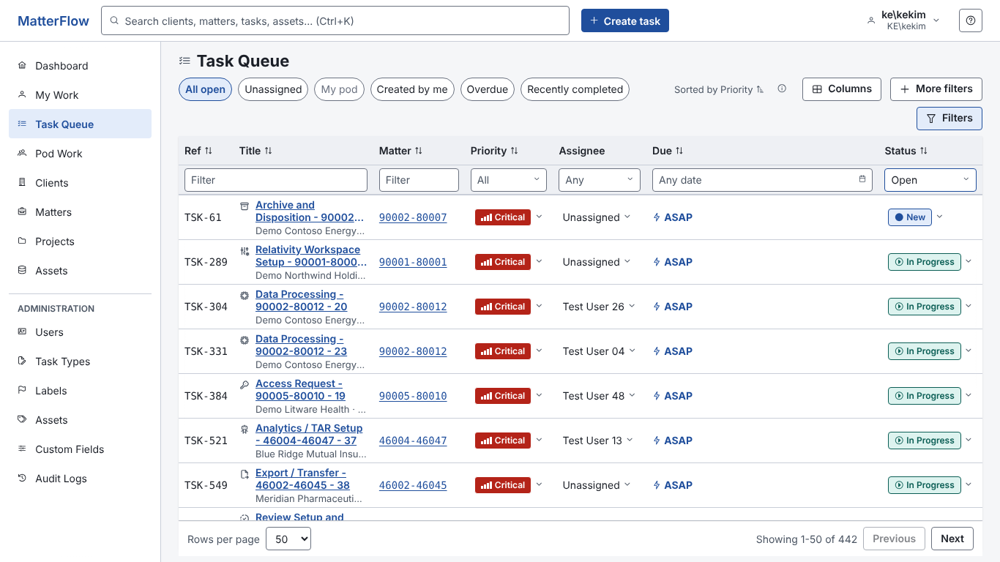
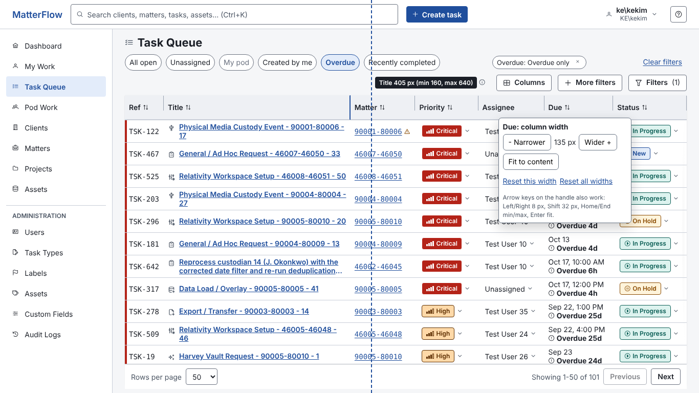
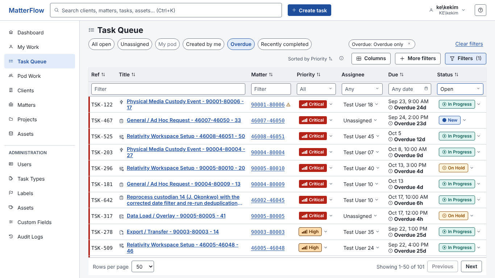

# Task Queue: independent UX review

Scope: the **Task Queue** page (`/tasks`) as shipped on `origin/dev` at `7ed7fb0` (screenshots and measurements are from that build; **WP10 landed while I was writing** (`4e9b474`, `9d81d4e`: the hold reason under the Status pill, a pause marker in the Ref cell, one colour language for stripe, On Hold and New). I read its diff and adjusted the text where it matters, but did not retake the screenshots): quick views, column filters and chips, the grid (columns, density, sorting, inline editors), paging, empty / loading / error states, drill-in and Back, URL state, permission variants, and the three owner requirements (Title cell, resizable columns, two-line Due cell). Reviewed as a senior UX designer and front-end reviewer. **No application code was changed.** Everything below was observed in the real stack (the published API with Dev authentication, SQL Server in Docker, the production Angular build on one origin, port 5570) driven with Playwright Chromium, plus a read of `frontend/src/app/features/task-queue`, `shared/work-queue/*`, `shared/filters/*`, `core/time/time.ts`, the API row shape, and the earlier UX documents (`ux-spec.md` S03 and 4.6, `column-filters/README.md`, `my-work-review/README.md` and its delivery plan, the addendum).

Screenshots are in `screenshots/` (56 PNGs, `<name>-<width>x<height>.png`; 1366x768 unless the name says otherwise; 1920x1080, 768x1024 and 375x812 where it matters). Files named `mock-*` are **DOM-patched mock-ups of the recommendations on the live page** (the page was changed in the browser only, nothing was committed or shipped); everything else is the shipped UI.

**Test data.** About 650 tasks: 442 open (129 New, 249 In Progress, 64 On Hold), 153 Completed in the last 30 days and about 50 Cancelled; 101 overdue, 96 due in the next 2 days (including today), 51 ASAP, 157 unassigned. about 15 clients (ten with realistic law-firm names, some long, such as "Meridian Pharmaceuticals International Holdings"), about 24 matters (names up to 54 characters), 4 pods, most of the 16 task types, 50 test users plus named personas: a Data Technician (Test User 10), a Pod Lead (Test User 06), a Director, an Intake Coordinator, a Read-Only Observer and a user with **only** `Task.View`. Six edge tasks were added by hand: a 170-character title, an unbroken 90-character token, timed due dates earlier today ("Overdue 6h", "Overdue 2h") and later today ("Due today" 11:59 PM), a due date three days ago, and a one-word title. Data was created through the public API (the demo seeder, run twice, plus a small script).

Ranking key: **severity** blocker / major / minor / nit; **effort** S (hours to a day or two), M (a few days), L (a week or more).

---

## 1. Executive summary

Task Queue is structurally sound where it is hard to retrofit: the URL is the single source of truth (every dashboard link I tried lands on the same list), **all 26 Dashboard drill-through links (tiles, priorities, statuses, ages, task types) show a grid total equal to the tile count**, drill-in keeps scroll and puts focus back on the row you left, the inline editors are labelled and permission-aware, axe-core (WCAG 2.2 AA plus best-practice) reports **0 violations** on 9 scans (1366, 1920, 768, 375, Columns open, a popover, an inline menu, the empty state, the view-only user), the API answers in 110 to 280 ms and there is no layout shift to speak of (CLS 0.006). The weaknesses are not about missing features. They are about **what one row looks like and whether the grid keeps its shape**:

- A row is **61 px and three lines** at 1366 (title wraps to two lines, then a "Client · Matter" line cut to "Demo Contoso Energy · ..."), so a technician or pod lead sees **7 rows** of 442. The same page with the line removed and the Due text on two lines shows **10** (`mock-overdue-two-line-short-date-1366x768.png`).
- The **Due cell is 38 characters on one line** ("Sep 23, 2026, 9:00 AM EDT · Overdue 24d") and sets the Due column to **317 px**, a quarter of the grid, which is why the Title is squeezed to 190 px.
- The grid uses automatic table layout, so **column widths and row heights change with whatever rows happen to be on the page**: across ten URLs of the same grid the Title column ranged from 185 to 374 px, the Due column from 111 to 323 px, and rows flipped between 44 and 61 px (BUG-TQ1). Sorting by Due on page 1 gives a different-looking grid than page 2.
- Columns cannot be resized at all, and added columns break the "two lines" rule: Client wraps to four lines, Task type to three (`tq-columns-wide-1366x768.png`).
- Quick views are bare buttons: **no counts**, no sort of their own ("Recently completed" is sorted by priority and shows the old Due dates of finished work), and the toolbar wraps so that "Filters" sits alone on a second row.

### Top 10 recommendations, ranked by impact over effort

| # | Recommendation | Evidence | Effort | Where |
|---|---|---|---|---|
| 1 | **Two-line Due cell** (date on line 1, relative text on line 2), year dropped for the current year, zone abbreviation moved to the tooltip and column header, one spoken sentence per cell. Due column 317 px becomes about 136 px. | Req. 3; `mock-overdue-two-line-short-date`; measured Title 185 to 365 px | S (1 to 2 days) | R3, TQ15 |
| 2 | **Title cell is the title and nothing else** (type icon plus a title of at most two lines, ellipsis, tooltip). The client and matter move to the Matter column, which becomes a two-line cell (reference over name). My Work stops using the `ref · client · matter` subline too. Defaults per page and a one-time migration for stored column sets. | Req. 1; rows 61 to 44 px, 7 to 10 visible rows | S to M (2 to 3 days) | R1, TQ14 |
| 3 | **Stable grid: `table-layout: fixed` with a `<colgroup>`**, per-column default and min/max widths, Title as the flexible column. Nothing reflows when you sort or page. | BUG-TQ1; Title 185 to 374 px and Due 111 to 323 px across pages | M (3 to 4 days) | R2 phase 1, TQ13 |
| 4 | **User-resizable columns**: drag handle with pointer capture, double-click to fit, a "Column widths" section in the Columns panel (steppers, Fit, Reset widths) as the keyboard and single-pointer alternative, a header context menu (Widen, Narrow, Fit, Reset), saved per user, page and tab. | Req. 2; WCAG 2.5.7 and 2.1.1 | M to L (5 to 7 days incl. tests) | R2, TQ13 |
| 5 | **One-row toolbar and a quieter restored-view notice.** Today "Filters" wraps to a second row (40 px, one grid row) and the toolbar re-flows differently with every state; the notice costs another 50 px. | `tq-default`, `tq-restored-notice`; first row starts at y=266 (35 % of the screen) | S (1 to 2 days) | TQ2, TQ3, TQ10 |
| 6 | **Quick views with counts, their own sort and column overlay**, plus Due soon, ASAP and On hold, so the row is the Task Queue's version of the My Work / Pod Work strip. "Recently completed" sorts by closed date and shows Closed instead of Due. | TQ1, TQ4, TQ7; Dashboard tile counts already exist | M (4 to 5 days incl. API counts) | TQ1, TQ4, TQ7 |
| 7 | **Real density**: Comfortable = fixed 44 px (two lines), Compact = fixed 36 px (one line, Matter reference only, short Due). Today Compact is 57 px (4 px saved) at 1366. | `tq-density-compact-1366x768` | S (folds into WP9 #190) | R3 section 5 |
| 8 | **Copy and state fixes that are wrong today**: "Overdue: Overdue only", "Restored your last view: Overdue Overdue only", "No tasks match these filters" for an empty Unassigned or Overdue view, a two-day-out task counted as "Due soon" with no cue, "Cancel task" offered on a Completed row, document title that never names the view. | TQ8, TQ33, BUG-TQ3 to BUG-TQ9 | S (1 to 2 days) | TQ8, TQ33 |
| 9 | **"Page 3 of 9", First and Last** in the pager (442 tasks is 9 pages of 50; only Previous and Next exist). Keep server paging; infinite scroll is not recommended. | `tq-page3-of-5-pagesize100` | S | TQ38 |
| 10 | **Phone cards for Task Queue** (already planned as WP13c) with the card spec in section 3.12, and "Assign to me" as the first item of the Assignee menu (Pod Work has it, Task Queue does not). | `tq-default-375x812` (952 px table in a 343 px box); `tq-technician-assignee-menu` | L (planned) / S | TQ40, TQ25 |

Everything else (keyboard rows, group by due bucket, density chrome, skeleton rows, hold reason, colour collisions, the 768 px Status clip) is already a work package of the My Work plan (the hold reason and the colour collisions have since shipped in WP10); section 6 says which of them this review changes or must wait for.

---

## 2. The three owner requirements

### 2.0 What the grid does today (measured, 1366x768, System Admin, 442 open tasks)

| Fact | Value | Evidence |
|---|---|---|
| Grid box width (content area) | 1098 px at 1366, 1652 px at 1920 | `tq-default-*` |
| Default columns | Ref 75, Title 191, Matter 125, Priority 121, Assignee 128, **Due 317**, Status 142 | `tq-default-1366x768` |
| Row height | **61 px** (title two lines + client line) or 44 px when the Title column is wide enough | 50 of 50 rows are 61 px on page 1; see BUG-TQ1 |
| Rows visible | **7** of 50 (chrome before the first row: 266 px; footer 56 px) | |
| Third line under the title | `Demo Contoso Energy · ...` (client first, matter name cut, ellipsis at about 22 characters) | `tq-default-1366x768` |
| Due text | `Sep 23, 2026, 9:00 AM EDT · Overdue 24d` (39 characters) for timed dates, `Oct 13, 2026 · Overdue 4d` for date-only | `tq-restored-notice-1366x768` |
| Layout stability | Title 185 to 374 px, Due 111 to 323 px, row 44 or 61 px, visible rows 7 to 10, depending on page, sort and filter | BUG-TQ1 table |
| Compact density | 57 px rows at 1366 (still 7 visible); 40 px at 1920 | `tq-density-compact-1366x768` |
| Columns that break "two lines" when added | Client up to 4 lines, Task type 3 lines, Pod ellipsis | `tq-columns-wide-1366x768` |
| Column preferences | `localStorage` only: `mf.work-columns.v2.taskQueue.<userId>` (array of keys), `mf.work-view.v1.queue.<userId>` (last view). Density `mf.work-table.v3.queue.<userId>`. No widths, no order. | `k2.mjs` run |
| Same grid used by | Task Queue, My Work, Pod Work, the Tasks grids on a Matter and a Project (`mf-task-table`) | code |

The code facts that matter for the designs below: the table is `width: 100%` with automatic layout and `white-space: nowrap` on Ref, Priority, Status, Due, Matter, so the widest string on the page decides the column. The Title cell has `min-width: 180px; max-width: 360px`. The filter row is a second `<tr>` in the same `<thead>`; the Title and Ref filter is one control with `colspan=2`. The header cells are sticky (`top: 0`), the filter row is sticky at 40 px, and below 1100 px the first column is sticky on the left. `PROGRESS_FOLDS_BELOW = 1060`, `MATTER_HIDES_BELOW = 960` and `PROJECT_HIDES_BELOW = 800` silently drop columns on narrow boxes.

---

### 2.1 Requirement 1: the Title cell, and the Ref, Matter and Client defaults per page

#### Finding

The owner's reading is right that the line is noise, with one correction to the premise. **The default Task Queue grid has a Matter column but no Client column** (Client is only in the Columns chooser), and the Matter column shows only the reference (`90002-80007`; the name is a tooltip). So today the subline is the only default place where the client's name and the matter's name appear. It is also the worst place: it is the third line of a 61 px row, it is cut after about 22 characters so you usually read only the client, and it makes My Work and Task Queue disagree (My Work: `ref · client · matter`, Task Queue and Pod Work: `client · matter`, and the matter ref in the Matter column repeats nothing). Removing the line is right, but the matter name must land somewhere, or the screen gets less informative, not just calmer.



#### Recommendation

**1. The Title cell contains the task type icon and the title, nothing else.**

| Element | Rule |
|---|---|
| Type icon | Keep (14 px, muted, `title` = type name). It is the only per-row hint of the work type and costs 22 px. |
| Title text | Link, semibold, **at most 2 lines**, `-webkit-line-clamp: 2`, ellipsis, `overflow-wrap: anywhere` (the unbroken 90-character token must not widen the column). Native `title` carries the full title. |
| Client / matter line | **Removed on every page.** |
| "Workflow progress" folded under the title (`foldProgress`) | **Removed.** Below the progress width threshold the Progress column simply drops out (it is in the chooser). A third line is exactly what this requirement forbids. |
| "New" pill (My Work) | Removed from the Title cell. The 6 px dot with `aria-label="New"` in the Ref cell stays (WP8b); that is enough and it does not consume a line. |
| Hold reason (WP10, shipped in `4e9b474`: `mf-hold-note` under the Status pill, one line, full text in the tooltip, none in Compact; on phones "Waiting: ..." under the title) | Stays in the **Status cell** (the pill plus one line is exactly the two-line budget). **Remove the phone variant under the title** when the card lands (WP13b/c): in a card the reason is its own chip line. |

**2. The Matter column becomes a two-line cell; Client stays a one-line column in the chooser.**

```
Comfortable (44 px)                    Compact (36 px)
+--------------+                       +--------------+
| 46001-46044  |  line 1: reference    | 46001-46044  |   reference only
| Antitrust 2n…|  line 2: matter name  +--------------+
+--------------+     (muted, 12 px, ellipsis, tooltip "Hartwell & Bryce LLP · Antitrust Second Request")
```

- Line 1 is the existing reference (mono, linked only with `Matter.View`, then the sensitive marker). Line 2 is the matter name, muted, one line, ellipsis; `(inactive)` is appended for an inactive matter (spec S06). The tooltip is `Client · Matter name`.
- Client is a plain one-line cell (ellipsis, tooltip = full name), 140 px by default when shown. It is **not** in the default sets at 1366-class widths, because the measured budget does not allow it (below). It is one click in Columns for anyone who wants it, and it is searchable in the column filter row today (Client filter).

Why not put Client in the defaults: measured with the mock on live data (`mock-proposed-default-*`):

| Columns (1366, 1098 px box) | Title width | Row height | Rows visible |
|---|---|---|---|
| Today's default | 191 px | 61 px | 7 |
| Proposed default (no Client, Matter two-line, Due two-line, subline gone) | **334 px** | **44 px** | **10** |
| Same plus Client (130 px) | 204 px | 44 px | 10 |
| Same plus Client at 1920 (1652 px box) | 474 px | 44 px | 18 |

At 204 px a 60-character title loses its second half; at 334 px it fits on two lines. A title is what the person came to read. At 1920 Client fits easily, which is where the next point comes in.

**3. Defaults per page** (`DEFAULT_COLUMNS` in `column-prefs.ts`; table order is `WORK_COLUMNS` order):

| Page and tab | Default columns | Today | Title width at 1366 (new / today) |
|---|---|---|---|
| **Task Queue** | Ref, Title, **Matter (2-line)**, Priority, Assignee, Due, Status | same set; Matter is ref-only today | 334 / 191 |
| **Pod Work**, all tabs | same as Task Queue. The "Assign to me" button column moves into the Assignee cell (a link-button next to "Unassigned"), which frees 128 px. | same set + Actions column | about 340 / 180 |
| **My Work, Active** and **Due soon and overdue** | Ref, Title, **Matter (2-line)**, Progress, Priority, Due, Status | Ref, Title, Progress, Priority, Due, Status; context only in the subline (WP6b, A2) | about 314 / 280 (Title today is 274 on Due soon) |
| **My Work, Closed** | Ref, Title, Matter (2-line), Closed, Status | same set | |
| **My Work, Created by me** | Ref, Title, **Matter (2-line)**, Assignee, Priority, Due, Status, Age | no Matter | about 274 / 258 |
| **Tasks on a Matter or a Project** (`hideContext`) | unchanged: no Matter or Client (the page header already says it) | | |

Rationale for reversing WP6b's A2 (matter reference into the subline, drop the Matter column on My Work): A2 was approved, but its premise was that the subline carries the matter. With the subline gone the Matter column is the right home, and the two-line cell shows the reference **and** the name where A2 showed only the reference plus a truncated client. **My Work should be consistent with Task Queue and Pod Work**: one Title cell, context in Matter. Client availability is the same everywhere (chooser). A user who works one client at a time can add Client and drop Matter's second line by switching to Compact.

**Wide screens.** Do not build a second, width-dependent default set. With resizable columns (section 2.2) a user on a 1920 screen adds Client once and it is remembered. If the PM wants Client by default for directors, put it in the Task Queue default set only and let the existing narrow-box drop rule hide it below 1280 px of box width (the mechanism already exists for Matter and Progress); I measured that it fits at 1920.

**4. The two-line rule applies to every other cell too** (full table in section 2.3): Client, Pod, Assignee, Task type, Project, Workflow are one line with ellipsis and a tooltip, never wrapped.

#### Migration for users with stored column sets

Columns are stored as an array of keys per user, page and tab (`mf.work-columns.v2.<scope>.<userId>`), with a one-time migration flag per page (`mf.work-columns.v2.migrated.<page>.<userId>`). Defaults are not stored (a user who never touched Columns stores nothing), so **default users get the new sets automatically** and nobody needs a migration for them. For customised users:

| Stored set | What the user saw | Action (once, flag `mf.work-columns.v3.migrated.<page>.<userId>`) |
|---|---|---|
| Contains `matter` | Matter ref column plus the client line | Keep as is. The Matter cell gains its second line (name). |
| Lacks `matter` (typical on My Work after WP6b, rare on Task Queue) | Context only through the subline | **Insert `matter` after `title`** so the information they relied on stays visible. Show one dismissible notice per page: "The client and matter line under task titles is gone. Matter now shows the reference and the name. Client is in Columns." |
| Contains `progress` and was relying on the fold-under-title below 1060 px | Step text under the title on narrow screens | Nothing to migrate; the column drops on narrow boxes as before. Mention in the release note. |
| Corrupt or unknown keys | | existing `normalizeColumns` behaviour (dropped) |

Rollback: leave the inserted `matter`; it is harmless. The migration must be idempotent and must never reorder or remove other keys. No server data is touched (preferences are browser-local).

#### Edge cases

- Very long matter or client name: ellipsis on one line; the tooltip carries the full text. The sensitive-matter triangle and its `aria-label` stay on line 1.
- A matter the user may not link to (no `Matter.View`): reference is plain text, name is shown (it is not secret; the old subline showed it too, and the column already shows the reference).
- Task without a project, with a long type name, with an inactive assignee (`(inactive)` suffix stays in the Assignee cell, one line).
- Screen readers: the Matter cell reads "46001-46044, Antitrust Second Request" (two lines are one text run); the link keeps its own name.
- Copy and paste of a row: unchanged (cells in order).
- Matter and Project task grids keep passing `hideContext`; the input becomes a no-op for the Title cell and is kept only to hide the Matter column.

#### Acceptance criteria

1. No `.wt-subline`, `.wt-sub`, `data-title-context` or `data-title-progress` in the DOM of any `mf-task-table`.
2. Title link is at most 2 lines at every width; a 170-character title and a 90-character unbroken token do not change the column width or the row height.
3. Row height is 44 px (Comfortable) for every row of a 50-row page of the seed data at 1366 and 1920 (`h` histogram has a single value).
4. At 1366x768, Task Queue default shows **at least 10 rows**; My Work Active **at least 9** (with the strip) .
5. Matter cell shows reference and name; the tooltip shows client and matter; Compact shows the reference only.
6. A user with a stored set that lacks `matter` gets it inserted once and sees the notice; a user with a stored set that contains `matter` sees no notice; running the migration twice changes nothing.
7. Unit specs for `defaultColumns`, migration and the Title cell; e2e `my-work-per-tab-columns.spec.ts` and the column-filters specs updated (they assert the subline); axe 0 violations at 1366, 1920, 768, 375.

#### Effort and impact

**S to M (2 to 3 days).** Files: `task-table.ts` (`@case ('title')`, `@case ('matter')`, `foldProgress`, `refInSub`, `context()`), `task-table.scss`, `column-prefs.ts` (defaults and migration), `my-work-page.ts` (notice), Pod Work assignee cell, specs and e2e.

- **My Work**: reverses A2 (#174) in part and removes the "New" pill and the fold (#175, WP9 #189 "fold at 1180"). #189's fold is no longer needed; re-scope it (section 6).
- **Pod Work**: same Title cell; Actions column folds into the Assignee cell.
- **Matter and Project grids**: unchanged except they inherit the Title cell cleanup.
- **Stored columns**: migration above; no server change.

---

### 2.2 Requirement 2: user-resizable column widths

#### Finding

There is no resizing, and the grid cannot offer it safely today because its **column widths are a by-product of content**. The same grid, ten URLs (1366x768, System Admin):

| URL | Title | Due | Row heights | Rows visible |
|---|---|---|---|---|
| `/tasks` | 191 | **317** | 61 x50 | 7 |
| `?sort=due&dir=asc` | **374** | **111** | 44 x49, 61 x1 | 10 |
| `?sort=due&dir=asc&page=2` | 185 | 323 | 61 x49 | 7 |
| `?sort=due&dir=asc&page=5` | 306 | 201 | 44 x11, 61 x39 | 7 |
| `?page=2`, `?page=4`, `?page=8` | 206, 185, 192 | 317, 323, 316 | 61 | 7 |
| `?sort=number&dir=asc` | 205 | 311 | 61 | 7 |
| Overdue quick view | 185 | 323 | 61 | 7 |

(`m2.mjs`.) Page 1 of "sorted by Due" contains only ASAP rows, so the longest Due string is "ASAP" and the column collapses to 111 px; page 2 has dated rows and it jumps back to 323. A user who sorts and pages sees columns breathe. Any resizing feature built on this layout would fight the browser's content sizing, so the first step (phase 1 below) is the layout itself.

#### Recommended technical approach

**Keep the real `<table>`; switch it to `table-layout: fixed` with a `<colgroup>`.** Reasons and rejected options:

| Option | Verdict |
|---|---|
| **`<table>` + `table-layout: fixed` + `<colgroup>`** | **Recommended.** Real header and data cells keep their roles (`aria-sort`, `th scope`, caption), the filter row's `colspan` (Title or Ref spans two columns) just works because both rows share the colgroup, sticky `thead` and the sticky Ref column keep working, print works, and a width lives in **one `<col>` per column, not on every cell**, so cost does not grow with rows. Fixed layout also removes the content-driven reflow (BUG-TQ1). |
| CSS Grid (`div role="grid"` with `grid-template-columns` and subgrid) | Rejected. It means rebuilding the table semantics, the filter row, the sticky rules, `mfGridBody` and every e2e page object for no benefit at 25 to 100 rows. |
| Per-cell inline `width` on `th` in auto layout | Rejected. Auto layout lets content override the width (I set the Due `th` width on the live table: the browser kept the content width and the Title stayed at its 180 px minimum, so the value did not behave as a setting) and it reflows whenever the content changes. |
| PrimeNG `p-table` with `pResizableColumn` | Not evaluated in code; adopting it is a rewrite of a grid that already carries sticky filter rows, inline editors and drill-in. Not recommended for this scope. |

**Column model** (`ColumnDef` in `column-prefs.ts` gains `width`, `minWidth`, `maxWidth`, `fill?`; the Title widths quoted in this document come from the mock (Ref 75 px) or are computed with a 76 px Ref; with the 96 px Ref above subtract about 20 px):

| Column | Default | Min | Max | Notes |
|---|---|---|---|---|
| Ref | 96 | 80 | 120 | mono reference plus the pause marker (WP10, On Hold rows) and the New dot must all fit; 76 px is enough for the reference alone |
| **Title** | fill (the spring) | 160 | none | takes the rest; never has its own stored width, see below |
| Matter | 160 | 112 | 320 | two-line cell |
| Client, Project, Task type, Pod, Creator, Requestor | 140 | 96 | 280 | one line |
| Workflow | 150 | 96 | 280 | |
| Progress | 160 | 120 | 320 | |
| Priority | 112 | 96 | 160 | pill + chevron |
| Assignee | 136 | 112 | 240 | |
| Due | 136 | 112 | 200 | two-line cell; 112 is the date filter control's minimum |
| Status | 140 | 112 | 200 | |
| Closed, Created | 104 | 88 | 160 | |
| Updated | 120 | 96 | 180 | |
| Age | 64 | 56 | 100 | |
| Actions | 128 | 96 | 160 | not resizable |

Minimums come from the filter controls in the second header row (the Priority multi-select, the Due date range button) as much as from the content: a handle must never let a control overflow its cell.

**The Title is the spring.** In fixed layout a column with no width takes the remaining space, which is the behaviour people expect ("the title uses what is left"). Consequences:
- Widening Due, Matter or any other column narrows the Title; narrowing gives it back. No leftover blank band at the right and no proportional scaling of the other columns (browsers scale columns of a fixed table when the table is wider than the sum; the spring prevents that).
- The Title's own right-edge handle resizes the **column to its right inversely** (drag right: neighbour shrinks), which is what the pointer position suggests. The Title has no stored width. Its minimum (160 px) is the only Title setting a user can change (Columns panel > Column widths shows Title as "Fills the space left").
- When the sum of the other columns plus the Title minimum exceeds the box, the grid scrolls sideways (as today) and the Ref column becomes sticky (today only below 1100 px; make it depend on `overflowing()`).
- The existing silent drop rules (`PROGRESS_FOLDS_BELOW` etc.) become one rule: while the Title would be narrower than 200 px, drop columns flagged `autoHide` in this order: Updated, Created, Age, Project, Workflow, Task type, Pod, Requestor, Creator, Progress, Client. Priority, Due, Status, Assignee, Matter are never dropped. A chip with "(hidden column)" already explains a hidden filtered column; keep that.

**Rendering and the drag.** Widths are applied as CSS custom properties on the `<table>` (`--w-due: 8.5rem`) read by `col { width: var(--w-due) }`, so one style write moves the whole column. Apply widths in **rem** (stored value in px at a 16 px root divided by 16): a browser text-size setting then scales the columns with the text, which keeps the two-line Due cell from clipping under text-only zoom (WCAG 1.4.4).

**Pointer interaction** (on each sortable and non-sortable header cell except Actions):
- A handle element `span.wt-resize` as a child of the `th` (which is already `position: sticky`, so it is the containing block): `position: absolute; right: -6px; top: 0; height: 100%; width: 12px; cursor: col-resize; touch-action: none; z-index: 5` (above the sticky Ref header, `z-index: 4`). Visible 1 px divider at 60 % height at rest, 2 px full height on hover, 3 px accent while dragging.
- `pointerdown` calls `setPointerCapture(pointerId)`; `pointermove` computes `clamp(startWidth + dx, min, max)` and writes the CSS variable inside `requestAnimationFrame`; `pointerup` and `pointercancel` release capture and persist; `Escape` during a drag restores the start width. While dragging: `document.body` gets a class with `user-select: none; cursor: col-resize`, a polite live region says "Due 164 pixels" on release.
- **Double-click** the handle: auto-fit. Measure the widest rendered content of the column (`scrollWidth` of a nowrap inner wrapper in each cell, up to 200 reads in one layout pass) plus 16 px padding, plus the sort icon for the header, clamp to min and max. It fits **the rows on the current page** (server paging), which the tooltip says. For the Title, double-click returns to "fill".
- **Cost while dragging.** I measured the per-frame relayout of the real table on this machine (4 cores shared with other work): 25 rows 6 ms, 50 rows 12.5 ms (p95 22), 100 rows 19 ms (p95 40), **200 rows 47 ms (p95 139)**, dominated by re-wrapping the clamped titles. So: live resize up to 100 rows (the largest page size offered); above that, or when a frame takes more than 24 ms, fall back automatically to a **guide line** (a dashed vertical line and a width tooltip that follow the pointer; the width is applied on release). No `ResizeObserver` loop: the existing observer watches the wrapper, not the table, and only updates `boxWidth` and `overflowing`.

**Keyboard and single-pointer alternatives** (WCAG 2.1.1 and 2.5.7, which asks for a non-dragging way to do a dragging task):
1. **Primary: a "Column widths" section in the Columns panel.** One row per shown column: name, a `-` button, the width as an editable number (96 to 280), a `+` button, and a "Fit" button; the Title row reads "Fills the space left" with its minimum only. Footer: **Reset widths** next to Reset columns. One tab stop (the Columns button), works for touch, switch and voice users, and needs no new shortcut. Steps: 8 px, 32 px with Shift (or hold). Each change announces the new width in the panel's existing live region.
2. **Secondary: the header context menu.** On a focused header (the sort button) the Menu key, Shift+F10, a right click or a long press (touch) opens a small menu: Sort ascending, Sort descending, **Widen**, **Narrow**, **Fit to content**, **Reset width**, Hide column (not Ref or Title). This is the "column menu" the owner suggested, and it adds no tab stops. Register Menu / Shift+F10 in the shortcut registry help ("Work lists").
3. The drag handles are **not** in the tab order. They are decorative to assistive technology (`role="presentation"`, `aria-hidden`), because 7 to 12 extra tab stops on a header row would make the 23 stops before the first row (measured) worse, and focusable separators would duplicate the panel and the menu. (If a later review wants the ARIA window-splitter pattern, the handle can be made `role="separator"` with `aria-valuenow/min/max` and `tabindex="-1"` reachable from the header menu; I do not recommend it now.)

**Touch and narrow screens.**
- Below 640 px the grid is cards (WP13b/c, #192) and **widths do not apply**: no handles, and the "Column widths" section is hidden from the Columns panel (the panel keeps Columns and Density).
- 640 to 1100 px (tablet): the grid scrolls sideways and widths apply. With `(pointer: coarse)` the handle's hit area is 24 px and `touch-action: none` on the handle only, so a finger on the divider resizes and a finger anywhere else still pans. Long press on a header opens the context menu. The Columns panel steppers work as on desktop.
- Reduced motion: nothing animates; the guide line and tooltip appear without transition.

**Persistence.** New key, same scope as the column sets:

```
mf.work-widths.v1.<scope>.<userId>      scope = columnScope(page, tab):  taskQueue | myWork.active | myWork.dueSoon | myWork.closed |
                                                myWork.createdByMe | podWork.queue | podWork.attention | podWork.all
value = {"v":1,"w":{"due":132,"matter":176}}      only columns the user changed; px at a 16 px root; integers
```

- Sparse on purpose: columns without an entry follow the default (so a changed default reaches users who never touched that column, the same idea as the column-set migration). Unknown keys, non-numbers and corrupt JSON are ignored; values are clamped to the current min and max on read (a max that shrinks never traps a user). Reads and writes are wrapped in try/catch like `column-prefs.ts`; a blocked or full storage means widths just do not persist.
- Fallback when a scope has no stored widths: defaults. Do **not** fall back to another tab's widths (columns differ).
- Widths survive hiding and re-showing a column (they are keyed by column, not by position). They are **independent of density** (a user width wins in both; the Compact default for Due is narrower).
- **Reset widths** removes the key (all columns of this scope); the header menu's Reset width removes one entry. Reset columns does not reset widths and vice versa (two buttons in the panel footer, "Reset columns" and "Reset widths", each disabled when there is nothing to reset).
- No server storage in this scope. See cross-cutting 4.4: a roaming or non-persistent browser profile loses widths and column sets today; once people invest time in widths, moving **all** table preferences to a server-side `UserPreferences` document becomes worth it (effort M to L, one additive endpoint).
- Print ignores stored widths: `@media print { .wt { table-layout: auto; width: 100% } .wt col { width: auto } }`.

**Interplay with the sticky parts and the filter row.**
- The header row stays exactly 40 px; the handle is only as tall as the header row (the filter row below it is not a handle surface).
- Both rows use the same `<colgroup>`, so filter controls stay under their headers at any width; the Title or Ref filter's `colspan=2` sums Ref and Title automatically. The existing `.cf__input { width: 0; min-width: 100% }` rule stays (it exists so a control never sizes its column) and becomes less critical in fixed layout.
- Minimum widths include the filter control minimums (table above).
- Sticky Ref column: `left: 0` while overflowing; its handle works the same.
- Hidden-column chips and "Show column" are unaffected.



#### Phases (each shippable alone)

| Phase | What | Effort |
|---|---|---|
| **W1** | Fixed layout, `<colgroup>`, column defaults and min or max, Title as spring, one rule for narrow-box drops, `rem` widths, print override. **No user control yet**; this alone fixes BUG-TQ1. | M (3 to 4 days; e2e and screenshot specs that depend on content-sized columns need updating) |
| **W2** | Drag handle, double-click fit, guide-line fallback, persistence, Reset widths (footer, header menu) | M (2 to 3 days) |
| **W3** | "Column widths" section in the Columns panel, header context menu with Widen, Narrow, Fit, Reset (keyboard and long press), shortcut help entries, live announcements | S to M (2 days) |

#### Acceptance criteria

1. Opening any page or sort of the same grid gives **identical column widths** (BUG-TQ1 table has one row, not seven).
2. Drag Due from 136 to 180 px: the Title narrows by exactly 44 px, the filter row stays aligned (every control inside its cell, 0 px overflow), the sticky header does not jump, the width is still 180 px after reload and after switching tab and back, and "Reset widths" restores 136 px.
3. Double-click on a handle fits the column to the widest of the rendered rows (within min and max) and is undoable with Reset width.
4. Keyboard only: Columns > Column widths > Due + three times, then Esc; the Due column is 160 px; focus returns to the Columns button. Header Shift+F10 > Widen works without touching a mouse.
5. A 200-row page (DOM clone in a test) resizes with the guide-line fallback and no frame above 50 ms on the CI machine; 50 and 100 row pages resize live.
6. At 375 px there are no handles and no Column widths section; at 768 and 1024 the grid scrolls sideways with the Ref column sticky and the handles usable by touch emulation.
7. Corrupt, out-of-range and unknown-key storage values are ignored (unit specs); a disabled `localStorage` does not throw.
8. axe: 0 violations at 1366, 1920, 768, 375 with the panel and the menu open; the live region announces "Due 164 pixels".
9. Text-only zoom of 150 % does not clip the Due cell (widths in rem).

#### Impact on My Work and Pod Work

They share `mf-task-table`, so W1 to W3 apply to all three pages and to the Matter and Project Tasks grids at once; each gets its own widths scope (the key table above). My Work's per-tab column defaults (`DEFAULT_COLUMNS`) gain the `width` defaults in the same `ColumnDef`; **WP9 #189 (Due cap, fold at 1180, chrome) and #190 (Compact) overlap and should be re-scoped onto W1** (section 6). `column-chooser.ts` gains the widths section; `work-view-controls.ts` is unchanged.

---

### 2.3 Requirement 3: the Due cell on two lines, and "at most two lines per row"

#### Finding

Today (`task-table.ts`, `@case ('due')`) the cell is one nowrap line: icon, then `dateText · <strong>badge</strong>`. For a timed task that is up to 39 characters (`Sep 23, 2026, 9:00 AM EDT · Overdue 24d`), which sets the column to 317 px and costs the Title about 130 px; date-only tasks are 25 characters. Two further facts from reading `describeDue`:

- The grid shows the badge for overdue, today and tomorrow only. A task due in **2 days** gets a plain date, although `describeDue` returns "Due soon" for it, the spec (4.6) says "date + Due soon within 2 days", and the Dashboard's **Due soon tile counts it** (96 tasks, including tasks two days out). See `tq-from-dashboard-due-soon-1366x768.png`: `Oct 19, 2026, 9:00 AM EDT` with no cue is in the list the tile counted (BUG-TQ3).
- The Dashboard Summary lists already use a two-line Due cell (date over "Created today"), so the pattern exists in the product (`cmp-dashboard-summary-1366x768.png`). In the same list the badge is clipped at 1366: "Overdue 24d" shows as "Overdue 24" (`bug-dashboard-overdue-list-clipped-crop-2x.png`, BUG-TQ2).

#### Design: the two-line Due cell

```
Comfortable (two lines)                      Compact (one line)
+------------------------+                   +---------------------+
| Oct 17, 10:00 AM       |   red, line 1     | Oct 17 · Overdue 6h |  (time and year in tooltip)
| (!) Overdue 6h         |   red bold, 2     +---------------------+
+------------------------+
| Oct 17, 11:59 PM       |   amber
| (clock) Due today      |   amber bold
+------------------------+
| Oct 18, 3:00 PM        |   normal text
| Tomorrow               |   bold, normal text colour
+------------------------+
| Oct 19, 9:00 AM        |
| In 2 days              |   NEW: closes the Due soon gap
+------------------------+
| Oct 28                 |   line 2 empty: future dates stay calm
|                        |
+------------------------+
| (bolt) ASAP            |   blue bold, vertically centred, one line
+------------------------+
| Oct 13                 |   closed task: muted, no relative text
+------------------------+
```

**State table** (all colours are existing tokens: `--mf-due-overdue #B42318` 6.6:1, `--mf-due-soon #8A4B00` 6.8:1, `--mf-asap #1F4E9C` 8.0:1, muted `#4B5563` 7.6:1 on white):

| State | Line 1 (date) | Line 2 (relative text) | Colour and icon | Spoken name (single sentence) |
|---|---|---|---|---|
| ASAP (no date) | `ASAP` with bolt, one line, centred | none | blue, bold | "No due date, ASAP" |
| Overdue, timed | `Oct 17, 10:00 AM` | `Overdue 6h` | red both lines; alert icon before line 2; red row bar | "Due Oct 17 at 10:00 AM, overdue 6 hours" |
| Overdue, date only | `Oct 13` | `Overdue 4d` | same | "Due Oct 13, overdue 4 days" |
| Due today | date and time if timed, else `Oct 17` | `Due today` | amber both lines; clock icon | "Due today, Oct 17 at 11:59 PM" |
| Tomorrow | `Oct 18, 3:00 PM` | `Tomorrow` | text colour; line 2 bold | "Due tomorrow, Oct 18 at 3:00 PM" |
| In 2 days | `Oct 19, 9:00 AM` | `In 2 days` | text colour; line 2 bold | "Due Oct 19 at 9:00 AM, in 2 days" |
| Later | `Oct 28` (`Jan 5, 2027` if the year differs) | empty | text colour | "Due Oct 28" |
| Closed (Completed, Cancelled) | date, muted | empty | muted, no overdue styling | "Was due Oct 13" |

Only two states carry colour (overdue red, today amber); tomorrow and in two days are bold neutral, so amber does not collide with the High priority pill and the On Hold pill any more than it does today (the My Work review M9 collision is untouched and not made worse). "In 2 days" is the only new wording and exists so that every row the Dashboard's Due soon tile counts shows why (today, tomorrow, in 2 days).

**Format rules.**
- **Year**: omit when the due date is in the current calendar year in the viewer's zone (`Oct 17`), show it otherwise (`Jan 5, 2027`).
- **Zone abbreviation**: drop from the cell; show it in the tooltip (`Oct 17, 2026, 10:00 AM EDT`), in the Due column header tooltip ("Times are shown in your time zone, Eastern (EDT)") and in the task page. Addendum M says timestamps show the zone abbreviation; for a grid column in which every value shares the viewer's zone the abbreviation is 38 repetitions of the same word. **This needs a one-line PM decision**; if rejected, keep `EDT` on line 1 (Due column 168 px instead of 136, Title 30 px narrower).
- **Time**: shown only when the task has one (`dueAtUtc`); date-only stays a floating calendar date. A timed due date is the same instant for everyone; a date-only due date is overdue after 23:59 in the **viewer's** zone (addendum M), which is why the same task read "Overdue 3d" in New York and "Overdue 4d" in Auckland in my check (`c3.mjs`); that is accepted behaviour, not a bug.
- **Overdue duration**: unchanged (`<1h`, hours below 24 h, then whole days). Optional nit: cap at weeks above 60 days ("Overdue 9w").
- **Machine-readable**: line 1 is a `<time datetime="2026-10-17T14:00:00Z">` (or a date) so find-in-page, extensions and print keep the value.

**Accessible name.** One spoken sentence per cell (table above) so a screen reader does not read "Oct 17, 10:00 AM" and "Overdue 6h" as two unrelated cells' worth of text: a visually hidden span carries the sentence, the two visible lines are `aria-hidden="true"`. The icon stays `aria-hidden`; the colour is never the only cue (word plus icon plus row bar). Sorting is unchanged (`aria-sort` on the header; the Due sort is by due instant with ASAP first, see TQ22). Tooltip (`title`) on the cell repeats the sentence with the zone abbreviation.

**Print.** Two lines print as two lines; icons and words keep the meaning in grey scale; add `tr { break-inside: avoid }` and set `-webkit-print-color-adjust: exact` for the red row bar and pills (the print preview today splits rows across pages and prints the app header, BUG-TQ6).

**Implementation.** Extract a shared `mf-due-cell` component (`layout: 'two-line' | 'inline'`, inputs `row` or the `DueInput` plus status) used by `mf-task-table`, the Dashboard list panels (`task-list-panel.ts`, which already needs the clipping fixed), the Swimlane card and drawer and the task header, so the five places stop re-implementing `describeDue` branches. The pure text logic stays in `core/time/time.ts` (`describeDue` gains `relative` and `daysUntil` for the 2-day state and a `short` date format).

#### The whole-row rule: at most two lines in every row

**Rule.** Every cell of a work-table row is at most two lines. A cell that needs more is truncated with an ellipsis and a tooltip, never wrapped further. The row height is **fixed per density**, not content-driven, which also fixes BUG-TQ1.

| Column | Comfortable | Compact |
|---|---|---|
| Ref | 1 line (mono) + New dot | same |
| **Title** | link, **2 lines max**, ellipsis, tooltip | **1 line** |
| Matter | 2 lines: reference over name | reference only |
| Client, Project, Task type, Workflow, Pod, Creator, Requestor | 1 line, ellipsis, tooltip (never wrap) | same |
| Progress | 2 lines: `2 of 4 done` over the step name (link); no truncation of the count | `2 of 4 · step` on one line |
| Priority | pill, 1 line | same |
| Assignee | 1 line, ellipsis; `(inactive)` and the out-of-office marker stay on the line | same |
| **Due** | 2 lines (above) | 1 line `Oct 17 · Overdue 6h` (time and year in tooltip) |
| Status | pill, 1 line; for On Hold the 2nd line with the hold reason (WP10, shipped), ellipsis | pill only |
| Closed, Created, Updated | date, optional 2nd line time | date only |
| Age | 1 line (`12 d`), tooltip | same |
| Actions | 1 button | same |

**Fixed heights.** Comfortable: 44 px (2 lines of 18 px line-height, 4 px padding above and below); Compact: **36 px** (the controls are 32 px targets, the project's own minimum, so 36 px is the floor; today's Compact is 57 px at 1366 and 40 px at 1920). Rows are `height` fixed with `overflow: hidden` on cells (`max-height` on the cell content for the clamped title), so a 170-character title can never grow a row.

**Vertical alignment.** `vertical-align: middle` for every cell (as today): pills and menus sit centred and one-line text centres against two-line neighbours. Two-line cells have their lines tight (line-height 18 px, no gap) so they read as one unit.

**Result at 1366x768** (measured on the mock, same data): 7 rows becomes **10 rows** at 44 px; with the toolbar fix (TQ2, 40 px) and no restored notice, **11**; Compact at 36 px gives **12** (13 with the toolbar fix). At 1920x1080 the same rules give 18 rows comfortable and 22 compact.

| Mock | Title | Due | Row | Rows visible |
|---|---|---|---|---|
| Today (overdue view) | 185 px | 323 px | 61 px | 7 |
| Subline removed only (`mock-title-only-no-subline-1366x768`) | 191 px | 317 px | 43 px | 10 |
| Plus two-line Due, full date (`mock-two-line-due-title-only-1366x768`) | 304 px | 204 px | 44 px | 10 |
| Plus year and zone dropped (`mock-overdue-two-line-short-date-1366x768`) | **365 px** | **135 px** | 44 px | 10 |



#### Acceptance criteria

1. Every Due state in the table renders as specified at 1366 and 1920 (unit specs on the pure function for the eight states, with fixed clocks in New York, Los Angeles and Auckland), and the text of line 2 is never clipped at the default Due width (136 px) for the longest state, `Overdue 120d`.
2. The Due column default width is 136 px (168 px if the PM keeps the zone abbreviation) and Title gains at least 100 px.
3. The accessible name of a Due cell is the sentence in the table (checked with `getByRole('cell')` text and the accessibility tree), and axe reports 0 violations.
4. A task due in 2 days shows "In 2 days"; the number of rows showing today, tomorrow or in-2-days equals the Dashboard Due soon tile total for the same query (the 96 in the seed data).
5. Every row of a 50-row page is exactly 44 px (Comfortable) or 36 px (Compact); adding Client, Task type, Pod, Created and Updated keeps that; the 170-character title, the unbroken token and the 47-character client name change nothing.
6. Print: header chrome hidden, rows never split across pages, two-line Due cells intact, colour not required to read overdue.
7. Dashboard lists and the Swimlane use `mf-due-cell` and "Overdue 24d" is not clipped at 1366.

**Effort S (1 to 2 days)** for the cell and the format; the fixed row heights and the other cells of the table are another day, and folding into R1 and W1 above is natural. **Impact:** all three queues, both record grids and (through `mf-due-cell`) the Dashboard lists and Swimlane; no stored preference changes; e2e specs that assert "· Overdue" text on one line or `data-col="due"` text need updating (the text content of the cell stays the same words).


---

## 3. Findings by area

IDs are `TQn`. Screens are in `screenshots/`. "R1", "R2", "R3" point to the owner requirements in section 2. Items that are already a My Work work package are marked **(WP)** and only carry what is specific to Task Queue.

### 3.1 Purpose and information hierarchy

Task Queue's job (UX spec S03): the shared, searchable list of every task, the source of Dashboard drill-through, and the place a pod lead or director goes to find, triage and reassign. The hierarchy on the page is: title, quick views, a bar of controls, the column header and filter row, rows, pager. That order is right. What is missing is the answer to "how big is the pile and what is on fire" before reading any row.

**TQ1 (major, M): quick views carry no numbers and the total is only at the bottom.**
What: six preset buttons (`tq-default-1366x768`); the only count on the page is "Showing 1-50 of 442" in the footer. My Work (`cmp-my-work-technician-1366x768`: Overdue 12, Due today 1, ASAP 5, On hold 1) and Pod Work already answer it with the shared `mf-work-strip`; the Dashboard has the same numbers (442 open, 157 unassigned, 101 overdue, 96 due soon, 51 ASAP, 64 on hold) and I verified that each equals the grid total of its link.
Recommendation: the quick views row **is** the Task Queue strip: each view shows its count, counts are the same predicates as the Dashboard tiles and are **not** narrowed by the filters currently applied (like My Work's `attention`), a zero is muted not hidden so nothing jumps. One additive object on `GET /task-queue` (`views: { open, unassigned, overdue, dueSoon, asap, onHold }`, five small counts; the Dashboard already computes them with `TaskQueueRules`). Reuse the visual (`mf-work-strip`) so the three queues look alike.

```
Task Queue                                                                         [+ Create task]
(All open 442) (Unassigned 157) (Overdue 101) (Due soon 96) (ASAP 51) (On hold 64) (My pod 31) (More v)
```

**TQ2 (major, S): the toolbar wraps and re-flows with every state.**
What: at 1366 the six views, "Sorted by Priority" with its info button, Columns, More filters and Filters do not fit on one row, so **Filters sits alone on a second row** (`tq-default-1366x768`); with "Reset sort" the group wraps differently (`tq-sorted-due-1366x768`); with chips, "Clear filters" is a third item that moves the controls again (`tq-filters-closed-chips-1366x768`, `tq-technician-assignee-menu-1366x768`). The bar is 80 to 130 px high depending on state and the buttons change places, which is the opposite of a stable control surface.
Recommendation: two fixed rows. Row 1: views (left), `Columns`, `More filters`, `Filters (n)` (right). Row 2 appears only when there is something to say: chips and Clear filters (left), "Reset sort" (right). Move **"Sorted by Priority ⓘ" into the footer** next to "Showing 1-50 of 442" (it is a description of the result, not a control; the sorted header already shows the arrow and `aria-sort`). Measured: this returns one grid row (40 px) at the default state.

```
(All open 442) (Unassigned 157) (Overdue 101) (Due soon 96) (ASAP 51) (On hold 64) (My pod) (More v)    [Columns] [More filters] [Filters]
[Priority: Critical x] [Assignee: Test User 10 x]  Clear filters                                                         Reset sort     <- only when needed
...
Rows per page [50 v]     Showing 1-50 of 442 · Sorted by Priority (default order) ⓘ                          [Previous] [Next]
```

**TQ3 (minor, S): vertical budget at 1366x768.** The first row starts at y=266 (35 % of the screen), the footer takes 56 px, the grid body is 445 px: **7 rows** today. With the restored-view notice the first row starts at y=316 and 6 rows show. The cell changes in section 2 give 10; TQ2 gives 11; removing the notice (TQ10) keeps it there. No further chrome work is needed beyond what WP9 #189 already lists; do not duplicate it.

### 3.2 Quick views

**TQ4 (major, M): a quick view is a filter preset only; it has no sort and no column overlay.**
What: "Recently completed" lists finished tasks sorted by priority (the default) with the **Due** column (the due dates of finished work: `Jul 31, 2026`, `-`) and no Closed column (`tq-quickview-recentlyCompleted-1366x768`). "Unassigned" uses the default order while the Dashboard's Unassigned "View all" link uses `priorityAge` (priority then oldest), and "Overdue" uses the default while the Dashboard says "Critical first, then longest overdue": the same list in a different order depending on the way in. Quick views also ignore the person's column set, which on this view is wrong for the job.
Recommendation: a view is `{ filters, sort, dir, columnOverlay }`. Recently completed: `sort=closed desc`, overlay replaces Due with Closed; Unassigned: `priorityAge`; Overdue: priority then longest overdue (the Dashboard's rule, so one definition in `LIST_ORDER`); Due soon: `due asc`. The overlay is a view-level suggestion (shown while the view is active, never stored, never overwrites the user's saved set; "Columns" shows it as modified).

**TQ5 (minor, S): the same words mean different sets on My Work and Task Queue.** "Created by me" on Task Queue is every status (443 tasks, Status cell "All", URL `?status=&creator=11`); on My Work it is Open by default (303). "Recently completed" excludes Cancelled (like the Dashboard's Completed tile) and is a 30-day window, while My Work's **Closed** includes Cancelled with a 90-day window. All are individually decided; together they are three vocabularies. Recommendation: Task Queue "Created by me" starts on Open like My Work (Status chip to widen), and the tooltip of "Recently completed" says "Completed in the last 30 days". Also see BUG-TQ7 (the window starts a day earlier than the Dashboard's).

**TQ6 (minor, S): "My pod" is disabled with a tooltip as the only explanation.** For a Director, Observer, or any user without a primary pod it is a greyed chip (`tq-persona-director-1366x768`). A disabled button is not focusable and a tooltip is not reachable by keyboard or touch, so nobody learns why. Hide it when there is no primary pod (the Pod column filter is the alternative for those users); keep it for people who have one. Likewise hide "Created by me" for a user without `Task.Create` (the Task.View-only persona cannot have created anything).

**TQ7 (minor, M with TQ1): views people actually need are missing.** Due soon (the Dashboard tile, 96), ASAP (51) and On hold (64) have to be built by hand from More filters (three filters for Due soon: `ASAP: Has a due date`, `Overdue: Not overdue`, Due `Until Oct 19`). With counts (TQ1) they are one click. "Recently completed" can move into the More menu to keep the row at seven. Decided against bulk and saved views stay out (section 7).

### 3.3 Filters, chips, search

**TQ8 (minor, S): the wording repeats itself.** The Overdue view writes the chip "Overdue: Overdue only" (`tq-error-on-quickview-change-1366x768`) and the restored notice says "Restored your last view: **Overdue Overdue only**" (`tq-restored-notice-1366x768`). A drill-through from the Dashboard's Due soon tile shows "ASAP: Has a due date", "Overdue: Not overdue" and "Until Oct 19" in the Due cell. Recommendation: tri-state chips drop the label when the value is the whole message ("Overdue", "ASAP only", "Has a due date"); the notice names the **view** when the filters match one ("Restored your last view: Overdue"), otherwise the filters.

**TQ9 (minor, S): known Dashboard links are not recognised as views.** `/tasks?status=NEW&status=IN_PROGRESS&status=ON_HOLD&asap=false&overdue=false&dueTo=2026-10-19` is exactly "Due soon" but opens with no view pressed and "Filters (3)". Once Due soon is a quick view (TQ7), `activeBuiltIn` should match it (the date is the Dashboard's `dueTo`, today plus 2, computed, so match on the shape, not the date).

**TQ10 (minor, S): the restored-view notice is a full-width bar above the quick views.** It adds 50 px (one row) and shifts everything under it (`tq-restored-notice-1366x768`). It is already dismissible, but it is shown on every plain visit until the user acts. Recommendation: render it inside the chip row ("Restored your last view: Overdue · Reset to default · x") so the grid does not move, and auto-dismiss after the first user action.

**TQ11 (verified good): filtering.** Column filters under the headers (Title or Ref, Matter, Priority, Assignee, Due, Status), More filters (ASAP, Overdue, Closed), chips when the row is closed, "Filters (n)" counts, debounce on text, Esc clears, `/` focuses, defaults visible and not counted (Status = Open), hidden-column chips with "Show column" (`tq-filtered-priority`, `tq-filters-closed-chips`, `tq-more-filters`, `tq-filter-due-presets`). Due presets are Today, Tomorrow, Next 7 days, This week, Next week, This month (WP4 #155).

**TQ12 (nit, S): every filter input says "Filter".** The accessible names are right ("Filter by Matter") but the visible placeholder is the same word in the Title or Ref, Matter and the other cells (`tq-default-1366x768`). The Title/Ref box spans two columns for a reason the user cannot see. Placeholder: "Title or ref", "Matter".

### 3.4 Grid: columns, order, density, truncation

**TQ13 (major, M to L): the grid reflows with its content and cannot be resized.** Full analysis, design and acceptance criteria are in **section 2.2** (BUG-TQ1 has the measurements).

**TQ14 (major, S): the Title cell is three lines with a client line that is cut.** See **section 2.1**. `tq-default-1366x768`, `tq-persona-viewonly-1366x768`, `mock-title-only-no-subline-1366x768`.

**TQ15 (major, S): the Due cell is the widest cell on the page.** See **section 2.3**. `tq-restored-notice-1366x768`, `mock-overdue-two-line-short-date-1366x768`.

**TQ16 (minor, S): added columns break the two-line rule.** With Client, Task type, Pod, Created and Updated shown (`tq-columns-wide-1366x768`): "Meridian Pharmaceuticals International Holdings" wraps to **four lines**, task types to three, so rows grow past 78 px and become uneven; Pod is cut with an ellipsis while Client wraps. The Title falls to its 180 px minimum and the grid is 1722 px wide in a 1098 px box (sideways scroll, Status out of sight). Rule in section 2.3: one line plus ellipsis for every one-line column, fixed row heights.

**TQ17 (minor, S): Matter shows a bare number.** `90002-80007` is a code; the name is a tooltip and the client is not shown at all by default. Two-line Matter cell (section 2.1). The sensitive-matter triangle has an `aria-label` but no visible text; keep (it is a warning, the icon plus the label is acceptable) but move it to the end of line 1 so it does not push the reference.

**TQ18 (minor, S to M): the Columns panel is a flat list.** Nineteen checkboxes in canonical order, cut at 768 px high (Creator, Requestor, Due, Status... below the fold, a scroll shadow shows it), Density beside it, Reset columns at the bottom (`tq-columns-panel-1366x768`). There is no order control, no widths, no way to see what a column is for. Recommendation: group (Task: Ref, Title, Type, Workflow, Progress; Where: Matter, Client, Project; Who: Assignee, Pod, Creator, Requestor; When: Due, Created, Updated, Closed, Age; State: Priority, Status), add the **Column widths** section and "Reset widths" (section 2.2), keep Reset columns. Reordering columns (Up/Down buttons in the panel as the non-drag alternative, plus drag in the header) is a natural companion and not required for the owner's three items; `normalizeColumns` forces the canonical order today, so it is a separate M item (TQ21).

**TQ19 (minor, S): finished work shows urgency columns.** On Recently completed and any Completed-only filter the Due column shows the old due date and "-" for ASAP (`tq-quickview-recentlyCompleted-1366x768`), Priority is a full pill (muted since WP6b: good) and Closed is available but not shown. Solved by the view overlay (TQ4) and, for hand-built Completed filters, the rule "when Status is only Completed or Cancelled, offer Closed in place of Due" in the Columns panel as a one-click suggestion rather than an automatic swap.

**TQ20 (major, S; WP9 #190): Compact is not compact.** 57 px rows at 1366 (a 4 px saving, 7 rows still visible) and 40 px at 1920 (`tq-density-compact-1366x768`). Definition in section 2.3: Comfortable 44 px, Compact 36 px, title one line, Matter reference only, Due on one line. Comfortable and Compact stay a per-page user preference (`mf.work-table.v3.queue.<userId>`).

**TQ21 (nit, M): no column order.** See TQ18. Not part of this batch unless the PM wants it; storage would be the existing array (its order becomes meaningful) and the migration is "canonical order stays the default".

### 3.5 Sorting

**TQ22 (minor, S): sorting by Due puts every ASAP task first, so the first page shows no dates.** `?sort=due&dir=asc` gives ASAP x51, overdue x101, dated x290; page 1 (50 rows) is **all ASAP** (`tq-sorted-due-1366x768`) and descending is the mirror image (dated, overdue, ASAP). This follows the decided rule (ASAP above explicit dates, addendum G) and is right for the default order, but under a header that says "Due" the user sees the word "ASAP" 50 times and has to page to reach a date. Recommendation (S): keep the order, add group labels in Due-sorted views ("ASAP 51", "Overdue 101", "Dated 290" as sticky divider rows; the same mechanism as My Work's group by due bucket WP12a #180 and shared with it), and name the header tooltip "Due (ASAP first)".

**TQ23 (nit, S to M): Assignee, Client, Pod, Project, Type and Workflow are not sortable.** Sortable: Ref, Title, Matter, Priority, Due, Status, Created, Updated, Age, Closed (WP6a). People expect an A to Z header on Assignee (managers) and Client. Add `assignee` and `client` sort keys (additive on `TaskQueueRules.SortFields`); the rest can wait.

### 3.6 Selection and bulk actions

**TQ24 (decided, no action): no row selection and no bulk actions** (UAT-S03-11, addendum F "Bulk reassign dropped"). Not re-proposed. The one-click need behind it is single-row speed, TQ25.

**TQ25 (minor, S): no "Assign to me" in Task Queue.** The Assignee menu of an unassigned row lists the pod's members only and for a technician who is not in that pod, not even themself (`tq-technician-assignee-menu-1366x768`); Pod Work has an "Assign to me" button column and the Dashboard lists have Assign with "Assign to me" inside. Recommendation: first item of the Assignee menu, "Assign to me", for a user who may assign themselves (existing `Task.Assign` and pod rules; the server already enforces it), and in Pod Work the same link-button sits inside the Assignee cell so the Actions column goes away (section 2.1, 3).

### 3.7 Inline editing and menus

**TQ26 (minor, S, verify with PM): the Status menu on a Completed row offers "Cancel task".** Menu items on a Completed row: `Reopen` and `Cancel task` (`tq-closed-row-status-menu-1366x768`). Appendix B of the UX spec says "Completed -> Cancelled and Cancelled -> Completed are not offered (go via In Progress)", while the line above it says "Cancel allowed at any non-cancelled state". The spec contradicts itself; the UI follows the second line. Decide once and test it (BUG-TQ4).

**TQ27 (verified good): inline editors.** Priority, Assignee, Status menus with a current-value check, names such as "Critical, change priority of TSK-61", Esc closes and returns focus, read-only users see no chevrons and no editors (view-only persona: 0 editors, 150 for technician, pod lead, director), the hold dialog asks for a reason, row actions keep rows in place and dim during refresh (`tq-inline-priority-menu-1366x768`, `tq-inline-assignee-menu-1366x768`, `tq-inline-status-menu-1366x768`, `tq-loading-refresh-dimmed-1366x768`).

**TQ28 (nit, S): Priority and Status columns are 30 px wider than their content.** The chevron sits outside the pill (Priority 121 px for a 70 px pill, Status 142 px for a 100 px pill). With a fixed Priority of 112 px and the chevron inside the control, 40 px return to the Title. Part of W1 defaults.

### 3.8 Keyboard

**TQ29 (minor, M; WP12b #181): 23 Tab stops before the first row, five per row.** Measured: six quick views (five enabled), the sort-info button, Columns, More filters, Filters, the scroll region, six sort buttons, six filter controls; then per row: title, matter link, priority, assignee, status. Row 20 is about 123 presses away. WP12b covers the skip link and row navigation. Task Queue specifics to feed into it: make the quick views one **toolbar** (roving tabindex, arrow keys; saves four stops), keep the filter row in the tab order only while it is open (it is), and register the resize shortcuts (Menu or Shift+F10 on a header, section 2.2) in the same shortcut registry so the `?` help lists them.

**TQ30 (verified good):** Esc closes popovers and returns focus, `/` focuses the first text filter, focus ring is a 2 px outline on every control I tabbed (`tq-focus-ring-inline-control-1366x768`), the scroll region is named "Task Queue list, scrollable" and is focusable, Back from a task puts focus on the row's title (`tq-after-back-1366x768`, scroll position 300 px kept).

### 3.9 Loading, empty and error states and wording

**TQ31 (minor, S; WP9 #176): first load is one text row.** "Loading tasks..." in a one-row table (`tq-loading-first-1366x768`) and then 50 rows arrive: the grid grows from 1 to 7 visible rows and the Title column changes width. WP9's skeleton rows with the final column widths cover it, and with fixed layout (W1) the widths are known in advance; make sure the Task Queue and the three Task grids use it, not just My Work. A refresh keeps the rows dimmed (good, `tq-loading-refresh-dimmed-1366x768`).

**TQ32 (verified good): error.** "Couldn't load tasks." with the reference, Copy and Retry in the body, headers and filter row stay, chips stay (`tq-error-first-1366x768`, `tq-error-on-quickview-change-1366x768`). Retry moves focus to the first row when it succeeds.

**TQ33 (minor, S): empty views are worded as failures.** Unassigned, Overdue and any quick view with no rows say "No tasks match these filters" with Clear filters (verified by stubbing an empty answer: `tq-empty-no-tasks-1366x768`, and `s10.mjs`), and a truly empty queue says "No open tasks." with Create task. "Nothing is overdue" is good news and "Clear filters" there is a dead end. Copy per view:

| View | Empty text |
|---|---|
| Unassigned | "Every open task has an owner." |
| Overdue | "Nothing is overdue." |
| Due soon | "Nothing is due in the next 2 days." |
| ASAP, On hold | "No ASAP tasks." / "Nothing is on hold." |
| My pod | "Your pod has no open tasks." |
| Recently completed | "Nothing was completed in the last 30 days." |
| Created by me | "You have no open tasks you created." (+ Create task) |
| Other filters | "No tasks match these filters." + Clear filters (as now) |
| No tasks at all | "No tasks yet." + Create task when permitted (as now; view-only users see no button) |

### 3.10 Drill-in, URL state, shareable links

**TQ34 (verified good):** titles carry `?from=task-queue`, the task page lights Task Queue, says "Back to Task Queue", and the browser Back restores scroll (300 px kept), filters, sort and page and focuses the row (`tq-task-detail-from-queue-1366x768`, `tq-after-back-1366x768`; WP11). Ctrl-click opens in a new tab without touching state.

**TQ35 (verified good, with one nit): URL is the state.** Every filter, sort, page and page size is in the query string; Dashboard links round-trip. Nit: Created by me writes `?status=&creator=11` (empty `status=` means "every status", per the decided default rule; valid, but it reads like a bug when someone pastes it).

**TQ36 (nit, S): the page does not name its view.** Browser title, table caption and the live region are the same for every view ("Task Queue - MatterFlow", caption "Task Queue"); My Work got "My Work: Due soon" in M8. After a view or filter change the live region speaks "101 tasks" and then "Showing 1-50 of 101" (two announcements, BUG-TQ9). Recommendation: title and caption "Task Queue: Overdue" when a view is pressed; one announcement: "Overdue: 101 tasks, showing 1 to 50".

### 3.11 Performance perception, paging, 200+ rows

**TQ37 (verified good, with caveats): speed.** API 110 to 280 ms per page (25, 50, 100 rows), CLS 0.006, DOM 1.6k, 2.9k and 5.5k nodes at 25, 50 and 100 rows (the largest page size offered is 100). Browser timings on this shared 4-core machine were noisy (first row 2.3 to 5.5 s cold, quick view switch 230 to 790 ms), so I only trust the API numbers and the DOM sizes. No virtualisation is needed at 100 rows; at 200 rows a live column drag costs 47 ms a frame (section 2.2), which is why the resize falls back to a guide line above 100 rows.

**TQ38 (minor, S): paging is Previous and Next only.** 442 tasks is 9 pages and the pager says "Showing 201-300 of 442" with no page number, no way to reach the last page or the first (`tq-page3-of-5-pagesize100-1366x768`). Recommendation: keep server paging (deep links, 25/50/100, small DOM) and **do not add infinite scroll** (it breaks the fixed pager, the URL state and Back, and the sticky header already makes 50 to 100 rows comfortable); show "Page 3 of 9", First and Last, and keep the remembered page size (the restored view already stores it; a person who arrives through a link, for example from the Dashboard, gets 50 again, so remember it as a separate user preference).

**TQ39 (minor, S): print.** The print stylesheet keeps the grid and prints "Filters: Status Open, Overdue Overdue only", but also prints the app header (search box, Create task, user menu) and the rail icons, prints only the 50 rows of the current page without saying "50 of 442", splits rows across pages and prints in 4 pages (BUG-TQ6). Hide the shell, add "Page 1 of 9 · 442 tasks" to the print line, `break-inside: avoid` on rows.

### 3.12 Responsiveness (375, 768, 1366, 1920)

**TQ40 (major, L; WP13b/c #192): the phone is a 952 px table in a 343 px box.** At 375 (`tq-default-375x812`, `tq-scrolled-sideways-375x812`): the toolbar is four rows (quick views wrap to three, then Sorted by + Columns, then More filters + Filters), Ref, Title and half of Priority are visible, Status and Due need sideways scrolling, a "Scroll sideways to see every column." paragraph, and a three-line pager at the bottom (~100 px); about 5 rows show. WP13c plans the card for Task Queue; the spec for it:

```
+--------------------------------------------------+
| (icon) Reprocess custodian 14 (J. Okonkwo) with  |   title: link, 2 lines max
|        the corrected date filter and re-run ded… |
| Meridian Pharmaceuticals Intern… · 46002-46045   |   client · matter ref   (one line; the only place the context line stays,
|                                                  |   because a card has no Client or Matter column)
| [Critical v] [(!) Overdue 6h] [In Progress v]    |   chips: priority, Due (line 2 text only), status; inline controls where editable
| Test User 10                           TSK-642   |   assignee (or "Unassigned · Assign to me") and ref
+--------------------------------------------------+
```
Quick views become a horizontal scroller with counts (TQ1) or a select; "Filters" is one button (the sheet is already good, `tq-filters-sheet-375x812`); Columns and widths are hidden (cards have no columns); the pager becomes "Page 3 of 9" with Previous and Next in one row.

**TQ41 (minor, S; WP9 #191): at 768 portrait Status is clipped** (table 952 px in a 664 px box, `tq-default-768x1024`). W1 (fixed layout, Title as spring) plus the Due and Title changes bring the default set to about 760 px, so most of the clip disappears without anything else; keep #191's scroll hint for the remainder.

**TQ42 (verified, informational): 1920.** 18 rows, Title 473 px, Due still 403 px (the same content-sizing effect), so wide screens waste width on the Due column rather than the Title. W1 fixes it; adding Client there is comfortable (`mock-proposed-default-with-client-1920x1080`).

### 3.13 Accessibility

**TQ43 (verified good): automated.** axe-core 4.10 (wcag2a, 2aa, 21aa, 22aa, best-practice): 0 violations on `/tasks` at 1366x768, 1920x1080, 768x1024, 375x812, with the Columns panel open, a filter popover open, an inline menu open, the filtered-empty state, and for the Task.View-only user. axe reports 1 to 2 checks as "incomplete" (overlapping layers); the due colours were computed by hand: overdue `#B42318` 6.6:1, due today `#8A4B00` 6.8:1, ASAP `#1F4E9C` 8.0:1, muted text `#4B5563` 7.6:1, on white. Priority, status and due never rely on colour (word plus icon or glyph plus, for overdue, the row bar).

**TQ44 (minor, S): the Due cell has no single spoken name, and the resize alternatives are new surface.** See sections 2.3 (one sentence per cell) and 2.2 (WCAG 2.5.7 alternative, 2.1.1, 1.4.4 with `rem` widths, 1.4.10 reflow below 640 px, 2.4.11 focus not obscured by the sticky header: `scroll-padding-top` already exists).

**TQ45 (verified, informational): motion.** No transitions or animations in the work-queue styles; the Dashboard skeleton honours `prefers-reduced-motion`. The new guide line and tooltip must not animate.

### 3.14 Permission variants

**TQ46 (verified good, two nits).** Same page for five roles, same 442 rows:

| Persona | Lands on | Nav | Inline editors | Matter links | Create task |
|---|---|---|---|---|---|
| Data Technician (pod member) | My Work | full work menu | yes | links | yes |
| Pod Lead | My Work | + Users | yes | links | yes |
| Director (no primary pod) | Task Queue | + Users, Audit Logs | yes | links | yes |
| Task.View only | Task Queue | My Work, Task Queue only | **none** | **plain text** | **no** |
| Read-Only Observer | Task Queue | work menu | none | links | no |

(`s4.mjs`; screenshots `tq-persona-*`.) A read-only row looks like an editable one without the chevrons, which is the right calm. Nits: the view-only user is offered "Created by me" and a disabled "My pod" (TQ6), and a user who cannot open Matters sees the client and matter name only in the old subline today (`tq-persona-viewonly-1366x768`); with the two-line Matter cell they see the name as plain text next to the reference, no more revealing than the subline.

### 3.15 Consistency with My Work, Pod Work, Dashboard, Swimlane

**TQ47 (minor, S; WP10 #162 #182): visual language.** Priority pills, the ASAP bolt, Due words, status pills and the red overdue bar are the same on all five screens; the two collisions of the My Work review's M9 (left stripe means "overdue" in the tables and "priority" on the Swimlane; amber is both "High" and "On Hold") were open at `7ed7fb0` and are fixed by WP10 (`4e9b474`: red bar means overdue everywhere, On Hold is a grey pill with a pause icon, New is neutral); I did not retake the screenshots, so the pictures here still show the amber On Hold pill. New here: the Dashboard lists clip the overdue badge ("Overdue 24d" shows as "Overdue 24", `bug-dashboard-overdue-list-clipped-crop-2x.png`, BUG-TQ2) and show "Created today" as the second line of Due, which is a different second line from the grid's relative text; unify in `mf-due-cell`.

**TQ48 (minor, S): context line.** My Work shows `ref · client · matter`, Task Queue and Pod Work `client · matter` (and the ref in a column): resolved by R1 (no line anywhere, Matter column everywhere).

### 3.16 Wording and missing high-value features

**TQ49 (nit, S): microcopy.** "Sorted by Priority" is a note on the left of buttons (move to the footer, TQ2); "More filters" and "Filters (1)" are two buttons with near-identical names (More filters holds ASAP, Overdue, Closed and filters on hidden columns: "Other filters"); "Recently completed" says neither "30 days" nor "Completed"; "My pod" for "Tasks assigned to my pod".

**TQ50 (missing, ordered by value).**
1. Counts on the views (TQ1), M.
2. Page X of Y (TQ38), S.
3. Assign to me in the menu (TQ25), S.
4. Group by Assignee, Pod or Due bucket as a display toggle for managers (reuse WP12a's header rows and the Swimlane's group by), M, after WP12a.
5. Server-side table preferences (columns, widths, density, page size, last view) instead of browser storage (4.4), M to L.
6. Column order (TQ21), M.
7. ~~Hold reason in the Status cell second line~~ shipped in WP10 (`4e9b474`) after my screenshots; it fits the two-line rule (pill plus one line).
Out: bulk actions, exports and a notification bell are decided against; saved views are Batch 5 of the column-filters epic and are not repeated here.

---

## 4. Cross-cutting recommendations

1. **One grid contract, written down.** Put the numbers in `docs/ux/tokens.css` and ux-spec 5.2: row heights (Comfortable 44 px, Compact 36 px), line-height 18 px, the **two-line rule** and the per-column line table (section 2.3), fixed layout with a `<colgroup>`, Title is the spring, minimum and maximum width per column, widths stored per user, page and tab. Every `mf-task-table` consumer (Task Queue, My Work, Pod Work, the Matter and Project grids) inherits it; a column added later declares `width`, `minWidth`, `maxWidth` and its cell's line budget in `ColumnDef` or it does not ship.
2. **Shared cells instead of switch branches.** `mf-due-cell` (two-line, inline, with the one-sentence accessible name; used by the grid, the Dashboard list panels, the Swimlane and the task header), a matter cell (reference over name), an assignee cell (with inline "Assign to me"). `task-table.ts` is 646 lines with every cell inline in one `@switch`; the extraction is also what keeps WP9, WP10 and WP13b/c from colliding in that file.
3. **Preferences have four keys and no owner.** Today: columns (`mf.work-columns.v2.<scope>.<user>`), density (`mf.work-table.v3.<page>.<user>`), last view (`mf.work-view.v1.<page>.<user>`), filter row open (`mf.<screen>.filters.open.<user>`); widths would be a fifth. Keep the keys (they are documented and migrated), add **one small module** (`work-prefs.ts`) that reads, writes, clamps and resets all of them so Reset buttons and migrations stop being per-feature code.
4. **Server-side preferences.** All of it lives in `localStorage`, which is per browser profile. A technician who signs in on a second workstation or a non-persistent VDI profile starts from defaults every time; once people tune widths this becomes the most visible annoyance. One additive endpoint (`GET/PUT /me/preferences`, a JSON document with a version, last-write-wins per key) and a read-through cache in the browser; storage stays as the offline fallback. Effort M to L; optional, last.
5. **Tests that pin the contract, not the pixels.** e2e (a) row-height histogram has one value per density on three pages of seed data (BUG-TQ1 regression); (b) column widths equal across sort and page; (c) the eight Due states with fixed clocks in three zones; (d) resize by drag, by panel, by menu persists and resets; (e) axe at 1366, 1920, 768 and 375 with panel and menu open; (f) a 200-row DOM clone resizes without a frame over 50 ms (guide-line fallback). Unit specs for width clamping, corrupt storage, and the migration.
6. **Microcopy.** Add to ux-spec 8.2: "In 2 days", the empty texts of section 3.9, "Page n of m", "Fills the space left", "Fit to content", "Reset widths". Chip text rule: no label that repeats its value.
7. **Dashboard consistency.** The Dashboard Summary lists clip the overdue badge (BUG-TQ2) and use "Created today" as the Due cell's second line; they adopt `mf-due-cell` in the same change, and their client column and Task Queue's optional Client column should use the same truncation.

---

## 5. Bugs found (with repro)

Environment: `origin/dev` `7ed7fb0`, Playwright Chromium, Dev auth, `America/New_York` unless stated, 442 open tasks. All reproduced.

| ID | Sev | Bug | Repro | Expected |
|---|---|---|---|---|
| BUG-TQ1 | major | **Column widths and row heights depend on the rows on the page.** Title swings 185 to 374 px, Due 111 to 323 px, rows 44 or 61 px, visible rows 7 to 10. | 1366x768, System Admin. Open `/tasks`: Title 191, Due 317, rows 61 px. Open `/tasks?sort=due&dir=asc`: Title 374, Due 111, rows 44 px (page 1 is all ASAP). Open `...&page=2`: back to 185 and 323 and 61 px. Table in section 2.2. | Same widths and row height on every page and sort (fixed layout, section 2.2). |
| BUG-TQ2 | minor | The Dashboard Summary lists clip the Due badge: "Overdue 24d" shows as "Overdue 24", "Overdue 12d" as "Overdue 12c", a timed date as "Oct 19, 9:00 AI". | Sign in as an admin with overdue tasks, open `/dashboard` at 1366x768, look at the right edge of the Overdue and Unassigned lists (`cmp-dashboard-summary-1366x768.png`, `bug-dashboard-overdue-list-clipped-crop-2x.png`). Not root-caused (the clip is at the card, not an `overflow` I could find on the text element). | The whole badge; use `mf-due-cell`. |
| BUG-TQ3 | minor | A task due **in 2 days** shows a plain date, although it is in the Dashboard's Due soon tile and drill-through, `describeDue` returns "Due soon" for it and spec 4.6 says date plus "Due soon" up to 2 days. Today and Tomorrow get a cue. | Open `/tasks?status=NEW&status=IN_PROGRESS&status=ON_HOLD&asap=false&overdue=false&dueTo=2026-10-19` (the Dashboard Due soon link on Oct 17): TSK-170 "Oct 19, 2026, 9:00 AM EDT" has no label; the grid total (96) equals the tile. | "In 2 days" (section 2.3). |
| BUG-TQ4 | minor, needs a PM decision | The inline Status menu of a **Completed** row offers "Cancel task". Appendix B says Completed to Cancelled is not offered (go via In Progress) but its previous line says cancel is allowed from any non-cancelled state. | `/tasks?status=COMPLETED`, click the status chevron of any row: items "Reopen" and "Cancel task". | One rule, tested. |
| BUG-TQ5 | nit | Tautological wording: chip "Overdue: Overdue only"; notice "Restored your last view: Overdue Overdue only". | Click Overdue, open My Work, click Task Queue in the nav (`tq-restored-notice-1366x768.png`). | "Overdue"; "Restored your last view: Overdue". |
| BUG-TQ6 | minor | Print: the app header (search box, Create task, user menu) and rail icons print, rows split across pages, only the 50 rows of the current page print and nothing says "50 of 442". | `/tasks?overdue=true&status=NEW&status=IN_PROGRESS&status=ON_HOLD`, print preview or `emulateMedia({media: 'print'})` (`tq-print-1366x768.png`; the PDF is 4 pages for 50 rows). | Grid only, rows kept whole, "Page 1 of 9 · 442 tasks" in the print line. |
| BUG-TQ7 | minor | "Recently completed" lists finished tasks **sorted by priority** and shows their old **Due** dates and no Closed column; its window starts a day earlier than the Dashboard's. | Click Recently completed on Oct 17: chip "Closed: from Sep 17, 2026" (`recentFrom` = today minus 30 days, 31 days with today); the Dashboard's Completed tile is "Sep 18 to Oct 17" (30 days) with `completedFrom=2026-09-18`. A task completed on Sep 17 is in the grid but not in the tile (totals equal here only because all seed data is recent). | Closed newest first, Closed column, same 30-day window as the tile (`recentFrom` = today minus 29). |
| BUG-TQ8 | minor | An empty Unassigned, Overdue, Due soon (any quick view) says "No tasks match these filters" with Clear filters, which reads as a failure. | Click Unassigned when no task is unassigned (verified with a stubbed empty answer, `s10.mjs`). | "Every open task has an owner." (section 3.9). |
| BUG-TQ9 | nit | After a view change the live region announces "101 tasks" and then "Showing 1-50 of 101"; title and caption never name the view. | Click Overdue and read `[role=status]`; `document.title` stays "Task Queue - MatterFlow". | One announcement; "Task Queue: Overdue". |

**Data correctness.** I compared the Dashboard summary (as System Admin, scope All pods) with the Task Queue for **26 drill-through links** (Open 442, Unassigned 157, Overdue 101, On hold 64, Due soon 96, ASAP 51, Completed 153, Created 647, overdue Critical 8, overdue High 27, four priorities, three statuses, six aging buckets, the three largest task types): every tile count equals the grid total of its link, and the Status cell and chips describe each link (`c1.mjs`; "Open", "All", "Completed"; hidden-column chips with "Show column" for the Created filter). **No count discrepancy found.** The default order is verified on all 442 open rows: within each priority ASAP first, then overdue, then dated; Due ascending is ASAP x51, overdue x101, dated x290 and descending is the mirror. Vocabulary differences (TQ5) and the 30-day window (BUG-TQ7) are the only mismatches. Time zones: the same four tasks in New York, Los Angeles and Auckland show "Overdue 6h" and "Overdue 2h" identically for timed due dates (instants), and "Overdue 3d" versus "Overdue 4d" for a date-only date (floating date, decided in addendum M).

---

## 6. Proposed implementation batches

Issue-sized, ordered, with dependencies on the My Work packages still in flight (WP9 #189 #190 #191 #176, WP10 #162 #165 #182 [shipped after my baseline], WP12a #180, WP12b #181, WP13b/c #192). Effort in working days for one developer including unit, e2e, axe and screenshots.

| Batch | Item | Effort | Depends on | Notes for the in-flight packages |
|---|---|---|---|---|
| **TQ-A Cells** | **A1** `mf-due-cell` two-line plus format (year, zone), "In 2 days", one spoken sentence, `<time>`, print rules; adopt in the Dashboard lists and Swimlane (fixes BUG-TQ2, BUG-TQ3) | 2 | none | **Supersedes WP9 #189 "cap the Due column".** WP10 #162 (colour language) touches the same tokens: land one before the other, they do not conflict in code. WP13b cards reuse the `inline` layout. |
| | **A2** Title cell title-only; two-line Matter cell; one-line cells for Client, Pod, Assignee, Task type, Project, Workflow; defaults per page; column migration v3 and notice; Pod Work Actions into the Assignee cell | 3 | A1 (same file, one developer) | **Reverses #174 (A2) in part and #175 for the fold**; **supersedes #189 "fold at 1180"** (the fold goes away). WP8b's "New" pill is removed (dot stays). Update `my-work-per-tab-columns.spec.ts` and the column-filter specs. |
| | **A3** Confirm the Status cell stays within two lines with the shipped hold note, and that the Ref column (92 to 96 px, see 2.2) holds the pause marker, the reference and the New dot | 0.5 | WP10 (shipped) | Part of B1's default widths; nothing to build. |
| **TQ-B Grid engine** | **B1** Fixed layout, `<colgroup>`, column `width`/`minWidth`/`maxWidth`, Title spring, one narrow-box drop rule, `rem` widths, print override (BUG-TQ1) | 3 to 4 | A1, A2 for final defaults (can start with Due 136) | **Supersedes #191 (768 clip) for the most part**; overlaps `task-table.scss` of #189, so merge #189's remainder (shorter chrome) into C1. Rank-merge before WP13b (cards read the same column model). |
| | **B2** Fixed row heights: Comfortable 44 px, Compact 36 px (one-line variants of every cell) | 1 to 2 | B1 | **Is #190**; redefine #190's acceptance with section 2.3. |
| | **B3** Resize handle (pointer capture, rAF, guide-line fallback above 100 rows), double-click fit, persistence `mf.work-widths.v1`, Reset widths | 2 to 3 | B1 | none |
| | **B4** "Column widths" section in the Columns panel, header context menu (Widen, Narrow, Fit, Reset, Hide), shortcut entries and live announcements | 2 | B3, WP1 (done) | Coordinate with **WP12b #181** (shortcut registry, roving tabindex): the same registry, no conflicting keys (Menu, Shift+F10). |
| **TQ-C Toolbar, views, copy** | **C1** Two fixed toolbar rows, Sorted by into the footer, restored notice inside the chip row (TQ2, TQ3, TQ10) | 1 to 2 | none | Takes the "shorter chrome" part of **#189**. |
| | **C2** Quick view counts (additive `views` on `GET /task-queue`), views with sort and column overlay, Due soon, ASAP, On hold, recognise Dashboard links (TQ1, TQ4, TQ7, TQ9, BUG-TQ7) | 4 to 5 | WP8a `mf-work-strip` (done), WP5a vocabulary (done) | Reuse the strip's visual and `LIST_ORDER` from `dashboard-links.ts`. |
| | **C3** Chip wording, restored text, empty copy per view, title, caption and one announcement (TQ8, TQ33, TQ36; BUG-TQ5, 8, 9) | 1 to 2 | C2 for the view names | none |
| | **C4** Hide My pod without a primary pod, Created by me without Task.Create; Created by me starts on Open (TQ5, TQ6) | 1 | none | none |
| **TQ-D Paging and sort** | **D1** "Page n of m", First and Last, remembered page size (TQ38) | 1 | none | none |
| | **D2** Sort keys `assignee` and `client` (API additive, `SORT_FIELDS`) (TQ23) | 1 to 2 | none | Same backend file as WP5a/6a changes: merge order. |
| | **D3** Group labels in Due-sorted views (TQ22) | 2 to 3 | **WP12a #180** (group header rows in `task-table.ts`) | Wait for #180; reuse, do not build a second grouping. |
| **TQ-E Row actions** | **E1** "Assign to me" first in the Assignee menu (TQ25) | 1 | none | WP7 menus (done) |
| | **E2** One rule for the Completed row's Status menu (TQ26, BUG-TQ4) | 0.5 | PM decision | none |
| **TQ-F Narrow screens** | **F1** Task Queue card spec (section 3.12) inside WP13c; Quick views scroller with counts; pager "Page n of m" in one row | within #192 | A1, A2, C2, D1 | **WP13b** builds the renderer for My Work first: hand it the `mf-due-cell` inline layout and the card spec. Widths and the Column widths panel section do not apply below 640 px. |
| | **F2** Re-check the 768 default after B1 (TQ41) | 0.5 | B1 | Keep #191's scroll hint for what remains. |
| **TQ-G Preferences** (optional, last) | **G1** Server-side `UserPreferences` for columns, widths, density, page size, last view (cross-cutting 4) | 5 to 8 | B3 | none |
| **TQ-H Docs and tests** | **H1** ux-spec 4.6 (Due cell), 5.2 (grid contract, resizing), S03; UAT S03-12 to S03-16 (two-line rule, fixed row height, resize alternatives, empty copy, views counts); addendum entry for the zone abbreviation decision; e2e of cross-cutting 5 | 2 | all | WP14 #193 (docs sweep) is the home; coordinate. |

**Order.** Wave 1 in parallel (different files): A1 then A2 (one developer, `task-table.ts`), C3 and C4 (copy and chips), D1, E1, BUG-TQ2 inside A1. Wave 2: B1, then B2, B3, B4 in sequence; C1 and C2 in parallel with B (they touch `filters-bar`, `quick-views`, the API, not the table). Wave 3: D2, D3 (after #180), F1 (after #192's renderer), then G1 if the PM wants it. **Before starting, tell the owners of #189, #190, #191 which parts are superseded** (listed in the Notes column) so no one builds the fold at 1180, the Due cap or Compact twice.

Total: about 20 to 24 working days for A to F without G, of which the three owner requirements are A1 + A2 (5 days: R1 and R3), B1 to B4 (8 to 10 days: R2 and the fixed heights).

---

## 7. Already decided or shipped (not re-recommended)

- Column filters under the headers, "More filters", chips, "Filters (n)", live region, `/` shortcut, the Filters sheet below 768 px (column-filters epic #75 and Batch 3); defaults visible and not counted; Status = Open on a plain `/tasks`; every Dashboard link shape keeps working.
- The six quick views as presets, "Sorted by" with its info popover and "Reset sort", the Columns chooser with Reset columns and the Compact density toggle (the density itself is WP9), the fixed-header grid with sticky header, filter row and pager, "Restored your last view" (the shipped wording; the redundant text is a bug here, not a new feature).
- Inline Priority, Assignee and Status menus with Undo, the hold-reason dialog, the cancel and complete dialogs, "Complete needs step inputs" (WP7).
- Drill-in with `?from=task-queue`, "Back to Task Queue", focus and scroll return (WP11); "Open in Task Queue" from My Work.
- My Work vocabulary (Closed, Due soon and overdue), the needs-attention strip with the New item (WP8a, WP8b), the per-page and per-tab column framework and defaults (WP6a, WP6b), Closed and Age columns, sortable Title, Matter, Updated, Age and Closed.
- Role-aware Matter links, empty text by permission, Pod Work link only with `Pod.View` (WP4); one popover and Esc rule, the shortcut registry and `?` help (WP1); the nav rail collapses below 640 px (WP13a).
- The default order: priority, then ASAP first, then due ascending, then oldest (addendum G, UAT-S03-6).
- Decided against and not re-proposed: **bulk selection and bulk actions** (UAT-S03-11), **exports and reports**, a **notification bell**, snooze or pin; **saved views** are Batch 5 of the column-filters epic.
- Already planned in the My Work delivery plan and only referenced here: WP9 density and chrome (#189, #190, #191, #176 skeleton rows), WP10 hold reason and colours (#165, #162, #182; shipped in `4e9b474` after the baseline of this review), WP12a group by due bucket (#180), WP12b keyboard (#181), WP13b/c phone cards (#192).

---

## 8. What I did not verify

- **Real assistive technology.** No NVDA, JAWS or VoiceOver run; the accessible names, the proposed one-sentence Due name and the resize alternatives are reasoned from the DOM and the accessibility tree, not heard. Windows forced-colors and the dark theme were not run.
- **Real touch devices.** 375 and 768 were emulated in Chromium with a mouse; the touch behaviour of the resize handle (`touch-action`, hit area, long-press menu) is a design, not a test. iOS Safari, Android Chrome, Firefox and Safari desktop were not run (the sandbox has Chromium only).
- **The resize implementation itself.** The mock-ups (`mock-*`) are DOM patches of the live page; the handle, guide line and menu are drawn, not wired. The frame-cost numbers (6, 12.5, 19 and 47 ms for 25, 50, 100 and 200 rows) are a real relayout of the real table in fixed layout with a cloned 200-row body, but on a shared 4-core machine in headless Chromium, so treat them as relative, not as a budget; the 200-row case used cloned DOM, not a page the product can serve (the largest page size is 100).
- **Real titles and real data volume.** Titles are the seeder's (about 45 characters) plus six edge tasks; real firm titles, 5,000 to 50,000 tasks, and real client and matter names may stress the Matter cell and the two-line rules harder. Query timings at that size were not measured (the earlier My Work review measured 5,000 tasks at 25 to 90 ms).
- **Other time zones for sorting.** Rendering of due text was checked in New York, Los Angeles and Auckland; the sort key approximation of decision M (date-only due dates sorted as 23:59:59 UTC) was not tested against displayed order near midnight for far zones.
- **Text-only zoom and 200 % zoom.** Reasoned (the `rem` widths proposal), not run. Print was checked in Chromium's print emulation and one PDF only, not on paper or in Edge.
- **Concurrency.** Inline edits racing with another user (row version conflicts) were not exercised.
- **Pod Work, My Work and the Matter and Project grids** were observed once each at 1366 for comparison (and My Work column widths measured); their own states and tabs are covered by the My Work review, not repeated.
- **WP10 on screen.** It landed after my screenshots: the hold note under the Status pill, the pause marker in the Ref cell and the new On Hold and New colours were read in the diff (`task-table.ts`, `hold-note.ts`), not seen, and the Ref column width with the marker was not measured (I assume 92 to 96 px, section 2.2).
- **The existing e2e and unit suites** were not run; their expected breakage under R1 to R3 is estimated from the selectors I read (`data-title-context`, `data-title-progress`, subline text, column order), not from a run.
- **Method.** Everything measured came from Playwright scripts against the stack on port 5570 (scripts and logs stay in the session scratchpad, not in the repository); screenshots were taken with 1366x768, 1920x1080, 768x1024 and 375x812 viewports in America/New_York, Chromium 1194 as root with `--no-sandbox`.

---

## Appendix: screenshot index

Shipped UI (1366x768 unless the size says otherwise):

| File | What it shows |
|---|---|
| `tq-default-1366x768`, `-1920x1080`, `-768x1024`, `-375x812` | Task Queue as System Admin, default view, four widths |
| `tq-scrolled-1366x768` | after scrolling the grid 1,500 px; sticky header and filter row |
| `tq-filter-priority-open`, `tq-filter-due-presets`, `tq-more-filters`, `tq-filtered-priority`, `tq-filters-closed-chips`, `tq-empty-filtered` | filter popovers, chips with the row closed, filtered-empty state |
| `tq-filters-sheet-768x1024`, `tq-filters-sheet-375x812`, `tq-scrolled-sideways-375x812` | narrow-screen filter sheet and the sideways-scrolled phone grid |
| `tq-quickview-unassigned`, `-overdue`, `-createdByMe`, `-recentlyCompleted` | the four quick views that change the list |
| `tq-from-dashboard-due-soon` | the Dashboard Due soon drill-through |
| `tq-sorted-due`, `tq-sorted-by-info` | sorted by Due (page 1 all ASAP) and the default-order popover |
| `tq-columns-panel`, `tq-columns-wide`, `tq-density-compact` | Columns chooser, Client plus Task type plus Pod plus Created plus Updated added, Compact density |
| `tq-inline-status-menu`, `tq-inline-priority-menu`, `tq-inline-assignee-menu`, `tq-technician-assignee-menu`, `tq-closed-row-status-menu` | inline menus, as admin, as a technician, on a Completed row |
| `tq-loading-first`, `tq-loading-refresh-dimmed`, `tq-error-first`, `tq-error-on-quickview-change`, `tq-empty-no-tasks` | loading, refresh, error and empty (the empty answer is a stubbed API response) |
| `tq-restored-notice`, `tq-overdue-view-baseline` | restored-view notice (with "Overdue Overdue only") and the Overdue view without it |
| `tq-page3-of-5-pagesize100` | page 3 at 100 rows per page, "Showing 201-300 of 442" |
| `tq-task-detail-from-queue`, `tq-after-back` | drill-in and Back (focus on the row, scroll kept) |
| `tq-persona-technician`, `-podlead`, `-director`, `-viewonly` | the page for four roles |
| `tq-focus-ring-inline-control`, `tq-print` | keyboard focus on an inline control; print emulation |
| `cmp-my-work-technician`, `cmp-pod-work-podlead`, `cmp-dashboard-summary` | the neighbouring screens for consistency |
| `bug-dashboard-overdue-list-clipped-crop-2x` | the clipped overdue badge on the Dashboard (2x crop, not 1366x768) |

DOM mock-ups of the recommendations (live data, the page patched in the browser, **not shipped**):

| File | What it shows |
|---|---|
| `mock-title-only-no-subline` | R1 only: the line under the title removed (43 px rows, 10 visible) |
| `mock-two-line-due-title-only` | plus the two-line Due cell with the full date (Due 204 px, Title 304 px) |
| `mock-overdue-two-line-short-date` | plus year and zone dropped (Due 135 px, Title 365 px, 10 rows) on the Overdue view |
| `mock-proposed-default-no-client`, `mock-proposed-default-with-client` (1366 and 1920) | the proposed Task Queue default with the two-line Matter cell, without and with a Client column |
| `mock-resize-handles-and-menu` | resize dividers, a drag guide with its width tooltip and the header column-width menu |
